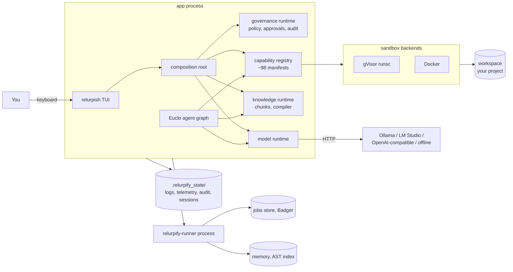
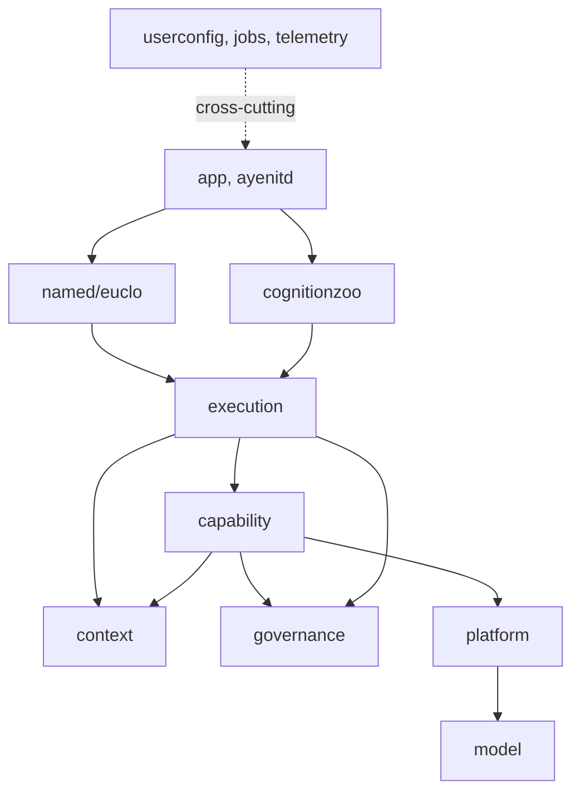
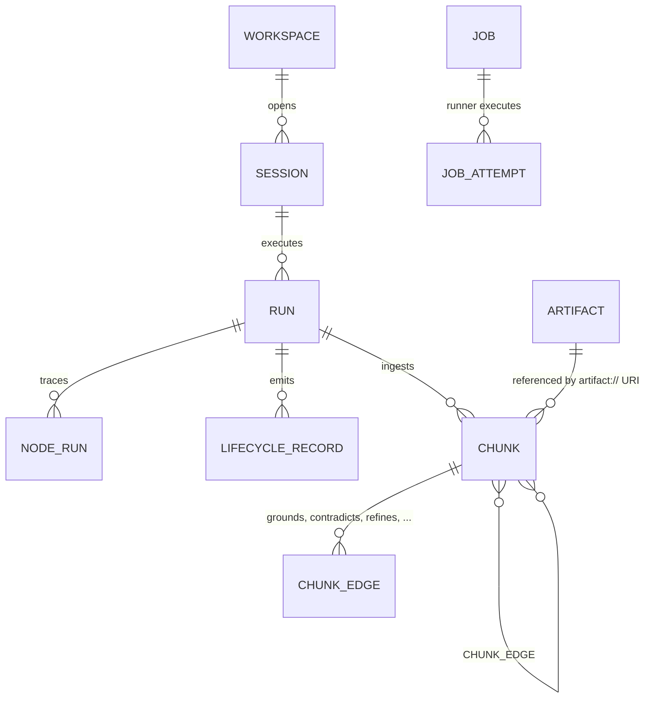

# Architecture

> **Audience**: framework developers and contributors who need to reason about the whole system.
> **Purpose**: the system shape, the rules that hold it together, and what happens during boot and a turn.
> **Prerequisites**: the [glossary](README.md#glossary); [Getting started](GETTING_STARTED.md) for a running workspace.

## System overview

Relurpify is a **modular monolith**: one Go module that compiles to a small set
of local binaries.
There are no microservices and no network broker; nothing listens on a socket
in the default flow.
The app process and a background runner process cooperate through an atomic
file spool.

## Architectural style and why

- **Modular monolith over microservices**: the product is a local desktop
  application; process boundaries would add failure modes without adding
  isolation you can see.
- **Enforced layering over conventions**: a dependency-DAG checker, import
  fences, and AST gates run in CI, so the structure below is machine-checked,
  not aspirational.
- **Composition root over dependency injection frameworks**: concrete
  implementations are wired in one place at boot
  (`app/envcomposition`), and a gate test pins the wiring vocabulary.
- **Plugin-shaped edges**: capability providers, model backends, sandbox
  backends, and UI surfaces are registered against contracts, so new
  implementations slot in without editing call sites.

## The rules that make it hold together

Each rule is enforced by a CI gate, not by goodwill:

1. **Dependency direction**: lower layers never import higher layers; the
   context-ports seam may import only the standard library.
2. **Governance never imports execution**: governance owns policy decisions and
   consumes execution only through interfaces it defines.
3. **One principal writer**: the security principal is written in exactly one
   governed agent-entry function; everything else reads it from context.
4. **One environment boundary**: only the configuration loader
   (`userconfig/config`) reads process environment variables; a grep gate
   fails any other read.
5. **No buckets**: a type-only package imported by three or more domains is
   flagged, preventing a shared junk drawer.
6. **No shims, compat layers, aliases, or stubs**: AST gates plus grep gates
   reject both the vocabulary and the telltale type-converter signature.
7. **Generated configuration**: the checked-in `relurpify_cfg/` tree is
   materialized from the embedded template bundle; a drift gate diffs them.
8. **Trust and insertion restrictiveness only increase** through composition;
   registration can only lower trust, never raise it.

## Domain map

Top-level directories, from the outside in:

| Directory | Layer | Responsibility |
|---|---|---|
| `app/` | Application | Binaries: relurpish (TUI, doctor, status), relurplint, composition root (`envcomposition`) |
| `ayenitd/` | Application | relurpify-runner: the spawned per-workspace service runner |
| `named/euclo/` | Named agents | Euclo: intent families, thoughtrecipe DSL and loader, 12 relurpic capabilities |
| `cognitionzoo/` | Paradigms | ReAct, planner, ReWOO, blackboard, HTN, pipeline, chainer, reflection, retry |
| `execution/` | Execution core | Graph runtime (nodes, contracts, checkpoints), session/workspace assembly, lifecycle records |
| `context/` | Context and memory | Envelope, knowledge chunks, graph database, artifact store, jobs store |
| `capability/` | Capability platform | Registry, descriptors, invocation pipeline, sandboxing, filesystem capability |
| `platform/` | Host adapters | git, shell, language servers, search, and the LLM provider layer |
| `governance/` | Governance | Identity, classification (risk/effect/trust), permissions, policy engine, approvals, audit |
| `userconfig/` | Configuration | The only code that reads environment variables; schema validation; embedded templates |
| `model/` | Cross-cutting | LLM request/response/tool-call vocabulary and ports |
| `jobs/` | Cross-cutting | Durable queue contracts executed by the runner |
| `telemetry/` | Cross-cutting | Event emission, budgets, framework event log, broadcast to the UI |
| `tooling/` | Development | dev-agent CLI, architecture checkers, coverage gate |
| `templates/` | Development | Template bundle notes |
| `testsuite/` | Development | Agent suites, conformance, test infrastructure |

## The binaries

| Binary | Role | Interacts with |
|---|---|---|
| `relurpish` | Terminal UI; `doctor`, `status` subcommands | Everything in-process; spawns the runner |
| `relurpify-runner` | Background job executor | File spool, Badger jobs store, knowledge runtime |
| `relurplint` | Workspace linter | Reads `relurpify_cfg/` |
| `dev-agent` | Agent test-suite runner | Builds the runtime per test case |
| `generate-config` | Materializes the default config tree | Embedded template bundle |

## Boot sequence

1. The entry point snapshots the environment through the configuration
   boundary and parses flags; precedence is CLI flag > environment > workspace
   config > built-in default.
2. A **doctor** pass checks readiness: workspace and config presence, sandbox
   toolchain, provider health, model profile, disk space (warning below 256 MB).
   On an uninitialized workspace it materializes starter configuration from
   the embedded templates.
3. The composition root builds the security, capability, knowledge, and model
   runtimes; Euclo registers with governance.
4. The workspace session opens; the **service runner** is attached or spawned:
   a live heartbeat in `<state>/jobs/status.json` (written every ~5 s) plus a
   PID check means attach, otherwise the app spawns `relurpify-runner`.
   A stale heartbeat (>= 15 s) means runner-down; stop is SIGTERM with a 25 s
   grace, then SIGKILL.
   A missing or timed-out runner degrades boot; it never blocks it.
5. The TUI takes over with the Euclo surface (chat, diff, recipe tabs).

Any failure produces a **degraded runtime, not a crash**: the UI opens and
explains what is missing, and the log records a `boot.degraded` marker.

## A turn, end to end

1. You submit an instruction.
   The runtime creates a task and a fresh **envelope** (read-only streamed
   context, mutable working memory, retrieval references).
2. Euclo's root graph runs: **intake** classifies the instruction into intent
   families (deterministic keyword scoring), ingests referenced files, and
   triggers context compilation (blocking or background).
3. A checkpoint node persists state; **capability classification** (LLM-assisted
   when the selection posture is `model_assisted`) refines ambiguous intents;
   an **interaction check** pauses the graph with a clarification frame when
   the intent is genuinely ambiguous.
4. A **policy gate** vets the route, and the **dispatcher** picks it
   deterministically from explicit pins, registered thoughtrecipes, and
   token-scored capability candidates.
5. The route executes a compiled thoughtrecipe (whose steps may delegate to a
   paradigm such as ReAct under a fail-closed tool scope) or a built-in
   capability directly.
6. Inside a paradigm the loop is think -> act -> observe; tool calls go through
   the **capability invocation pipeline**:
   allowlist check -> session-scoped lookup -> availability -> policy engine
   (allow / deny / require-approval) -> prechecks (doom-loop detection,
   write restrictions) -> schema validation and coercion -> safety budgets ->
   the tool -> postchecks and metrics.
7. Commands run through the **sandbox chain**: authorization policy -> shell
   guard (blacklist block/HITL rules) -> enforcing runner -> container
   (gVisor or Docker; workspace mounted, network isolated by default).
8. Each result returns in a result envelope carrying an **insertion decision**:
   the trust-based answer to what the model may see (full text, summary,
   metadata only, or nothing).
9. Observations are ingested asynchronously as knowledge chunks with
   `grounds`/`derives_from` edges back to their sources; the graph merges
   results, emits telemetry, and the UI projects events into the chat, diff,
   and recipe views.
   Large raw outputs land in the artifact store as `artifact://` references.

## Data model

The embedded graph database (in-memory adjacency over Badger) stores knowledge
chunks and their typed edges, plus workflow/run/event/artifact records.
Full record history is retained.

Knowledge chunks carry a three-axis model (memory class, storage mode, source
origin), provenance (principal, trust, derivation chain), freshness, and typed
views (decision, constraint, plan step, anchor, tension, intent).
Chunks link through sixteen edge kinds, including `grounds`, `contradicts`,
`refines`, `supersedes`, and `depends-on-code-state`.

## External integrations

| Integration | Mechanism | Notes |
|---|---|---|
| Model backends | Provider registry (`platform/llm`) | Kinds: `ollama`, `lmstudio`, `openai_compatible`, `offline`, `tape`; default Ollama at `http://localhost:11434` |
| Container runtime | Docker (or compatible) + gVisor `runsc` | gVisor is the default backend; a plain-Docker backend exists; bare host execution is removed and guard-tested |
| git | Host `git` via platform adapters | The workspace should be a git repository for diff/verify tooling |
| Language servers | LSP adapters | Used by lsp tool manifests |
| Ollama models | HTTP | Thinking models supported; per-model profiles tune tool calling |

## Extension points

| Want to add... | Mechanism |
|---|---|
| A reasoning strategy | Implement the workflow-executor contract in `cognitionzoo` |
| A tool | Manifest only (subprocess), or Go constructor + manifest (go_native) |
| An LLM provider | Implement the managed-backend contract and register the kind |
| A capability source | Implement the provider contract; trust normalizes down |
| A sandbox backend | Implement the sandbox contracts and extend the backend registry |
| A thoughtrecipe | Author a `.erpe` file in `relurpify_cfg/euclo/`; see [RECIPE_DSL](RECIPE_DSL.md) |
| A prompt | Author a versioned prompt file; see [PROMPT_DSL](PROMPT_DSL.md) |

## Decision records

### ADR-001: One configuration boundary reads the environment

- Context: agent code scattered environment reads everywhere and behaved
  differently under shells, CI, and services.
- We decided that only `userconfig/config` reads process environment
  variables; it snapshots once at boot and hands resolved objects downstream.
- Consequences: a grep gate can enforce the fence; every consumer receives
  validated configuration; adding an override means touching one mapping file.

### ADR-002: Configuration is generated, not hand-edited

- Context: config drift between documented defaults and real workspaces caused
  silent behavior differences.
- We decided the embedded template bundle is the single source of truth and
  `relurpify_cfg/` is its materialization; a CI gate diffs the two.
- Consequences: framework config changes regenerate the tree; your in-workspace
  edits are yours and doctor never overwrites them.

### ADR-003: Fail closed everywhere

- Context: an agent that guesses is dangerous; ambiguous permissions must not
  resolve to "allowed".
- We decided unset tool scopes deny all tools, a nil file policy denies all
  file access, the default tool posture is `ask`, and egress to private or
  loopback hosts is unconditionally denied.
- Consequences: misconfiguration surfaces as an explicit denial with a reason,
  never as silent access.

### ADR-004: All execution is sandboxed

- Context: a coding agent runs compilers and test runners; nothing model-driven
  should touch the bare host.
- We decided every command goes through the sandbox chain into a verified
  backend (gVisor default, Docker available); the local runner was removed and
  a guard test keeps it removed.
- Consequences: a missing sandbox toolchain degrades boot to the doctor screen
  instead of allowing unsandboxed execution.

### ADR-005: No shims, compatibility layers, aliases, or stubs

- Context: bridged duplicate types and stub surfaces hid real behavior and
  bred stale documentation.
- We decided the charter forbids all four, enforced by AST and grep gates.
- Consequences: removals are clean breaks; consumers migrate; docs stay honest.

### ADR-006: Deterministic routing by default

- Context: model-chosen routing is non-replayable and hard to test.
- We decided the default selection posture is `deterministic`: keyword
  classification picks the intent family, and genuinely ambiguous intents ask
  you via a clarification frame; `model_assisted` posture is opt-in.
- Consequences: the same input takes the same route; route provenance
  (`decided_by`) is visible in telemetry.

### ADR-007: Durable jobs run in a sidecar process

- Context: knowledge maintenance must survive app restarts without giving the
  runner governance authority.
- We decided `relurpify-runner` owns the Badger-backed jobs store (one process
  per directory; the file lock is the mutual exclusion) and receives work
  through an atomic file spool; nothing needing governance runs in the runner.
- Consequences: the app can degrade gracefully when the runner is absent; job
  state is observable in `status.json`.

## Scaling notes

- The graph engine keeps adjacency in memory over Badger; corpora are assumed
  to be workspace-sized, not web-sized.
- Several hot paths are full scans today (by-workspace chunk lookup, lineage
  search, compilation-record load); they are fine for local use and are known
  ceilings.
- Concurrency is per-process: the app and one runner per workspace, with the
  store lock as the only cross-process exclusion.
- There is no multi-tenant story: the local operator is implicitly the
  principal, and identity vocabulary exists for future use.
