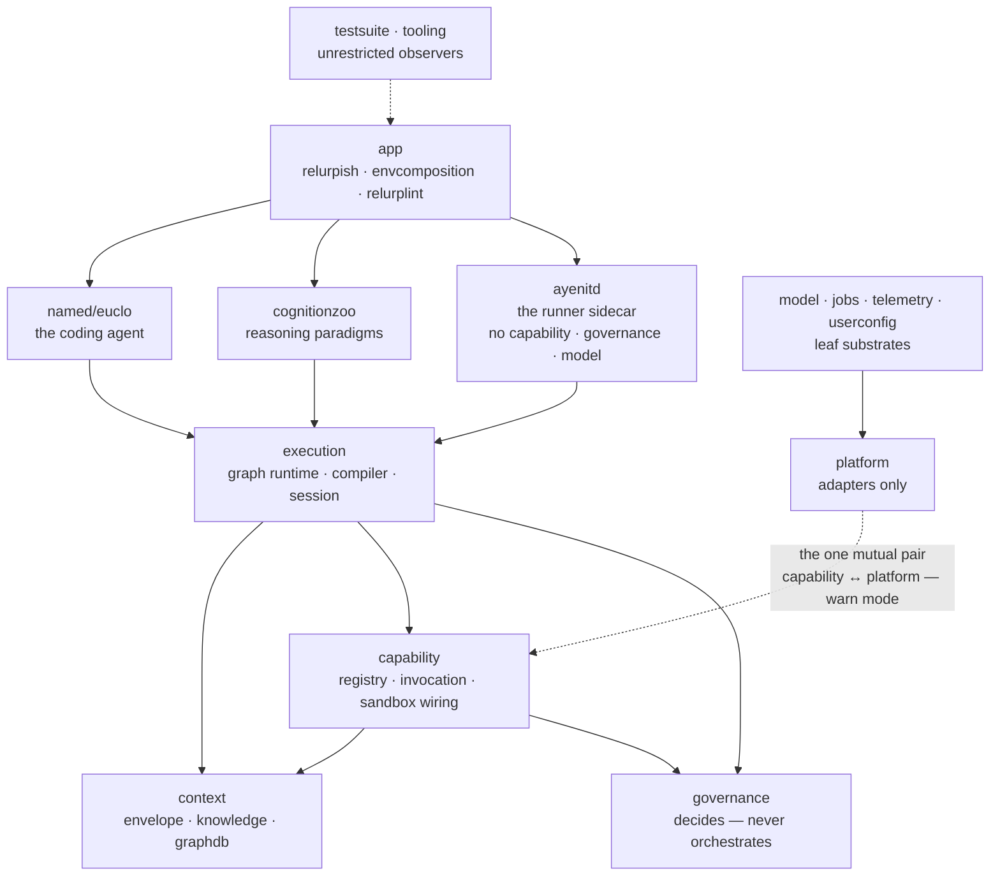

# Chapter 1 — The Repo Is the Map

Book 1 put you in the kitchen: you ran `doctor`, approved a diff, watched a
governed turn from the operator's chair. This book walks you into the
building itself. And like any building worth entering, Relurpify comes with
a blueprint — one that is unusual in one respect: **the blueprint checks
itself.** The map of this repository is not a diagram in a document that
drifts the first time someone renames a package. It is a data structure in
the tree, enforced by a gate that reads the real import graph. When the map
and the territory disagree, CI fails.

That changes how you should read this chapter. Everything you are about to
learn — the fifteen domains, the direction of every import, the split
between the two special directories — is not convention you must remember.
It is machine-checked law you can *query*. The skill this chapter teaches
is not memorizing the map. It is knowing that the map exists, where it
lives, and how to ask it questions.

> **A note on citations.** This book cites the tree as `path/to/file.go:NN`,
> pinned to the release tag. Two kinds of sources appear. Most citations
> point at files in the public clone, and you can verify every one of them
> yourself with `sed -n 'NNp' path`. A few point into the *authoring
> corpus* under `devdocs/` — the handoff documents and the technical
> whitepaper this book expands. That directory is not part of the public
> clone (`.gitignore:41`), so those citations name document and section;
> every claim they support is independently anchored in a tracked file.
> All outputs in this chapter were captured at commit `1bc57c62`
> (see the pin note in the front matter).

## Where you are

Assumed: you write Go, you have used relurpish at the Book 1, Chapters 1–3
level (`doctor`, one governed chat, the offline backend), and you know git
and GitHub pull-request mechanics. Not assumed: fluency in the thoughtrecipe
DSL (glossed where we touch it), either companion book, or any prior
exposure to the framework's internals.

By the end of this chapter you will be able to:

1. Name every top-level directory and the contract it holds with the rest
   of the tree.
2. Read the domain DAG — and run the gate that enforces it.
3. Say which binary comes from which package, and how the runner is found.
4. Explain the absolute split between `relurpify_cfg/` and
   `.relurpify_state/`, and why the framework treats it as non-negotiable.

No model backend is needed anywhere in this chapter. The whole internals
book is offline-first except where a chapter says otherwise.

## Technical requirements

| Requirement | Version / notes |
|---|---|
| OS | Linux x86-64 or arm64 (primary); macOS boxed — see Appendix A |
| Go | Module directive `go 1.26.0`; toolchain pin `go1.27.2` (`go.mod:3,5`) |
| Git | Any recent version |
| jq | Any 1.x, for the lab's card scripts |
| Disk | ~3 GB for the clone, module cache, and test caches |
| Model backend | **Not needed** for this chapter |

Everything in this chapter was captured on a real machine: Linux 6.18,
Go 1.27.3 (satisfying the `go1.27.2` toolchain pin), commit `1bc57c62`.
Where your output will differ — timings, package-count lines — the text
says so.

## 1.1 One module, nothing listening

Start with what the whole tree compiles into:

```go
// go.mod:1
module codeburg.org/lexbit/relurpify
```

One Go module. No workspace file, no sub-modules, no vendor forest. The
architecture docs are explicit about what that buys and what it rules out:

> Relurpify is a **modular monolith**: one Go module that compiles to a
> small set of local binaries. There are no microservices and no network
> broker; nothing listens on a socket in the default flow. The app process
> and a background runner process cooperate through an atomic file spool.
> — `docs/ARCHITECTURE.md:9-12`

Three facts are load-bearing there, and each one shapes the contributor's
life:

- **One module** means every package you will ever touch is versioned,
  tested, and gated together. There is no "bump the dependency" escape
  hatch from someone else's refactor.
- **Nothing listens on a socket** (in the default flow) means the attack
  surface you reason about as a contributor is files and processes, not
  services. The model backend is the one outbound HTTP client
  (`docs/ARCHITECTURE.md:211-215`), and it lives behind the platform
  adapters you will meet in §1.4.
- **Two processes** — the app and the runner — cooperate over a file spool,
  not RPC. That boundary is ADR-007's sidecar rule
  (`docs/ARCHITECTURE.md:289`); Chapter 9 owns the details. For now, hold
  only the shape: one module, at most two processes, files between them.

The rest of the shape is a dependency graph, and unlike most dependency
graphs, this one has a source of truth you can read.

## 1.2 The binary map

`docs/ARCHITECTURE.md:118-126` lists five binaries. Here is that table,
joined with the one fact it omits — which package each binary comes from —
and the release build that produces it:

| Binary | Role | Source package | Release build |
|---|---|---|---|
| `relurpish` | Terminal UI; `doctor`, `status` subcommands | `app/relurpish` | `.goreleaser.yaml:33` |
| `relurpify-runner` | Background job executor | `ayenitd/cmd/relurpify-runner` | built by `make build-runner` (`Makefile:213`) |
| `relurplint` | Workspace linter | `app/relurplint` | `.goreleaser.yaml:73` |
| `dev-agent` | Agent test-suite runner | `tooling/dev-agent-cli` | `.goreleaser.yaml:53` |
| `generate-config` | Materializes the default config tree | `userconfig/templates/cmd/generate-config` | `.goreleaser.yaml:93` |

Three of the five are what a user touches (`relurpish`, `relurplint`,
`generate-config`); `dev-agent` is the test-harness driver you will use in
Chapter 11; `relurpify-runner` is the spawned sidecar.

**How the runner is found — and why you will not find it.** The release
build list does *not* include the runner, and the maintainer's answer is
blunter than the table above: **there is no `relurpify-runner` binary in
the project, and there never has been.** What exists is the *seam* for
one: source at `ayenitd/cmd/relurpify-runner`, a `make build-runner`
target (`Makefile:213-214`), and a supervisor that looks for an
executable of that name in the configured directory, beside the running
`relurpish` ("the shipped layout: relurpish and relurpify-runner side by
side"), then on `PATH`
(`app/relurpish/runtime/runner_supervisor.go:174-187`). When the lookup
fails — which, on every machine that has ever run this product, it does
— boot degrades instead of blocking, and `doctor` reports the missing
runner as an informational warning, never an error. This is the tree's
honesty in miniature: `docs/ARCHITECTURE.md:120` lists a binary that has
never shipped, the code that would use it is present and guarded, and
the failure path is the documented, graceful one. Treat the seam as the
sidecar boundary of ADR-007 (`docs/ARCHITECTURE.md:289`) waiting for its
tenant; Chapter 9 covers what the boundary buys today.

**The three that ship alongside.** The release also carries three AST
checkers — `archcheck`, `domaincheck`, `driftcheck`
(`.goreleaser.yaml:113,134,155`) — described in the build file as "pure
Go" and built for Windows in addition to Linux and macOS
(`.goreleaser.yaml:25-26`). Count them with the five above and you get the
number the packaging comment uses: "all seven binaries land under
`/usr/bin/`" (`.goreleaser.yaml:200`).

So the honest binary map is: **five product binaries, three of which ship
as released checkers — and a runner seam with no runner behind it.** When
you read the domain map in the next
section, keep one eye on this table: every domain in the DAG exists to
serve one of these seven programs or the tests that pin their behavior.

## 1.3 The domain DAG: a map that checks itself

Open `tooling/arch/domaindag.go`. Lines 14–29 name thirteen domains as
constants; two more (`app`, `named`) appear as literals in the map below.
Fifteen domains, and for each one, the list of domains it is permitted to
import (`tooling/arch/domaindag.go:37-117`):

```
app (relurpish TUI, envcomposition, relurplint)
 ├── named/euclo      (the coding agent: router, DSL, recipes, capabilities)
 ├── cognitionzoo     (reasoning paradigms: react, planner, htn, blackboard, …)
 └── ayenitd          (service runner binary: supervision, jobs executor)
        │
     execution        (graph runtime · compiler · session · lifecycle)
        │
     context          (envelope · knowledge chunks · graphdb · persistence · ports)
        │
     capability       (descriptor vocabulary · registry · runtime · fs)
        │
     governance       (identity · permissions · policy · risk/effect/scope)
        │
  model · jobs · telemetry · userconfig    (leaf substrates)
        │
   platform          (ADAPTERS ONLY: git · lang · llm · lsp · search · shell)
```
— `devdocs/relurpify-technical-whitepaper.md` §5.1; the tracked authority
is the DAG itself, `tooling/arch/domaindag.go:37-117`, and the directory
table, `docs/ARCHITECTURE.md:79-100`.

Rendered as the checker sees it — every arrow is an *allowed import*
direction, the dashed edge is the one upward fold §1.3's cycle reporter
names, and `testsuite`/`tooling` watch everything
(`tooling/arch/domaindag.go:37-117,115`):



**How to read it.** Arrows point downward. `app` may import almost
anything; `named/euclo` (the agent) may import everything below it but
never `app`; `execution` may import `context`, `capability`, and
`governance`; `governance` may import only the leaf substrates —
**never `execution`**, a rule with its own gate
(`governance-no-orch`, `Makefile:100`; stated as rule 2 at
`docs/ARCHITECTURE.md:63-64`). `testsuite` and `tooling` are unrestricted
imports-wise (`tooling/arch/domaindag.go:115`) because they exist to
observe and check everything else.

Three members of the rule set are worth memorizing now, because they will
explain half the gate failures you ever cause:

1. **Governance never orchestrates.** Governance defines policy; it
   consumes execution only through interfaces it owns
   (`docs/ARCHITECTURE.md:63-64`). If your change makes `governance/`
   import `execution/`, the design is wrong, not the import.
2. **`context/ports` imports the standard library and nothing else**
   (whitepaper §5.1; `context/ports/`). The seam where request and decision
   vocabularies cross domains cannot hide a cycle inside a field type.
3. **No buckets.** A type-only package imported by three or more domains is
   flagged — the signature of a junk drawer forming
   (`no-bucket`, `Makefile:96`; rule 5 at `docs/ARCHITECTURE.md:70-71`).
   This is why there is no `contracts/` or `core/` package anywhere in the
   tree, and why `PermissionType` lives in `userconfig/permissions`
   (the decoder cannot import the governor) rather than where symmetry
   might suggest.

**Why a checker and not a diagram.** The whitepaper's own account of the
decision is worth quoting in full, because it is the project explaining
itself to you, the contributor:

> *Why it won*: the docs in this repo are unusually honest about what is
> unfinished, and the failure they could not defend against was
> documentation drifting from reality. A gate cannot drift silently.
> *Cost*: slower refactoring; every new import edge is a design
> conversation.
> — `devdocs/relurpify-technical-whitepaper.md:91`

Every new import edge is a design conversation. That sentence is the
culture of this tree in one line, and the gate is what makes it true.

**The map's one honest wrinkle.** Run the project's own cycle reporter and
it names a mutual pair — the DAG permits `platform` to import `capability`
(the adapter substrate reaching up to the capability vocabulary,
`tooling/arch/domaindag.go:96-102`) and permits `capability` to import
`platform` in the same map — and the reporter flags the pair in warn mode:

```
$ make domain-cycles
[FAIL] domain-cycles: 1 violation(s)
  capability ↔ platform: 1→30 (platform→capability)
[PASS] All domain checks passed
```

That is captured output from this chapter's machine, not a hypothetical.
The build is not broken — `domain-cycles` is a warn-mode reporter
(`Makefile:90-94`), distinct from the enforce-mode direction check that
gates CI. But the pair is real, the project's own tooling says so out loud,
and this book's convention is to hand you the wrinkle rather than smooth
it over. Chapter 2 explains warn versus enforce; for now, read it as the
map marking its own fold.

## 1.4 Every top-level directory, its contract

The domain map (`docs/ARCHITECTURE.md:79-100`) lists what each directory
is responsible for. The table below restates those rows and adds the
contract each directory holds *with the rest of the tree* — what it may
consume, what may consume it, and the file that pins the claim. This is
the annotated map the chapter's title promises; walk the tree with it open.

| Directory | Contract with the rest of the tree | Pin |
|---|---|---|
| `app/` | Composition root and the operator-facing binaries. Contains `relurpish`, `relurplint`, and `envcomposition` — the one place concrete implementations are wired at boot | `docs/ARCHITECTURE.md:85`, `:50-52` |
| `ayenitd/` | The runner sidecar: supervises services, drains the file spool into the durable jobs store, executes knowledge
handlers. Links no capability, governance, or model code — the DAG comment
forbids it in so many words | `tooling/arch/domaindag.go:57-59` |
| `named/` | Named agents; contains exactly one, `euclo/`: intent families, the thoughtrecipe DSL and loader, capabilities | `docs/ARCHITECTURE.md:87` |
| `cognitionzoo/` | Reasoning paradigms as declarative contracts — ReAct, planner, ReWOO, blackboard, HTN, pipeline, chainer, reflection, plus the retry helper | `docs/ARCHITECTURE.md:88`, `cognitionzoo/doc.go:1-2` |
| `execution/` | The graph runtime: nodes and contracts, the compiler, session and workspace assembly, agent lifecycle | `docs/ARCHITECTURE.md:89` |
| `context/` | Context and memory: the envelope (`contextdata/`), knowledge chunks and the graph store (`knowledge/`), streamed compilation (`contextstream/`), artifact and jobs stores | `docs/ARCHITECTURE.md:90` |
| `capability/` | Descriptor vocabulary, registry, the invocation pipeline, sandbox wiring, filesystem capability | `docs/ARCHITECTURE.md:91` |
| `governance/` | Identity, risk/effect/trust classification, permissions, policy engine, approvals, audit — eleven packages that decide and never orchestrate | `docs/ARCHITECTURE.md:93` |
| `platform/` | Host adapters and nothing else: `git`, `lang`, `llm`, `lsp`, `search`, `shell`, `tools` | `docs/ARCHITECTURE.md:92`, `platform/doc.go` |
| `model/` | Leaf substrate: the LLM request/response/tool-call vocabulary and its ports — four source files, no dependencies below it | `docs/ARCHITECTURE.md:95`, `model/ports.go` |
| `jobs/` | Leaf substrate: durable queue *contracts* — creation, atomic claim, exponential backoff, at-least-once delivery, idempotent handlers — executed by the runner, stored elsewhere | `jobs/doc.go:4-10` |
| `telemetry/` | Leaf substrate: event emission, budgets, the framework event log, broadcast to the UI | `docs/ARCHITECTURE.md:97` |
| `userconfig/` | Configuration: the only code that reads environment variables; schema validation; the embedded template bundle; the permissions vocabulary it must decode | `docs/ARCHITECTURE.md:94` |
| `tooling/` | Development machinery: `dev-agent-cli`, the architecture checkers, the coverage gate. Unrestricted imports because it watches everything | `docs/ARCHITECTURE.md:98` |
| `templates/` | Notes pointing at the real template bundle under `userconfig/templates/` | `docs/ARCHITECTURE.md:99` |
| `testsuite/` | Agent suites, conformance cases, tape and golden infrastructure | `docs/ARCHITECTURE.md:100` |
| `docs/` | Normative documentation — architecture, configuration, DSLs, testing — the files this book cites most | `docs/README.md` |
| `devdocs/` | The authoring corpus: handoff documents, whitepaper, plans. **Not part of the public clone** (`.gitignore:41`) | `.gitignore:41` |
| `dist/` | GoReleaser output; gitignored | `.gitignore:51` |
| `relurpify_cfg/` | The *config* directory — generated, tracked, yours to edit (§1.5) | `.gitignore:13-20` |
| `.relurpify_state/` | The *state* directory — runtime-written, gitignored, never edited (§1.5) | `.gitignore:11` |

Two rows deserve a second look. `jobs/` is a contracts-only package —
read `jobs/doc.go` and you will find the queue's behavioral law (at-least-once
delivery, atomic claim, handlers idempotent per correlation ID) with no
storage in sight; the Badger store lives across the DAG in
`context/jobsstore/`, and the runner that executes jobs lives in
`ayenitd/`. One responsibility, three directories, and the direction of
the arrows between them is the whole point. And `model/` is a reminder
that the leaf substrates are leaves on *purpose*: `model/` is four source
files (`ports.go`, `runtime.go`, `errors.go`, `doc.go`), and the DAG
forbids it from importing anything but the bottom of the map
(`tooling/arch/domaindag.go:84-86`).

## 1.5 Two directories the map treats as absolute

Twenty-odd directories sit at the top of the tree, and exactly two of them
are *not* source. The framework draws the line between them harder than
any other line in this book:

- **`relurpify_cfg/` is configuration: generated, tracked, and yours to
  edit.** Every file in it is materialized from the embedded template
  bundle (`userconfig/templates/embedfs/embed.go:18`) by a single
  producer — `generate-config`, whose package doc says so without
  hedging: "GenerateConfig is the single producer of the checked-in
  relurpify_cfg/ tree" (`userconfig/templates/doc.go:9`). The tree you
  get looks like this:

  ```
  relurpify_cfg/
  ├── euclo/        # 10 thoughtrecipes (.erpe) + families.yaml
  ├── model/        # provider/ and profiles/
  ├── prompts/      # agents/, framework/, named/
  ├── security/     # localtool, sandbox, shell, workspaceingestion policies
  ├── tools/        # file, git, lsp, search, shell, test manifests
  └── workspace.yaml
  ```

- **`.relurpify_state/` is state: runtime-written and never edited by
  hand.** The name is a single constant in the source —
  `const StateDirName = ".relurpify_state"`
  (`execution/workspace/identity.go:10`) — and everything the framework
  persists at runtime lands under it: `artifacts/`, `audit/`, `events.db`,
  `logs/`, `memory/`, `telemetry/`, plus the runner's heartbeat and job
  status written every ~5 seconds
  (`docs/ARCHITECTURE.md:139-140`).

Why *absolute*? Because two ADRs meet here, and each is enforced by a
gate rather than goodwill. ADR-001 — one configuration boundary reads the
environment (`docs/ARCHITECTURE.md:235-243`) — is enforced by `envcheck`,
an AST gate that resolves aliased *and dot* imports, so a rename or a
`import . "os"` cannot sneak an environment read past it
(`tooling/arch/envcheck.go:23-59`; gate wired at `Makefile:122`).
ADR-002 — configuration is generated, never hand-edited
(`docs/ARCHITECTURE.md:244-252`) — is closed by a drift gate that
materializes the embedded bundle and diffs it against what you committed:

```
$ make check-config-tree-drift
[PASS] relurpify_cfg/ matches embedded templates
```

The split is even visible in `.gitignore`, which is as close as this tree
comes to a philosophy statement: `.relurpify_state/` is ignored wholesale
(`.gitignore:11`), while `relurpify_cfg/` is tracked *except* the
runtime-written subdirectories the framework may create inside it —
`test_run/`, `memory/`, `logs/`, `sessions/`, `telemetry/`
(`.gitignore:13-20`). Configuration is the part you own and commit; state
is the part the framework writes; and when the two would blur, the ignore
file picks a side.

Book 1 taught you the operator's version of this rule: you edit
`relurpify_cfg/`, you read `.relurpify_state/`. The contributor's version
has one more clause — *and code that blurs the two will not merge*, because
the gates that enforce ADR-001 and ADR-002 run before a PR is reviewed.

## 1.6 Hands-on: build the map, then let it check you

The deliverable of this chapter is a set of commands whose output proves
its claims. Run them in order; the captured outputs below are yours to
diff against. (Lab: `docs/relurpic-internals/labs/ch01-repo-map/` —
the command card is `card.md`, the full annotated transcript is
`transcript.txt`, and `verify.sh ch01` re-runs the deterministic subset.)

**1. Clone and pin.** The chapter is pinned to tag `BETA-RC1-FALL2026`;
if the tag is not yet on the public remote, work at the captured commit:

```bash
git clone https://codeburg.org/lexbit/relurpify && cd relurpify
git checkout 1bc57c62   # captured commit; replace with the tag once published
go version              # must satisfy the go1.27.2 toolchain pin
```

**2. Build everything.** One module, one command, no cgo:

```bash
go build ./...
echo "build exit: $?"
```

Captured: no output, `build exit: 0`. (The module tree is 165 packages;
`go list ./... | wc -l` will show you.)

**3. Prove the tree green.** `test-unit` runs the config linter, then the
whole unit suite with a 60-second per-package timeout
(`Makefile:176-179`):

```bash
make test-unit
```

Captured (excerpt): `relurplint: all checks passed (0 diagnostics)`, then
152 `ok` package lines, 0 failures, exit 0. Slowest package on the capture
machine: `app/relurpish/e2e` at 25.7s.

**4. Ask the map to check itself.**

```bash
make domain-check      # direction check, warn mode
make domain-cycles     # mutual-pair reporter
```

Captured: direction — `[PASS] domain-direction: no violations`. Cycles —
the `capability ↔ platform` pair quoted in §1.3. If your direction run
reports violations, your checkout is not at the pin; stop and diff.

**5. Prove the config split.**

```bash
make check-config-tree-drift
```

Captured: `[PASS] relurpify_cfg/ matches embedded templates`.

**6. Walk the tree against the table.** Open §1.4's table beside
`ls` output. For any row, the contract is falsifiable: pick a directory,
pick a claim, and either find the pin or report the miss. That habit —
trust the pin, not the prose — is the one this book exists to teach.

### Verification block

| Chapter claim | Where captured | Lab file |
|---|---|---|
| `go build ./...` is clean | §1.6 step 2 | `transcript.txt` §2 |
| `make test-unit` green (152 packages, 0 failures) | §1.6 step 3 | `transcript.txt` §3 |
| Direction check passes at the pin | §1.6 step 4 | `transcript.txt` §4 |
| Cycle reporter names `capability ↔ platform` (warn) | §1.3 | `transcript.txt` §4 |
| Drift gate passes on a pristine tree | §1.6 step 5 | `transcript.txt` §5 |
| Binary → package map | §1.2 table | manual: `.goreleaser.yaml:33-155` |
| Domain list and allowed imports | §1.3 | manual: `tooling/arch/domaindag.go:37-117` |

## Summary

- One Go module, no sockets in the default flow, at most two cooperating
  processes joined by a file spool (`docs/ARCHITECTURE.md:9-12`).
- Five product binaries with known source packages; three AST checkers
  ship beside them; the runner is a documented seam with no binary behind
  it — the supervisor's lookup degrades gracefully
  (`app/relurpish/runtime/runner_supervisor.go:174-187`).
- Fifteen domains in an enforced DAG — a data structure at
  `tooling/arch/domaindag.go:37-117`, not a diagram — with three rules
  worth memorizing: governance never orchestrates, `context/ports` is
  stdlib-only, no buckets.
- The map checks itself, and it is honest: the cycle reporter names the
  `capability ↔ platform` mutual pair in warn mode. Warn is not broken;
  it is the project publishing its own wrinkles.
- `relurpify_cfg/` (generated, tracked, yours) and `.relurpify_state/`
  (runtime-written, ignored, never edited) are the two non-source
  directories, split by two ADRs and enforced by the `envcheck` and
  drift gates.

## Check yourself

1. Why does this tree encode its layering as a Go data structure checked
   by a gate, instead of a diagram in `CONTRIBUTING.md`? Quote the
   whitepaper's reason in one sentence.
2. You want `governance/policy` to reach into `execution/session` to read
   the current session state directly. Which rule fails, which gate names
   it, and what is the *designed* alternative?
3. Your change needs an API token from the process environment at tool
   execution time. Where must the read live, and which gate fails if you
   put it anywhere else?
4. You hand-edit `relurpify_cfg/security/shell.policy.yaml` and commit.
   Does the drift gate fail? What would make it fail?
5. `make domain-cycles` prints `[FAIL]` yet the command exits successfully.
   What is warn mode for, and which check actually gates CI?

*Answers.* 1. "The failure they could not defend against was documentation
drifting from reality. A gate cannot drift silently"
(whitepaper §5.1 / `:91`). 2. Rule 2, governance never imports execution —
   the `governance-no-orch` gate (`Makefile:100`) and the direction check
   both name it; the designed alternative is governance defining its own
   interface that execution implements (`docs/ARCHITECTURE.md:63-64`).
3. Inside the configuration boundary, `userconfig/config`; the `envcheck`
AST gate fails any other read, and it resolves aliased and dot imports
(`tooling/arch/envcheck.go:23-59`). 4. No — hand-*editing* a file that
matches the shipped template passes; the gate fails when your committed
tree diverges from what `generate-config` would materialize
(`Makefile:22-26`). Editing is legitimate; drifting *from the bundle* is
what fails. 5. Warn mode reports and exits clean — it is for publishing
known wrinkles like `capability ↔ platform`; the direction check
(`domain-check` / `domain-check-enforce`, `Makefile:82-87`) is what gates.

## Try it yourself

1. **Break the DAG on purpose.** In a *scratch clone*, add an import of
   `governance` to any package under `context/`, run
   `make domain-check-enforce`, read the violation output, then revert.
   Note the exact phrasing the checker uses — you will see it again in
   Chapter 2's violation lab, and eventually in your own PRs.
2. **Prove one row of the table.** Pick a directory from §1.4, `grep -r`
   its imports, list every *domain* it imports, and check each against
   `AllowedDomainImport` (`tooling/arch/domaindag.go:120`). If all edges
   are legal, you have verified a row of this book's map with the same
   authority the gate uses.

## Where next

You have the map, and you have seen that the map is law — enforced by
gates that read the AST and the import graph. Chapter 2 reads the law
itself: the seven ADRs, the charter bans (no shims, no compatibility
layers, no aliases, no stubs), and the two fence layers that make them
non-optional. The chapter's lab breaks a rule on purpose, captures the
gate's verdict, and reverts — because the fastest way to learn what the
constitution protects is to watch it catch you.

The lab for this chapter lives in
`docs/relurpic-internals/labs/ch01-repo-map/` — the command card, the
captured transcript from the pin, and `verify.sh ch01` to check your
machine against the book's deterministic outputs.
