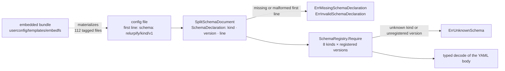

# Chapter 3 — The Surfaces, Graded

Chapter 1 gave you the map; Chapter 2 gave you the law. This chapter
inventories what the tree *offers* — every surface a caller can touch —
and, more interestingly, how the project grades its own promises about
them. The handoff corpus labels each claim **high**, **medium**, or
**low**, where *high* means "declared in a named type, a flag/command
definition, or a normative doc"
(`devdocs/HANDOFF-docs/API_SURFACES.md:7-9`). The stability column runs
from *stable* through *semi-stable* and *internal* down to the grade no
other project prints: the Go package API is **explicitly not stable**
(`devdocs/HANDOFF-docs/API_SURFACES.md:32`).

Read as intended, a *high* label is not reassurance — it is an
invitation. The label asserts that the claim can be checked against a
declaration site, so this chapter checks. Its lab verifies five *high*
claims from the compatibility table against the tree, one of which — you
will be glad to hear, by now — turns out to need a correction. The
grading system grades itself, and the grade is honest.

> **A note on citations.** As before: tracked files are cited
> `path:line`; the authoring corpus under `devdocs/` is cited by
> document and line but is not part of the public clone
> (`.gitignore:41`). Captured at commit `1bc57c62`; see the pin note in
> the front matter.

## Where you are

You need Chapters 1–2 of this book and nothing else: the domain DAG, the
config/state split, the ADRs and their gates. The contracts here are
*introduced* here; the subsystem chapters (Part II) trace them through
running behavior. No model backend is needed.

By the end you will be able to:

1. Name the interface inventory and the stability grade of each surface.
2. Explain the schema-tag system — the versioning mechanism for every
   config file — and read its failure modes.
3. State the four implementation contracts (`model.LanguageModel`,
   `governance/ports`, capability provider, sandbox backend) and which
   two are graded *stable*.
4. Identify the two data types the rest of this book traces: the
   envelope and the result payload.
5. Verify a *high* claim yourself, and know what to do when the
   verification disagrees.

## Technical requirements

| Requirement | Version / notes |
|---|---|
| OS / toolchain | As Chapters 1–2 (Linux primary; toolchain pin `go1.27.2`, `go.mod:5`) |
| Model backend | **Not needed** |
| Extra | `jq` for one lab step (optional) |

Captured on the Chapter 1 machine, commit `1bc57c62`.

## 3.1 The inventory

`devdocs/HANDOFF-docs/API_SURFACES.md:15-33` tabulates fourteen surfaces
across six kinds. Restated with the tracked files that declare each:

| Kind | Surface | Stability | Declared in |
|---|---|---|---|
| CLI | `relurpish` (TUI + `doctor` + `status`) | Semi-stable; flag surface documented | `app/relurpish/main.go` |
| CLI | `relurplint` | Semi-stable | `app/relurplint/main.go` |
| CLI | `dev-agent` (agent test runner) | Unstable; development tooling | `tooling/dev-agent-cli/` |
| CLI | `relurpify-runner` | Internal; not user-facing | — see below |
| CLI | `generate-config` | Internal-ish | `userconfig/templates/cmd/generate-config/` |
| Config | `relurpify_cfg/` tree | Versioned by schema tag | §3.2 |
| Config | Environment variable overrides | Documented; small and stable | `userconfig/config` (ADR-001) |
| Contract | `model.LanguageModel` | **Stable**; streaming contract normative | `model/ports.go:9` |
| Contract | Capability provider, sandbox backend, tool backend | Semi-stable | §3.4 |
| Contract | `governance/ports` request/decision vocabulary | **Stable** | `governance/ports/` |
| Event | Telemetry event vocabulary | Semi-stable; additive | `telemetry/doc.go:1-6` |
| Job | Durable job kinds | Internal | `jobs/job.go:51` |
| Queue | Runner spool + job store | Internal | `ayenitd/spool.go`, `context/jobsstore/` |
| Library | Go package API across the domain DAG | **Explicitly *not* stable** | ADR-005 |

One row needs the Chapter 1 correction applied: the inventory lists
`relurpify-runner` as "Internal; not user-facing," which is generous.
There is no such binary and never has been (plan decision D10; Chapter 1
§1.2). The *seam* is real — the supervisor's lookup
(`app/relurpish/runtime/runner_supervisor.go:174-187`) and the job kinds
the runner would execute (§3.5) — but the row grades a surface the
release has never carried. This is what verifying *high* claims is for:
the label promises a declaration site, not that the surface ships.

The two *stable* grades are the chapter's spine: the model contract and
the governance ports vocabulary. Everything else is free to evolve with
the module — and does, because ADR-005 (Chapter 2) makes every removal a
clean break rather than a deprecation.

## 3.2 Config schemas: the schema tag

Every config file in `relurpify_cfg/` begins with a first-line schema
tag — the versioning mechanism for the whole config surface:

```yaml
# relurpify_cfg/workspace.yaml:1
schema: relurpify/workspace/v1
```

The captured inventory at the pin: **112 files carry a tag, across nine
distinct tags** — 99 tool manifests (`relurpify/tool/v1`), 4 model
providers, 3 model profiles, and one each for workspace, the four policy
kinds, and the Euclo families table. The loader machinery is small and
worth reading in full order:

1. **Parse.** `SplitSchemaDocument` (`userconfig/config/schema.go:37`)
   splits the first line into a `SchemaDeclaration` (kind, version,
   source line — `userconfig/config/schema.go:18-24`) from the YAML body. A file that does
   not begin with a declaration is an error: `ErrMissingSchemaDeclaration`;
   a malformed line is `ErrInvalidSchemaDeclaration`
   (`userconfig/config/errors.go:21-26`).
2. **Validate.** `SchemaRegistry.Require`
   (`userconfig/config/schema_registry.go:65`) checks the kind exists and
   the version is registered; an unknown kind is `ErrUnknownSchema`
   (`userconfig/config/errors.go:28`).
3. **Register.** Eight kinds ship by default, all currently at version 1
   (`userconfig/config/schema_registry.go:8-17`): workspace, the four policy kinds,
   model/provider, model/profile, and tool.

The ninth observed tag — `relurpify/euclo/families/v1` on
`relurpify_cfg/euclo/families.yaml:1` — is *not* one of the registry's
default kinds, and that is not an inconsistency: families.yaml is the
Euclo intent-family handoff table, workspace data loaded and validated by
the thoughtrecipe loader (`named/euclo/thoughtrecipes/families.go:18,29`),
not by the generic config loader. Its header says so in its own words:
"This is user-editable workspace data — … `doctor --fix` never overwrites
an edit."

The versioning payoff: when a schema's shape changes, its tag moves to
`v2`, the registry learns the new version, and a file that still declares
`v1` fails *validation with a typed error naming the line* — not with a
mysterious decode failure downstream. The tag is the contract's
fingerprint, on the contract.

The pipeline, end to end — parse, validate, and the two typed failure
exits (§3.2's three steps, with the bundle as the ultimate source):



## 3.3 The model contract and its six rules

`model.LanguageModel` (`model/ports.go:9-30`) is the narrow surface every
LLM backend satisfies — four methods: `Generate`, `GenerateStream`,
`Chat`, `ChatWithTools`. The inventory grades it *stable*, and one part
of it is graded stronger than everything else in this book: the streaming
contract, declared normative in the interface's own doc comment
(`model/ports.go:13-28`). Six rules, abbreviated:

- **R1** — the call-time `ctx` is the only stop signal.
- **R2** — on cancellation, internal goroutines exit and the channel
  closes within 250 ms.
- **R3** — the channel closes exactly once, by its producer.
- **R4** — pump-owned resources close exactly once, including on
  cancellation.
- **R5** — producer-side failures degrade; they never panic.
- **R6** — send contention resolves by selecting on `ctx.Done()`; the
  token is dropped and counted.

Normative in a comment would be cheap — Chapter 2 taught you to ask for
the teeth. They exist: `make check-stream-contract`
(`Makefile:186-191`) runs `TestStreamLifecycle` under `-race` against the
conformance suite, checking "cancel-to-stop, graceful channel close, and
leak-freedom under -race with goleak." Captured at the pin:

```
$ make check-stream-contract
ok  	codeburg.org/lexbit/relurpify/testsuite/conformance	1.021s
```

The inventory's phrase "Stable; the streaming contract is normative" is
therefore two claims, both verified: the contract is written where an
implementor cannot miss it, and a race-enabled gate fails when an
implementation drifts from it.

## 3.4 The other three contracts

**`governance/ports` — the decision vocabulary (stable).** Governance
defines the interfaces it evaluates policy over, and the producing
domains satisfy them — "governance never imports the producing domain"
(`governance/ports/doc.go:3-4`). The authorization vocabulary is six
types in one file: `Principal` (`governance/ports/authorization.go:12`),
`DelegationLink` (`:18`), `Resource` (`:56`), `AccessRequest` (`:64`),
`Decision` (`:72`), and `Obligation` (`:81`), with sibling files for
sandbox, state, and coordination views (`governance/ports/` —
`DescriptorView`, `SandboxRuntime`, `StateView`, `SearchScope`,
`DelegationSink`, `Config` per `governance/ports/doc.go:10-17`). Chapter 5 traces these
through real decision paths; here, hold the shape: *the vocabulary is
the stability boundary*. Your code can depend on `governance/ports` the
way it depends on the standard library's interfaces — that is the grade.

**Capability provider (semi-stable).** An external capability source
implements the provider shape in `capability/provider/provider.go`:
descriptor (`:14`), config (`:25`), security profile (`:36`), session
snapshots (`:44-78`), and registration through a `CapabilityRegistrar`
(`:86`). Registration normalizes aggressively — the handoff doc's
summary (`devdocs/HANDOFF-docs/API_SURFACES.md:291-304`) is verified by
the normalization path, and its key rule you already know from Book 1:
the **more restrictive** of the provider's trust baseline and the
capability's declared trust class wins.

**Sandbox backend (semi-stable).** The enforcement side,
`capability/sandbox/contract_types.go:83-96`: a `Backend` interface
(name → verify → describe capabilities → validate a policy → apply it)
and the command-runner `Provider` built from a runner configuration.
Two grades live here that out-rank the interface: gVisor `runsc` is the
default and a `local` (bare host) backend "does not exist and is
rejected by config validation" — ADR-004's teeth, which Chapter 2 met
as a guarded deletion — and a manifest declaring the gVisor runtime
while the configured backend is Docker is a *hard error*, because only
gVisor provides the full security model
(`app/envcomposition/security_validate.go`).

## 3.5 The data model: envelope, result payload, events, jobs

Two types carry everything the rest of this book traces, and both live
at DAG positions Chapter 1 taught you to expect: the envelope in
`context/`, the result payload in `execution/`.

**The envelope.** `contextdata.Envelope`
(`context/contextdata/envelope.go:21-38`) is the execution context passed
to graph nodes: task, session, and node IDs, the reference bundle,
working data with origin classes, a checkpoint request, and the streamed
delivery slice. Its doc comment states a locking invariant before the
first field: all state is guarded by `mu`; outside callers read through
`*Snapshot` accessors and mutate through setters, and the exported
fields "are an implementation detail and must not be accessed directly"
(`context/contextdata/envelope.go:12-20`). The half this book follows into Chapter 8 is
`AssemblyMeta` (`context/contextdata/envelope.go:41-53`): `CompilationID`, token budgets and
shortfalls, and the compile identity pair — `EpochID` plus `RunID`, whose
comment explains that "the compiler cache must never serve an entry
across runs."

**The result payload.** `execution.Result`
(`execution/agent_executor.go:18`) carries a typed
`ResultPayload` (`execution/result_payload.go:5-9`), an interface with
exactly three implementations: `ToolResultPayload` (keyed fields,
`execution/result_payload.go:10-20`), `PromptResultPayload` (text plus fields, `:22-40`), and
`ErrorResultPayload` (`:42`). The payload is what flows out of a
graph node; what the model *sees* of it is a different, governed
decision — the insertion decision of Book 1 §2.3, which Chapter 6 traces
end to end.

**Events and jobs.** The telemetry vocabulary — "structured records of
node executions, tool calls, and LLM interactions" flowing through
`Telemetry.Emit` into the composition-wired sinks, with the TUI
broadcast and the OpenTelemetry leg as the only outputs
(`telemetry/doc.go:1-6`) — is graded *semi-stable; additive*, and
Chapter 10 owns it. Durable jobs are graded *internal*, and the grade is
precise: `Spec.Kind` is a required free-form string
(`jobs/job.go:51-67`), and exactly two kinds are registered today —
`knowledge.bootstrap` and `knowledge.refresh`
(`ayenitd/runner.go:91-94`). The queue is a general mechanism whose
tenant list, like the runner's, is short and honest.

## 3.6 Lab: verify five claims

The compatibility table (`devdocs/HANDOFF-docs/API_SURFACES.md:436-452`)
makes nine promises, all graded **high**. The lab verifies five — each
traced to its declaration site — plus the one grading correction this
chapter found. (Lab: `docs/relurpic-internals/labs/ch03-surfaces/`;
`transcript.txt` holds the captured evidence.)

**Claim 1 — "Config schemas are versioned."** *Evidence:* the tag at
`relurpify_cfg/workspace.yaml:1`; the parser at
`userconfig/config/schema.go:37`; the typed errors at
`userconfig/config/errors.go:21-28`; the captured inventory — 112 tagged
files, nine tags. **Verdict: holds.**

**Claim 2 — "The streaming contract is normative: six explicit rules,
enforced by a dedicated race-enabled conformance gate."** *Evidence:*
the rules at `model/ports.go:13-28`; the gate at `Makefile:186-191`;
captured `ok … 1.021s` under `-race`. **Verdict: holds.**

**Claim 3 — "Behaviour is replayable: compilation records carry a
deterministic digest."** *Evidence:* the field itself —
`DeterministicDigest string // Hash for determinism verification`
(`execution/compiler/types.go:92`) inside `CompilationRecord`
(`execution/compiler/types.go:84-96`). **Verdict: holds** at the declaration site; Chapter 8
replays a real compilation and diffs the digest.

**Claim 4 — "Release artifacts are verifiable: checksums and SBOMs ship
with every release."** *Evidence:* the release configuration declares
both — `checksums.txt` (`.goreleaser.yaml:243-244`) and per-artifact
SBOMs (`:246-249`). **Verdict: holds** as declared; the artifacts
themselves are a publication-gate question (the tag, Appendix A).

**Claim 5 — "The library API is *not* stable."** *Evidence:* the charter
in four words (`AGENTS.md:1-4`: no shims, no compat, no aliases, no
stubs), ADR-005 (`docs/ARCHITECTURE.md:273-278`), and the enforcement
you watched in Chapter 2 — `symcheck`'s removed-symbol table
(`tooling/arch/symcheck.go:14-49`). **Verdict: holds**, and it is the
  strangest promise in the book: instability, guaranteed by a gate.

**The correction — the runner row.** The inventory grades
`relurpify-runner` "Internal; not user-facing"
(`devdocs/HANDOFF-docs/API_SURFACES.md:20`). The maintainer's answer is
plainer: the binary does not exist and never has (plan decision D10).
The seam is real and graded honestly elsewhere; this row grades a
surface that has never shipped. **Verdict: the grade was generous; the
tree and the maintainer agree.** This is the lab's real lesson — a
*high* label means *checkable*, and checking is allowed to end in
"the doc is wrong."

### Verification block

| Claim | Declaration site | Captured evidence | Lab file |
|---|---|---|---|
| Schema tags version every config file | `userconfig/config/schema.go:37`, `userconfig/config/schema_registry.go:65` | 112 files, 9 tags | `transcript.txt` §1 |
| Streaming contract normative, race-gated | `model/ports.go:13-28`, `Makefile:186-191` | `ok … 1.021s` | `transcript.txt` §2 |
| Compilation records carry a deterministic digest | `execution/compiler/types.go:84-96` | field inspected | `transcript.txt` §3 |
| Checksums + SBOMs on every release | `.goreleaser.yaml:243-249` | config inspected | `transcript.txt` §4 |
| Library API not stable | `AGENTS.md:1-4`, `tooling/arch/symcheck.go:14-49` | Chapter 2's captured gate runs | `transcript.txt` §5 |
| Runner row over-graded | `app/relurpish/runtime/runner_supervisor.go:174-187` | plan D10 | `transcript.txt` §6 |

## Summary

- The grading system is the book's method made explicit: *high* means
  checkable at a declaration site, and one of this chapter's five
  checks corrected a doc row. The inventory's 14 surfaces carry four
  stability grades; the runner row is the one that needed the
  correction.
- Schema tags are the config surface's versioning mechanism: first-line
  tag, typed parse errors, a registry of eight kinds at version 1, and
  one tag (`euclo/families`) that belongs to the Euclo loader, not the
  generic registry.
- Two contracts are graded *stable*: `model.LanguageModel` (with the
  six-rule streaming contract, enforced by a race-enabled conformance
  gate) and the `governance/ports` vocabulary. The provider and sandbox
  contracts are semi-stable; the job-kind and queue surfaces are
  internal, with exactly two job kinds registered today.
- The envelope (with its snapshot-accessor locking invariant and
  compile-identity `EpochID`/`RunID`) and the three-variant
  `ResultPayload` are the data model every subsystem chapter traces.
- The Go package API is *explicitly not stable* — and that is a promise:
  ADR-005 turns every removal into a clean break, fenced by Chapter 2's
  gates.

## Check yourself

1. Which two surfaces are graded *stable*, and which one of them has a
   dedicated CI gate enforcing a normative comment?
2. A config file's first line reads `schema: relurpify/tool/v9`. What
   error type reaches the caller, and which component produced it?
3. The inventory grades `relurpify-runner` "Internal; not user-facing."
   Why does this book call that grade generous rather than wrong?
4. Why must the compiler cache never serve a compilation across two
   different runs? Which two envelope fields encode the answer?
5. `families.yaml` carries a schema tag but is not validated by
   `SchemaRegistry`. Is the tag a lie? What validates it?

*Answers.* 1. `model.LanguageModel` and the `governance/ports`
vocabulary; the streaming contract's gate is `make check-stream-contract`
(`Makefile:186-191`, race-enabled). 2. `SchemaError` wrapping
`ErrUnknownSchema` from `SchemaRegistry.Require`
(`userconfig/config/schema_registry.go:65`, `userconfig/config/errors.go:28`) — the kind exists but version 9
is not registered. 3. Because the label is accurate about what the row
describes (a seam, internal, not user-facing) while grading a surface
that has never shipped (D10); the grade's *method* was fine, its object
was absent. 4. Epoch counters are per-run and "therefore not comparable"
(`context/contextdata/envelope.go:48-52`); the pair is `EpochID` + `RunID` in
`AssemblyMeta`. 5. No — the tag is a contract fingerprint on the file;
it is parsed and validated by the thoughtrecipe loader
(`named/euclo/thoughtrecipes/families.go:18,29`), which owns that file
kind.

## Try it yourself

1. **Break a schema tag.** In a scratch workspace, edit a *copy* of any
   `relurpify_cfg/tools/**/*.tool.yaml` to declare
   `relurpify/tool/v2`, and run `relurplint --check tools`. Capture the
   diagnostic — then try deleting the first line entirely and compare
   the two error texts against `userconfig/config/errors.go:21-28`.
2. **Find rule R4's test.** The streaming contract's six rules are
   tested by `TestStreamLifecycle` (`Makefile:189`). Open
   `testsuite/conformance/`, find the subtests, and map each to its
   `R` rule. Which rule's test uses goleak, and what would its failure
   output name?

## Where next

Part I closes here: the map (Ch 1), the law (Ch 2), the offers (Ch 3).
Part II begins where every config fight begins — with the one boundary
that reads the environment. Chapter 4 walks ADR-001 and ADR-002 as lived
reality: change a shipped template, regenerate, and watch the drift gate
pass and fail on either side of the line.

The lab for this chapter lives in
`docs/relurpic-internals/labs/ch03-surfaces/` — the verify-five-claims
worksheet, the captured transcript from the pin, and `verify.sh ch03`
to check your machine against the deterministic outputs.
