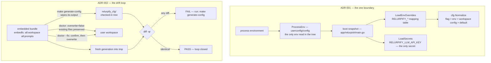

# Chapter 4 — Configuration and the One Boundary

Most codebases do not have a configuration boundary; they have
configuration *weather* — environment reads scattered through packages,
each shaping behavior slightly differently under shells, CI, and
services. ADR-001's context line records that exact past
(`docs/ARCHITECTURE.md:237-238`), and its decision is correspondingly
absolute: one package reads the environment, once, at boot, and hands
resolved objects to everyone else.

Chapter 2 showed you the fence around that boundary. This chapter walks
you inside it: the one function that touches the environment, the
mapping table that turns it into typed overrides, the template bundle
that is the config tree's single source of truth, and the drift gate
that closes the loop between them. The lab runs the loop in both
directions — change the source of truth and watch the gate fail; change
the generated tree and watch it fail again — because "generated, never
hand-edited" (ADR-002) only means something once you have been caught
doing both.

> **A note on citations.** Tracked files are cited `path:line`; the
> authoring corpus under `devdocs/` is cited by document and line and is
> not part of the public clone (`.gitignore:41`). Captured at commit
> `1bc57c62`; see the pin note in the front matter.

## Where you are

From Chapters 1–3 you have: the two-directory split (Ch 1), the ADRs and
their gates (Ch 2), and the schema-tag system (Ch 3). This chapter puts
those pieces to work. Same toolchain, no model backend — and this
chapter's lab dirties two *tracked* files, both reverted, with the gate
itself confirming the restoration.

By the end you will be able to:

1. Name the single place the environment may be read, and what the boot
   does with it.
2. Add a config override the way a maintainer would — by touching one
   mapping file.
3. Explain the two materialization paths and their opposite overwrite
   rules.
4. Run the drift loop end to end and predict, at each step, whether the
   gate passes or fails — before running it.

## Technical requirements

| Requirement | Version / notes |
|---|---|
| OS / toolchain | As Chapters 1–3 (Linux primary; toolchain pin `go1.27.2`, `go.mod:5`) |
| Model backend | **Not needed** |
| Extra | Nothing; all lab changes are reverted in-checkout |

Captured on the Chapter 1 machine, commit `1bc57c62`.

## 4.1 The boundary, in one function call

The entire environment-reading surface of a 165-package tree is one
function:

```go
// userconfig/config/env_overrides.go:5-11
// ProcessEnv returns the current process environment as a stable snapshot.
// The process boundary belongs in userconfig so app packages do not read env
// directly.
func ProcessEnv() []string {
	return os.Environ()
}
```

That is the only `os.Environ`/`os.Getenv`/`os.LookupEnv` call in
`userconfig/config` — a grep of the package finds exactly it
(`userconfig/config/env_overrides.go:9`) — and the gates from Chapter 2
make it the only one in the tree. The boot takes the snapshot once, at
the top of `main` (`app/relurpish/main.go:51-52`), and everything
downstream — overrides, secrets, TUI preferences — is a pure function
*of the snapshot*:

```go
// app/relurpish/main.go:53-62 (excerpt)
envOverrides, ovErr = config.LoadEnvOverrides(envSnapshot)
…
secrets = config.LoadSecrets(envSnapshot)
tui.SetReduceMotionPreference(config.LoadReduceMotionPreference(envSnapshot))
tui.SetTerminalNamePreference(config.LoadTerminalName(envSnapshot))
```

The mapping table — the file ADR-001's consequences mean when they say
"adding an override means touching one mapping file"
(`docs/ARCHITECTURE.md:241-242`) — is `LoadEnvOverrides`
(`userconfig/config/env_overrides.go:13-33`): `RELURPIFY_WORKSPACE`,
`RELURPIFY_MODEL_PROVIDER`, `RELURPIFY_MODEL_NAME`,
`RELURPIFY_SANDBOX_BACKEND`, `RELURPIFY_OLLAMA_HOST`,
`RELURPIFY_LOG_LEVEL`, and `RELURPIFY_STRICT`, plus two
non-`RELURPIFY` names (`EDITOR`, `XDG_DATA_HOME`) that are part of the
user's platform, not the framework's vocabulary. Secrets are a separate
loader and there is exactly one: `RELURPIFY_LLM_API_KEY`
(`userconfig/config/env_overrides.go:32-38`; `docs/CONFIGURATION.md:33-35` — "the only
secret, and it is read from the environment"). Secrets never live in
config files, and the schema lint bans secret-like *field names* in any
config file outright (`docs/CONFIGURATION.md:30`).

The table's most instructive entry is the strict flag, because it
applies ADR-003's fail-closed shape to *configuration parsing itself*.
`parseBoolEnv` (`userconfig/config/env_mapping.go:71-84`) accepts
`1/true/yes/on` and `0/false/no/off` and nothing else:

> Any other value is an error — a typo like "flase" or "enabled" is
> caught immediately rather than silently treated as false.
> — `userconfig/config/env_mapping.go:76-77`

`RELURPIFY_STRICT=flase` fails the boot loudly instead of quietly
meaning `false`. That is the whole philosophy of the boundary in one
line: ambiguity escalates; silence is never the default. (The boundary
also absorbs complexity that would otherwise leak outward — the
reduce-motion preference silently checks `CI`, `GITHUB_ACTIONS`,
`SSH_TTY`, and friends so no TUI code ever has to
(`userconfig/config/env_overrides.go:40-57`).)

**Precedence, implemented.** The documented chain is CLI flag >
environment > workspace config > built-in default
(`docs/ARCHITECTURE.md:130-132`). In the code it reads as three
overlays on one struct: `DefaultConfig` infers the built-in defaults
(`app/relurpish/runtime/config.go:68-70`), the env overrides apply at
boot (`app/relurpish/main.go:61-62` — e.g. `cfg.Editor` and the shared root come from
the snapshot), and flags apply per command in `PersistentPreRunE`
(`app/relurpish/main.go:85-91`), after which `cfg.Normalize()` reconciles. The
workspace config enters when the workspace loads — Book 1's lesson that
*the workspace config governs actual turns* even when a flag named a
different model.

## 4.2 The bundle: one producer, one source of truth

The config tree's source of truth is not a directory — it is a compiled
filesystem inside every binary:

```go
// userconfig/templates/embedfs/embed.go:5-6,11-12
// The embed FS is the canonical source for workspace config, manifest,
// security policies, tool definitions, and prompts. An installed binary
// carries these defaults and can self-provision without a source tree.

//go:embed all:workspace all:prompts
var defaultTemplates embed.FS
```

Two subtrees: `workspace/` (which becomes the config root — `euclo/`,
`model/`, `security/`, `tools/`, `workspace.yaml`) and `prompts/`
(which lands at `<config>/prompts/`, "so a materialized workspace
resolves its system prompts without a source checkout" —
`userconfig/templates/generate_config.go:13-18`). The bundle's package
doc states the role without hedging: "GenerateConfig is the single
producer of the checked-in relurpify_cfg/ tree"
(`userconfig/templates/doc.go:9`).

The producer itself (`GenerateConfig`, `userconfig/templates/generate_config.go:21-64`) is
deliberately bare: refuse to write into `.` or `/` (`:26-28`), wipe the
output directory (`os.RemoveAll`, `:30-31`), then walk the bundle and
write every file through `securefile` (permission-conscious
`MkdirAllSecure`/`WriteFileSecure`). Note what that means: **the
producer overwrites; the doctor does not.** There are two
materialization paths with opposite rules, and the asymmetry is the
design:

- **`generate-config`** — the maintainer's regeneration of the
  checked-in tree. It owns its output and wipes it (`:30`). Run via
  `make generate-config` (`Makefile:168-169`), which targets
  `relurpify_cfg/` by default.
- **`InitializeWorkspaceFromTemplates`** — the user-facing
  materialization in the doctor (`app/relurpish/runtime/doctor.go:435-440`),
  documented as "when overwrite is false, existing files are preserved"
  (`:438`). Plain doctor and the auto-bootstrap both call it with
  `overwrite = false` (`app/relurpish/runtime/bootstrap.go:170`);
  `--fix` is the *only* overwrite path, and it is gated:
  `overwrite := fix` behind a confirmation prompt unless `--yes`
  (`app/relurpish/main.go:229-231`). Book 1's chapter 1 taught the
  operator's version ("your edit wins"); here is the contributor's
  version — the `overwrite` boolean has exactly one `true` producer, and
  it asks first.

## 4.3 The loop, closed by a gate

ADR-002's consequence — "a CI gate diffs the two"
(`docs/ARCHITECTURE.md:247`) — is `check-config-tree-drift`
(`Makefile:26-36`), and its comment is the proof obligation in three
lines:

> materialises the embedded default template bundle and diffs the ENTIRE
> generated tree against the checked-in relurpify_cfg/.
> A == C by construction; any diff is a real drift.
> — `Makefile:22-24`

Mechanically: generate the bundle into a temp directory, `diff -qr`
against the checked-in tree, fail with the repair command in the message
("Run: make generate-config"). CI runs it (`.github/workflows/ci.yml:137`),
and the standalone `driftcheck` binary (`.goreleaser.yaml:155`) carries
the same comparison to machines without the Makefile
(`tooling/driftcheck/main.go`). The gate compares *the embedded bundle
against the checked-in tree* — not repository file against repository
file — which is exactly what the lab exploits.

The checked-in tree is also where the Chapter 3 schema tags do their
daily work. The config loader's rules are stricter than YAML's
(`docs/CONFIGURATION.md:28-32`): unknown fields are rejected ("a typo is
an error, not a silent default"), YAML anchors and aliases are rejected
outright, and every file must declare a registered schema kind/version.
And `RELURPIFY_STRICT` tightens one more notch: the five keys with
built-in defaults (`paths.state_dir`, `logging.level`,
`logging.format`, `audit.retention_days`, `telemetry.enabled`) must be
present or loading fails (`docs/CONFIGURATION.md:75-78`).

Both ADRs rendered as the flows this chapter traced — the one boundary
on the left, the drift loop on the right:



## 4.4 Hands-on: the drift loop, both directions

This is the chapter's experiment, captured in full at the pin. The lab
(`docs/relurpic-internals/labs/ch04-config/`) ships the card, the diffs,
and the transcript; the sequence below is the whole story.

**1. Baseline — the loop is closed.**

```
$ make check-config-tree-drift
[PASS] relurpify_cfg/ matches embedded templates
```

**2. Change the source of truth, and only it.** One comment line added
to the shipped template `workspace.yaml` (the lab's
`template-edit.diff`):

```diff
--- a/userconfig/templates/embedfs/workspace/workspace.yaml
+++ b/userconfig/templates/embedfs/workspace/workspace.yaml
@@ -1,5 +1,6 @@
 schema: relurpify/workspace/v1
 
 # Workspace-local state lives outside relurpify_cfg/.
+# ch04 lab: template edit (reverted after capture)
 paths:
   state_dir: .relurpify_state
```

Nothing in `relurpify_cfg/` has changed. The gate fails anyway:

```
$ make check-config-tree-drift
[FAIL] relurpify_cfg/ drifts from embedded templates. Run: make generate-config
Files /tmp/tmp.ZiXVjrDWJr/out/workspace.yaml and relurpify_cfg/workspace.yaml differ
make: *** [Makefile:27: check-config-tree-drift] Error 1
```

Read that failure carefully: the *generated* file and the *checked-in*
file differ, and the temp path in the message is the proof the gate
regenerated the bundle rather than diffing files it found lying around.
A template edit is a promise the checked-in tree has not kept yet.

**3. Keep the promise.** Regenerate:

```
$ make generate-config && make check-config-tree-drift
[PASS] relurpify_cfg/ matches embedded templates
```

The regeneration absorbed the template change into the checked-in tree.
This is ADR-002's "framework config changes regenerate the tree"
(`docs/ARCHITECTURE.md:248`) happening in front of you.

**4. Now the other direction.** Hand-edit the checked-in
`workspace.yaml` directly — no template change. The gate fails
identically:

```
$ make check-config-tree-drift
[FAIL] relurpify_cfg/ drifts from embedded templates. Run: make generate-config
Files /tmp/tmp.7HmLb2h6JF/out/workspace.yaml and relurpify_cfg/workspace.yaml differ
```

The gate cannot tell a well-meaning hand-edit from corruption, and it
does not try: *in this repository*, `relurpify_cfg/` is generated, so a
hand-edit is drift by definition (ADR-002). The remedy is always the
same — edit the bundle, regenerate.

**5. Revert everything; the loop closes.**

```
$ git checkout -- relurpify_cfg/workspace.yaml userconfig/templates/embedfs/workspace/workspace.yaml
$ make check-config-tree-drift
[PASS] relurpify_cfg/ matches embedded templates
```

One scope note so the rule does not over-extend in your head: the drift
gate polices *this repository's* checked-in tree. A user's workspace
copy of `relurpify_cfg/` is *supposed* to diverge from the bundle —
their edits are theirs, the doctor never overwrites them (§4.2), and
nothing fails when they diverge. The gate's jurisdiction ends at the
repo checkout.

### Verification block

| Chapter claim | Where captured | Lab file |
|---|---|---|
| Baseline: gate passes on pristine tree | §4.4 step 1 | `transcript.txt` §1 |
| Template-only edit fails the gate (bundle vs tree, not file vs file) | §4.4 step 2 | `transcript.txt` §2 |
| Regeneration absorbs the change and restores the PASS | §4.4 step 3 | `transcript.txt` §3 |
| Hand-edit of the checked-in tree fails identically | §4.4 step 4 | `transcript.txt` §4 |
| Full revert restores the PASS; tree clean | §4.4 step 5 | `transcript.txt` §5 |
| One env read in the boundary; overrides are one mapping file | §4.1 | manual: `userconfig/config/env_overrides.go:5-30` |
| Overwrite asymmetry (producer wipes; doctor preserves) | §4.2 | manual: `userconfig/templates/generate_config.go:27`, `app/relurpish/runtime/doctor.go:438`, `app/relurpish/runtime/bootstrap.go:170` |

## Summary

- One function reads the environment — `ProcessEnv`
  (`userconfig/config/env_overrides.go:9`) — the boot snapshots it once
  (`app/relurpish/main.go:51-52`), and every consumer is a pure function of the
  snapshot. The mapping file is the only file a new override touches
  (`userconfig/config/env_overrides.go:12-30`), and `parseBoolEnv` fails the boot loudly
  on a typo (`userconfig/config/env_mapping.go:71-84`).
- The source of truth is a compiled embed FS
  (`userconfig/templates/embedfs/embed.go:11-12`); `GenerateConfig` is the single producer
  of the checked-in tree (`userconfig/templates/doc.go:9`); the workspace and prompts
  subtrees map 1:1 onto the config root.
- Two materialization paths, opposite overwrite rules: the producer
  wipes its output (`userconfig/templates/generate_config.go:27`); the doctor preserves
  existing files unless `--fix` — the one overwrite path, behind a
  confirmation (`app/relurpish/main.go:230-231`).
- The drift gate compares the embedded bundle against the checked-in
  tree (`Makefile:22-36`), so both a template edit and a hand-edit of
  the generated tree fail it, and regeneration is always the remedy.
  Its jurisdiction is the repo checkout — user workspaces are supposed
  to diverge.
- Strict mode, unknown-field rejection, anchor rejection, and the
  secret-name ban are the boundary's fail-closed posture applied to
  configuration itself (`docs/CONFIGURATION.md:28-35,75-78`).

## Check yourself

1. A teammate wants a new `RELURPIFY_HTTP_PROXY` override. Which file
   changes, and which two gates would catch a shortcut taken outside
   the boundary?
2. `RELURPIFY_STRICT=enabled` is set. Does the boot proceed? Why is
   failing *the right behavior* here, and which ADR's shape is it?
3. Plain `doctor` on a workspace where you edited
   `euclo/default.erpe` — what happens to your edit? And with
   `--fix --yes`? Cite the lines.
4. You hand-edit `relurpify_cfg/tools/shell/cli_sort.tool.yaml` in two
   places: a repo checkout, and your live workspace. Which one does the
   drift gate fail, and why does the other *never* fail?
5. The drift-gate comment says "A == C by construction"
   (`Makefile:24`). In that sentence, what are A, B, and C — and why
   does the construction matter?

*Answers.* 1. `userconfig/config/env_overrides.go` (the mapping file,
`docs/ARCHITECTURE.md:241-242`); a read outside the boundary fails
`envcheck` plus the env grep fence (Chapter 2). 2. No —
`parseBoolEnv` errors on anything but the accepted spellings
(`userconfig/config/env_mapping.go:78-84`), failing the boot loudly; silent `false` would
hide a user's intent, which is fail-closed (ADR-003) applied to parsing.
3. Plain doctor preserves it (`InitializeWorkspaceFromTemplates` with
`overwrite=false`, `app/relurpish/runtime/bootstrap.go:170`; "existing files are preserved",
`app/relurpish/runtime/doctor.go:438`); `--fix` sets `overwrite := fix` behind a confirmation
unless `--yes` (`app/relurpish/main.go:230-231`) and re-materializes, overwriting your
edit. 4. The repo checkout fails `check-config-tree-drift`
(`Makefile:26-36`); the live workspace never fails anything — it is
supposed to diverge, and the doctor never overwrites it (ADR-002's
"your in-workspace edits are yours"). 5. A is the freshly generated
tree from the bundle, C is the checked-in `relurpify_cfg/`, and B (the
bundle) generates A deterministically — so any A-vs-C diff is real
drift, not generation noise; that is what lets the gate have no
suppressions and no baseline file.

## Try it yourself

1. **Add an override for real.** Add `RELURPIFY_EXPERIMENT` to
   `LoadEnvOverrides` in a scratch clone, run `make envcheck` and
   `make lint-config`, and confirm both stay green — the boundary
   absorbs a new override without any new env access. Then trace where
   `ovErr` (the overrides error) surfaces at boot.
2. **Compare the two drift tools.** Build `driftcheck`
   (`go build ./tooling/driftcheck`) and run it against a scratch
   directory; compare its output with the Makefile target's
   `diff -qr` output. Which one names the differing files, and which
   would you ship to a contributor without a Makefile?

## Where next

Configuration decides what the runtime *may* do; governance decides
what a turn *does* do. Chapter 5 opens the governance engine — eleven
packages that classify, decide, approve, and audit — and traces one real
decision from request to audit entry, reading ADR-003's fail-closed
shape in the paths themselves rather than in a table.

The lab for this chapter lives in
`docs/relurpic-internals/labs/ch04-config/` — the command card, both
diffs, the captured transcript from the pin, and `verify.sh ch04` to
check your machine against the deterministic outputs.
