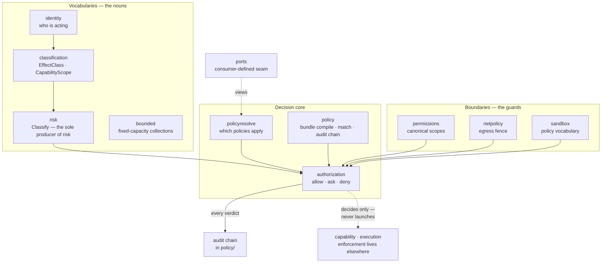
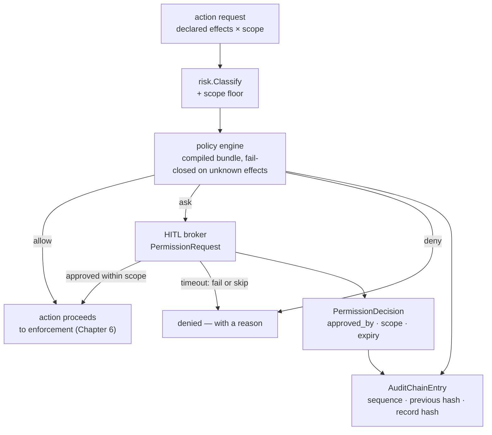

# Chapter 5 — The Governance Engine

Chapters 3 and 4 covered what the runtime offers and how it is fed. This
chapter covers the part that says *no*. Eleven packages under
`governance/` form one engine: they classify what a capability claims,
derive how dangerous it is, evaluate policy over a vocabulary the rest
of the tree cannot touch, escalate to a human when the answer is "ask,"
write every decision into a tamper-evident chain, and refuse egress that
cannot be proven public. What the engine never does is *act*: it decides,
and other subsystems execute — a division the Chapter 1 DAG enforces by
forbidding `governance` from ever importing `execution`.

The chapter's lab runs a real governed turn through the product runtime
— policy evaluation, tool admission, HITL, audit wiring, the works — and
then verifies all eleven packages green. Along the way you will meet the
finest piece of self-documentation in the tree so far: a comment, inside
the HITL broker, citing the date of the maintainer ruling that permits
its own permissive mode.

> **A note on citations.** Tracked files are cited `path:line`; the
> authoring corpus under `devdocs/` is cited by document and line and is
> not part of the public clone (`.gitignore:41`). Captured at commit
> `1bc57c62`; see the pin note in the front matter.

## Where you are

From Chapters 1–4: the DAG position (`governance` imports only the leaf
substrates), the `governance/ports` vocabulary (Ch 3, graded *stable*),
the ADRs (Ch 2), and the fail-closed posture as a config-parsing
practice (Ch 4). Here it becomes an *execution* posture. No model
backend is needed: the lab's governed turn runs on the offline backend.

By the end you will be able to:

1. Name the eleven packages and the question each answers.
2. Recite the four vocabularies — effect, scope, trust, risk — and the
   direction of derivation between them.
3. Read a policy evaluation, a HITL request, and an audit-chain entry as
   data shapes.
4. Run a governed turn and interpret every log line it prints.

## Technical requirements

| Requirement | Version / notes |
|---|---|
| OS / toolchain | As Chapters 1–4 (Linux primary; toolchain pin `go1.27.2`, `go.mod:5`) |
| Model backend | **Not needed** — the lab uses the offline backend |
| Sandbox | **Not needed** — the lab isolates enforcement, §5.6 explains why that is the right cut |

Captured on the Chapter 1 machine, commit `1bc57c62`.

## 5.1 Eleven packages, one engine, no hands

The package map, each with the question it answers and its owning file:

| Package | The question it answers | Pin |
|---|---|---|
| `identity/` | *Who is acting?* — actors, subject kinds, auth methods, trust-model vocabulary | `governance/identity/identity.go:21,31` |
| `classification/` | *What does a capability claim to affect?* — `EffectClass`, `CapabilityScope` | `governance/classification/classification.go:12-30` |
| `risk/` | *How dangerous is that, really?* — `RiskClass` and `Classify`, the sole producer of risk values | `governance/risk/risk.go:9-27` |
| `permissions/` | *What may this agent touch?* — canonical permission and file-scope types; platform adapters implement the checkers | `governance/permissions/doc.go:1-4` |
| `policy/` | *Under what conditions?* — the policy vocabulary every consumer imports, plus the audit chain | `governance/policy/audit.go:1-8` |
| `policyresolve/` | *Which policies apply to this capability?* — resolution over a governance-owned registry view | `governance/policyresolve/policyresolve.go:12-17` |
| `authorization/` | *Allow, ask, or deny — now, at execution time?* | `governance/authorization/doc.go:1-5` |
| `hitl` (in `authorization/`) | *Who decides when the answer is "ask"?* | `governance/authorization/hitl.go:23-60` |
| `netpolicy/` | *May this egress leave the machine?* — host classification and fail-closed resolution | `governance/netpolicy/resolve.go:11-17` |
| `sandbox/` | *What did we ask the backend to enforce?* — the backend-neutral policy vocabulary | `governance/sandbox/sandbox.go:1-7` |
| `bounded/` | *Can this grow without limit?* — fixed-capacity collections | `governance/bounded/ring.go:3-6` |
| `ports/` | *(The seam.)* The consumer-defined interfaces governance evaluates over — never the producing domains | `governance/ports/doc.go:1-4` |

Two sentences from the package docs define the whole design. First,
`authorization`: "It decides whether an action is permitted, denied, or
must be approved, but it does not launch processes or enforce OS-level
isolation. The sandbox package owns command execution enforcement"
(`governance/authorization/doc.go:3-5`). Decision and enforcement are
different packages in different domains — governance owns the *intent*
(`governance/sandbox/sandbox.go:1-4`: "Governance is the owner because these
structs are the contract between authored policy and enforcement;
backends … implement the enforcement ports against these types"), and
`capability/sandbox` owns the machinery (Chapter 6). Second, the rule
that keeps the engine from becoming an orchestrator is not a review
convention but a CI gate you have already run: `governance-no-orch`
(`Makefile:100`).

Note what is *not* on the list: there is no "audit package." The audit
chain lives inside `policy/` because an audit entry is a policy
vocabulary type — the record of a decision, typed where the decisions
are typed.

The engine's structure — vocabularies feed the decision core, the
boundaries guard its inputs, and every verdict leaves through the audit
chain (`governance/*` as tabled above):



## 5.2 Four vocabularies and one direction of derivation

The engine's nouns, in the order data flows through a decision:

**EffectClass — the claim.** Seven values
(`governance/classification/classification.go:16-22`):
`filesystem-mutation`, `process-spawn`, `network-egress`,
`credential-use`, `external-state`, `session-creation`,
`context-insertion`. A capability's descriptor declares the effects it
has (Chapter 3's contract), and — the critical part — an effect is a
*claim*, not a fact.

**CapabilityScope — the operating context.** Four values
(`governance/classification/classification.go:26-31`): `builtin`, `workspace`, `provider`,
`remote`. This is where claims get their epistemics, in `risk`'s own
words:

> Trust boundary (critical): EffectClass/CapabilityScope are claims for
> workspace/provider/remote scopes and ground truth only for builtin.
> Classify MUST apply a scope floor: any non-builtin scope raises the
> minimum risk regardless of declared effects (e.g. a remote tool
> declaring only read-only is still treated as at least
> sessioned/untrusted).
> — `governance/risk/risk.go:9-13`

**TrustClass — the provenance label.** Seven values, declared on the
capability descriptor (`capability/agentspec/capability_types.go:66-72`):
`builtin-trusted`, `workspace-trusted`, `llm-generated`, `tool-result`,
`provider-local-untrusted`, `remote-declared-untrusted`,
`remote-approved`. Book 1 met these as the *insertion* decision's input
(full text / summarized / metadata-only); here they are equally an
*admission* input. Registration can lower trust, never raise it — the
monotonicity invariant you met in the whitepaper, enforced in the
provider normalization path (`capability/provider/`, INVARIANTS §2.5).

**RiskClass — the derived judgment.** Seven values
(`governance/risk/risk.go:21-29`): `read-only`, `destructive`,
`execute`, `network`, `credentialed`, `exfiltration-sensitive`,
`sessioned`. And the sentence that makes the whole vocabulary honest:

> RiskClass is owned by governance (it is a derived judgment over facts,
> not a self-declared fact). Classify converts (EffectClass set ×
> CapabilityScope) into a risk classification, applying a per-scope
> minimum risk floor.
> — `governance/risk/risk.go:3-7`

`Classify` is "the sole producer of risk values in the system"
(`governance/risk/risk.go:31-32`), with a fixed mapping — `filesystem-mutation` yields
`destructive`, `process-spawn` yields `execute`, `network-egress` yields
both `network` and `exfiltration-sensitive`, `credential-use` yields
`credentialed` (`governance/risk/risk.go:40-50`) — plus the scope floor that no declared
effect list can buy back. A provider cannot say "I'm safe"; it can only
say what it claims to affect, and the engine decides what that is worth.

## 5.3 Deciding: the three-level model

`authorization` evaluates every action into three levels — allow, ask,
deny (`governance/authorization/doc.go:2-3`) — over the compiled policy
bundle (`policy_bundle.go`, `policy_compile.go`, `policy_engine.go`).
The fail-closed rule from Chapter 2's INVARIANTS table lives here in
code, twice: an unknown *effect* "is treated as maximally strong so the
fail-closed deny mapping always wins" (`governance/authorization/policy_match.go:60-61`), and
"an unknown effect fails closed to deny" at enforcement
(`governance/authorization/policy_match.go:122`).

Resolution — *which* policies apply to *which* capability — is
`policyresolve`'s job, and its central type is Chapter 3's
consumer-defined ports pattern made concrete:

```go
// governance/policyresolve/policyresolve.go:12-17
// RegistryView is the governance-owned view of the capability registry for
// policy resolution. Descriptors are passed as any; callers must ensure
// values returned by GetCapability and CallableCapabilities satisfy
// ports.DescriptorView.
type RegistryView interface {
	GetCapability(idOrName string) (any, bool)
	CallableCapabilities() []any
	EffectiveExposure(desc any) string
}
```

Governance cannot import the capability domain — the DAG forbids it —
so it defines the *view* it needs, and the registry satisfies it. The
`any` in the signature is not a weakness; it is the seam's toll, paid
exactly once, with the obligation named in the comment.

And the decision flow itself — the three exits of §5.3 and where each
one goes:



## 5.4 The human in the loop

When evaluation returns *ask*, the HITL broker in
`governance/authorization/hitl.go` takes over. The request shape is the
whole contract, serialized (`governance/authorization/hitl.go:23-37`):

| Field | Meaning |
|---|---|
| `ID` | the pending request's identity |
| `Permission` | the permission descriptor being escalated (`ucperms.PermissionDescriptor`) |
| `Justification` | why the agent wants it |
| `Scope` | the grant lifecycle being requested |
| `Duration` | how long a scoped grant lasts |
| `Risk` | the derived risk level (§5.2 — never self-declared) |
| `RunID` | the owning run |
| `Timeout`, `TimeoutBehavior` | what happens when no human answers |
| `State` | pending / decided |

A decision (`PermissionDecision`, `governance/authorization/hitl.go:38-47`) carries the approver,
scope, expiry, reason, and conditions — and grants have five lifecycles
(`governance/policy/grants.go:17-24`): `one_time`, `session`,
`persistent`, `conditional`, `task`. The timeout behavior is the
fail-closed posture again: `fail` or `skip`
(`governance/authorization/hitl.go:15-19`) — an unanswered request never silently becomes an
approval.

The broker coordinates blocking and async approvals, notifies
subscribers, and feeds every decision into telemetry's `DecisionSink`
(`governance/authorization/hitl.go:49-60`) — the "decisions are recorded" half of the privacy
boundary Chapter 10 traces. And then the comment that is worth the
price of the chapter:

```go
// autoApprove is the explicit permissive posture (workspace operator
// ruling 2026-10-11: first-pass HITL-permissive mode, --hitl-mode
```
— `governance/authorization/hitl.go:59-60`

The tree records the *date and provenance of the ruling that permits
its own weakest mode*, in the code that implements it. `--hitl-mode
permissive` (Chapter 3's CLI table) auto-approves and audits; governed
blocks on a human. Neither posture is hidden, and neither is default
un-explained.

## 5.5 The audit chain and the egress fence

**The audit chain** (`governance/policy/audit.go`) is append-only and
tamper-evident by structure. Each `AuditChainEntry`
(`governance/policy/audit.go:53-61`) carries a monotonically increasing `Sequence`, the
`Record`, the `PreviousHash`, and the `RecordHash` — so the chain
detects any edit or removal of an earlier entry — with optional
signature fields for non-repudiation. The `AuditRecord` inside it
(`governance/policy/audit.go:23-34`) records the decision metadata — agent, action,
permission, result, correlation ID — and, per the privacy boundary,
never the payload: attribute projection is Chapter 10's territory, but
its effect is visible here in the record's own fields. Seven actions
make up the vocabulary (`governance/policy/audit.go:10-20`): `file_access`, `exec`,
`network`, `capability`, `ipc`, `tool`, `permission_request`. And the
INVARIANTS row you met in Chapter 2 — audit chain cannot initialize →
fail closed — is enforced in the authorization runtime
(`governance/authorization/runtime.go`).

**The egress fence** (`governance/netpolicy/`) classifies hosts —
`ClassLoopback` (127.0.0.0/8, ::1) and `ClassPrivate` (RFC-1918/4193)
among the classes, with a rank ordering (`governance/netpolicy/host.go:19-25,55`)
— and its two sentinel errors state the posture better than any prose:
`ErrUnresolved` ("a caller that cannot prove a host public must not
dial it") and `ErrPrivateResolved` ("the caller can classify the most
restrictive answer" — one private IP in the record set taints the host,
`governance/netpolicy/resolve.go:11-17`). ADR-003's "egress to private or loopback
hosts is unconditionally denied" is these two errors plus their call
sites.

## 5.6 Hands-on: a governed turn, watched from the outside

The lab (`docs/relurpic-internals/labs/ch05-governance/`) runs a real
governed turn through the *product* runtime — not a mock — using the
tree's own end-to-end test as the harness:

```bash
go test ./app/relurpish/e2e -run TestBootTurnToolCall -count=1 -v
```

The test (`app/relurpish/e2e/boot_turn_test.go:184`) boots the real
runtime in a scratch workspace with the offline backend, submits a turn
whose scripted model emits a `file_read` tool call, and lets the full
governance chain process it. Captured output:

```
=== RUN   TestBootTurnToolCall
2026/10/23 11:11:13 INFO config loaded workspace_root=/tmp/TestBootTurnToolCall3254201996/001 model_provider=offline model_name=gemma4:e4b sandbox_backend=gvisor tools_loaded=99 strict_mode=true config_fingerprint=sha256:f02b98fa3cee102bd84035d85582c81159890a08321585d667c7214faa308419
2026/10/23 11:11:13 tool admission warning: skipping unlisted tool "query_ast"
2026/10/23 11:11:13 service manager: registered service "scheduler"
--- PASS: TestBootTurnToolCall (0.10s)
PASS
ok  	codeburg.org/lexbit/relurpify/app/relurpish/e2e	0.111s
```

Read the lines as governance, not noise. `strict_mode=true` and the
`config_fingerprint` — the configuration snapshot of Chapter 4, hashed
so the boot's decisions are attributable to exact config content. `tools
_loaded=99` — the tool manifests of Chapter 3, admitted into the
registry. `tool admission warning: skipping unlisted tool "query_ast"`
— the allowlist doing its job out loud: a tool that exists but is not
listed does not fail the boot; it is *excluded and named*. The turn
completes through real policy evaluation; the test then verifies the
turn's telemetry reached the durable OTLP-JSON leg (the test's AC-3
check, `app/relurpish/e2e/boot_turn_test.go:252-257`).

**What the lab fakes, and why that is the right cut.** Two seams are
doubled by the test harness: the sandbox command runner returns canned
output (`recordingRunner`, `app/relurpish/e2e/harness_test.go:20-31`), and HITL approvals
are auto-approved. That is deliberate isolation — this chapter is about
*decisions*, and the harness freezes *enforcement* so the decisions are
deterministic. Nothing about the decision path is faked: evaluation,
risk derivation, admission, and audit wiring are all the product's own.
Chapter 6 owns the other half — real backends, real containers.

The machinery, verified package by package:

```bash
go test ./governance/... -count=1
```

Captured: all eleven packages `ok`
(`authorization` 0.265s, `policy` 0.371s, the rest under 10 ms).

**The decision and audit shapes.** The lab's transcript also records
the two data shapes this chapter taught, as the JSON they serialize to:
the `PermissionRequest` (`governance/authorization/hitl.go:23-37` — permission, justification,
scope, risk, timeout behavior) and the `AuditChainEntry`
(`governance/policy/audit.go:53-61` — sequence, record, previous hash, record hash).
Those fields are what a real turn's audit directory contains — decisions
only, no payloads.

### Verification block

| Chapter claim | Where captured | Lab file |
|---|---|---|
| Governed turn passes through the product runtime (admission, policy, HITL wiring) | §5.6 | `transcript.txt` §1 |
| Allowlist excludes-and-names an unlisted tool | §5.6 | `transcript.txt` §1 |
| All eleven governance packages test green | §5.6 | `transcript.txt` §2 |
| Risk is derived, never declared; scope floor enforced | §5.2 | manual: `governance/risk/risk.go:3-13,20-21` |
| Unknown effects fail closed to deny | §5.3 | manual: `governance/authorization/policy_match.go:60-61,122` |
| Audit chain is hash-linked | §5.5 | manual: `governance/policy/audit.go:53-61` |

## Summary

- Eleven packages, one engine, zero execution: governance decides;
  `capability/sandbox` and the platform adapters act. The
  `governance-no-orch` gate keeps it that way (`Makefile:100`).
- Four vocabularies flow one way: declared effects (claims) × operating
  scope → derived risk, with a scope floor no claim list can lower;
  trust is provenance on the descriptor and registration can only lower
  it. `Classify` is the sole producer of risk values (`governance/risk/risk.go:31-32`).
- The three-level model is allow / ask / deny, with unknown effects
  failing closed to deny twice over (`governance/authorization/policy_match.go:60-61,122`), and
  `policyresolve` resolving over a governance-owned registry view —
  consumer-defined ports, with the `any`-descriptor obligation named in
  the comment.
- HITL requests serialize the whole contract (descriptor, justification,
  scope, derived risk, timeout behavior); grants have five lifecycles;
  timeouts `fail` or `skip`, never silently approve. The permissive
  posture exists by a dated, in-code ruling (`governance/authorization/hitl.go:59-60`).
- The audit chain is hash-linked and payload-free; the egress fence
  treats unresolved and private-resolved hosts as denials by type.

## Check yourself

1. Why must `Classify` be "the sole producer of risk values"? Name the
   two things that would break if a descriptor could declare its own
   risk.
2. A remote tool declares exactly one effect: `filesystem-mutation`.
   What risk classes come out of `Classify`, and which of them comes
   from the mapping rather than the scope floor?
3. `HITLTimeoutBehavior` has two values. Which one does a governed
   posture want, what does it do, and which invariant does it serve?
4. The audit chain stores `PreviousHash` per entry. What attack does
   that make detectable, and what does the *absence* of payload fields
   in `AuditRecord` protect?
5. In `RegistryView`, why is `GetCapability`'s return type `any`, and
   where does the real type obligation live?

*Answers.* 1. Risk is "a derived judgment over facts, not a
self-declared fact" (`governance/risk/risk.go:3-5`); a self-declared risk would let a
provider lower its own admission bar and would couple the insertion
decision (which also reads risk) to unverified claims — the scope floor
and the sole-producer rule both exist to prevent that. 2. `destructive`
(from the effect mapping, `governance/risk/risk.go:38-40`) *and* `sessioned` (the
non-builtin scope floor, `governance/risk/risk.go:9-13`) — the mapping term comes from
the claim, the floor term from the scope. 3. `fail` — an unanswered
request fails the action rather than approving it; this is ADR-003's
"ambiguity in a permission decision resolves to ask/deny, never allow"
(`governance/authorization/hitl.go:15-19`). 4. Editing or deleting any earlier entry breaks the
hash linkage at every subsequent entry; the absent payload fields
implement the privacy boundary — the chain records decisions, not
content (Chapter 10's attribute projection). 5. Governance cannot
import the capability domain (the DAG), so the view carries `any`
(`governance/policyresolve/policyresolve.go:12-17`); the obligation — "values returned … satisfy
`ports.DescriptorView`" — is stated in the same comment and satisfied
by the registry side of the seam.

## Try it yourself

1. **Watch the scope floor in test form.** Run
   `go test ./governance/risk -count=1 -v` and find the table-driven
   cases exercising the scope floor. Then predict: a *builtin* tool
   declaring only `filesystem-mutation` — does `sessioned` appear?
   Check your answer against the mapping.
2. **Find the emitters.** `grep -rn "AuditActionCapability" --include="*.go"`
   and trace one emitter back to the invocation pipeline step that
   produces it (you met the pipeline's nine steps in Book 1; Chapter 6
   walks it in this book).

## Where next

The engine has decided; something must now *do* it — inside a container,
with no network, under a policy the engine validated. Chapter 6 follows
one tool call all the way down: the sandbox backends, the command
policy, the capability journey from model decision to trust-classified
result insertion, and what "degraded" means when the sandbox toolchain
is missing.

The lab for this chapter lives in
`docs/relurpic-internals/labs/ch05-governance/` — the command card, the
captured transcript from the pin, and `verify.sh ch05` to check your
machine against the deterministic outputs.
