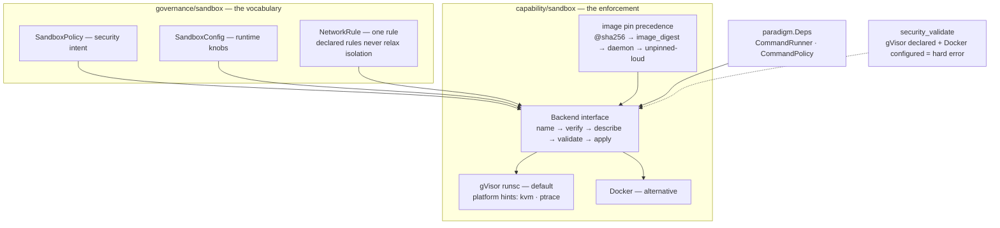
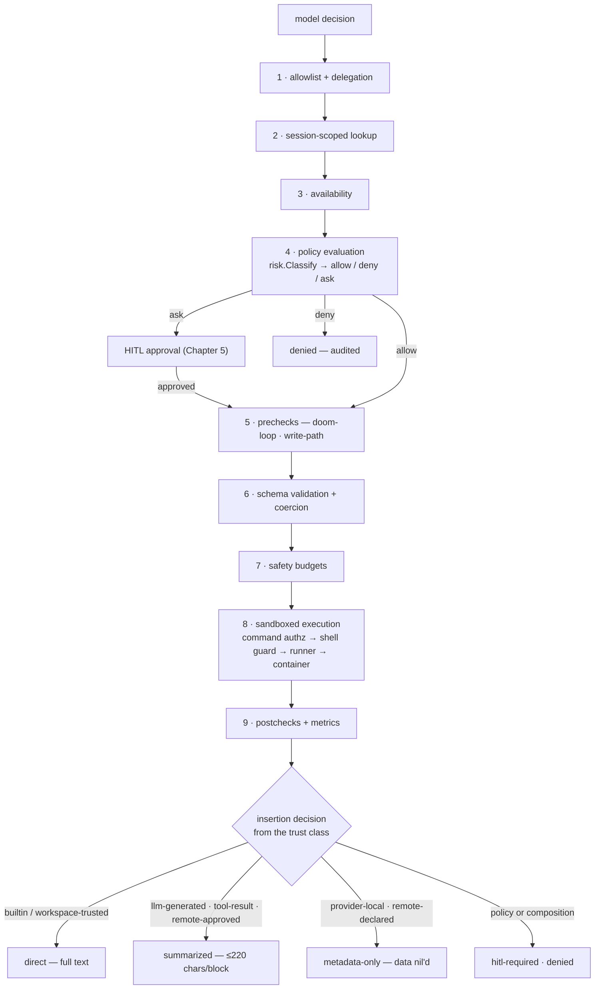

# Chapter 6 — Sandbox and Governed Execution

Chapter 5's engine said yes to one tool call. This chapter follows that
call all the way down — through admission, policy, approval, and into a
container with no network — and then all the way back up, where the
result is *classified before the model is allowed to see it*. That last
clause is the chapter's thesis: in this runtime, permission decides what
the agent may *do*, and a separate, monotone decision decides what the
agent may *see*. ADR-004 ("all execution is sandboxed") and ADR-003
(fail closed) meet in the middle of a single tool call.

The lab runs on your real machine's sandbox toolchain — no model
backend needed — and captures what *degraded* actually looks like when
the doctor reports it. If you have Docker and gVisor, you will see them
verified; if you do not, you will see the graceful degradation that is
itself one of this chapter's claims.

> **A note on citations.** Tracked files are cited `path:line`; the
> authoring corpus under `devdocs/` is cited by document and line and is
> not part of the public clone (`.gitignore:41`). Captured at commit
> `1bc57c62`; see the pin note in the front matter.

## Where you are

From Chapter 5 you have the decision machinery: effects, scopes, risk,
the allow/ask/deny model, HITL, the audit chain. This chapter adds the
enforcement side (`capability/sandbox/`) and traces the *journey* — the
nine-step invocation pipeline that every tool call traverses. You need
the Chapter 3 contracts (descriptor, trust class) and Chapter 5's
vocabularies. No model backend is needed anywhere.

By the end you will be able to:

1. State the sandbox backend contract and where the policy vocabulary
   lives (hint: not where the backends live).
2. Explain image digest pinning — its precedence and its failure mode.
3. Walk one tool call through all nine pipeline steps, citing each.
4. Read an insertion decision and compute the more restrictive of two.

## Technical requirements

| Requirement | Version / notes |
|---|---|
| OS / toolchain | As Chapters 1–5 (Linux primary; toolchain pin `go1.27.2`, `go.mod:5`) |
| Model backend | **Not needed** — the turn runs on the offline backend |
| Sandbox | Docker and gVisor `runsc` *welcomed but not required* — the doctor's degraded output is part of the lab |

Captured on the Chapter 1 machine (Docker 29.9.2, `runsc` release-20260406.0),
commit `1bc57c62`.

## 6.1 ADR-004 as a boot condition

The decision record is short and absolute
(`docs/ARCHITECTURE.md:263-271`): every command goes through the sandbox
chain into a verified backend — gVisor by default, Docker as the
alternative — the previous local host-exec runner *was deleted*, and a
guard test keeps it deleted. The consequence line is the semantics of
"degraded": a missing sandbox toolchain degrades boot to the doctor
screen instead of allowing unsandboxed execution. Degraded never means
unsandboxed; it means visible.

You can see all of it live. In a scratch workspace, the doctor at the
pin reports (excerpt; full output in the lab transcript):

```
  - runner: missing [warning] (no runner status (not spawned yet))
  - sandbox_backend: ok [required] (runsc version release-20260406.0
spec: 1.1.0-rc.1)
  - docker: degraded [warning] (degraded: runsc runtime not registered)
  - audit_chain: ok [required] (no audit chain yet (created on first agent run))
  - runtime_image: degraded [required] (unpinned (tag-based; resolved from the
    local daemon at boot — set security.sandbox.image_digest to pin))
Result: ready
```

Four rows teach four different things. `sandbox_backend: ok` verifies
the toolchain (`runsc` version quoted — the doctor doesn't trust
presence, it interrogates). `docker: degraded` — on a machine where
Docker the daemon runs fine — means the *gVisor runtime is not
registered with Docker*, so the default backend pairing is only half
present: degraded is a *pairing* verdict, not a health verdict.
`runtime_image: degraded` is §6.3's pin warning, surfaced as a required
row that still does not block. And `Result: ready` with two degraded
rows is the whole governance philosophy of boot in one line: fail
closed, degrade loudly, never quietly allow. (The runner row is Chapter
1's D10 seam; the audit row is Chapter 5's chain waiting for its first
entry.)

The platform hints — `kvm` and `ptrace` for gVisor
(`--sandbox-platform`, Chapter 3's flag table) — select *how* `runsc`
virtualizes, not *whether* it does.

## 6.2 The backends, and where the policy vocabulary lives

The enforcement side is `capability/sandbox/`. Its `Backend` interface
(`capability/sandbox/contract_types.go:83-96`) is the contract an
isolation technology satisfies: name → verify → describe capabilities →
validate a policy → apply a policy → return the applied policy. Two ship:
gVisor `runsc` (default) and Docker. An unsupported backend is a hard
error, and a `local` (bare host) backend "does not exist and is rejected
by config validation" (`devdocs/HANDOFF-docs/API_SURFACES.md:306-326`).

Here is the wrinkle Chapter 5 set up and this chapter resolves: the
*policy vocabulary* is not in `capability/sandbox/` — it is in
`governance/sandbox/`, because "these structs are the contract between
authored policy and enforcement; backends … implement the enforcement
ports against these types" (`governance/sandbox/sandbox.go:1-4`). The
vocabulary is three types — `SandboxPolicy` (security intent),
`SandboxConfig` (runtime knobs), `NetworkRule` (one egress/ingress rule)
— and one of its honesty rules you already know from ADR-003: declared
network rules do **not** relax network isolation
(`devdocs/HANDOFF-docs/API_SURFACES.md:319-321`; per-rule egress is not
enforceable at the packet level, so opening the container network
because rules exist would be an unsafe fallback).

The same split holds for the downgrade guard: a manifest that declares
the gVisor runtime while the configured backend is Docker is a hard
error — gVisor is the only runtime providing the full security model
(`app/envcomposition/security_validate.go`).

**Sharing the runner.** Reasoning paradigms do not own command
execution either — the command runner and the command policy arrive as
wired dependencies on the paradigm contract
(`cognitionzoo/paradigm/deps.go:33-34`: `CommandRunner` and
`CommandPolicy` in `paradigm.Deps`). One enforcement seam, threaded
everywhere; no paradigm can grow its own.

The structure in one picture — vocabulary owned by governance, the
five-verb contract in capability, the runner shared by wiring:



## 6.3 The image: pinned, or loud

Every sandboxed command runs in a container built from one image, and
the tree treats that image as a supply-chain fact
(`capability/sandbox/command_runner.go:24-29`): the digest is resolved
*at boot* — from the local daemon or from
`security.sandbox.image_digest` — and "an unpinned boot emits
`sandbox.image_unpinned`."

The pin precedence is recorded in the code with a decision ID
(`capability/sandbox/image.go:33-40`, SBH-1 D-13): an explicit
`@sha256:` reference wins, then the operator-configured `image_digest`,
then a daemon-resolved repo digest, and last — `PinUnpinned` — the tag
is used *with a loud warning*, which is exactly the
`runtime_image: degraded [required]` row from the doctor capture above.
There is no silent path: the image is either cryptographically pinned or
the boot tells you it isn't, in a row you cannot miss and that CI cannot
suppress.

## 6.4 The journey of one tool call

Every capability invocation traverses the same nine steps, all inside
`CapabilityRegistry.InvokeCapability`
(`capability/registry/invoke.go:32`) — the pipeline the whitepaper
documents (§5.2) and Book 1 summarized:

| # | Step | What gates it |
|---|---|---|
| 1 | Delegate and allowlist | a scoped registry view must contain the capability |
| 2 | Session-scoped lookup | a capability registered on the envelope wins over the registry |
| 3 | Availability | the handler may declare itself unavailable |
| 4 | Policy evaluation | `risk.Classify` (Ch 5) → policy engine returns allow / deny / require-approval |
| 5 | Prechecks | doom-loop detection, write-path restriction |
| 6 | Schema validation and coercion | unknown keys rejected, defaults injected, values coerced |
| 7 | Safety budgets | per-capability and per-provider call caps; session byte and token caps |
| 8 | Execution | panic-recovered; commands traverse the sandbox chain: command authorization → shell guard → enforcing runner → container |
| 9 | Postchecks and metrics | the result passes back through the insertion decision (§6.5) |

Step 8's sandbox chain is Chapter 5's vocabulary executing:
`governance/authorization/command_authorization.go` decides, the shell
guard blocks-or-escalates unparsable commands, and the enforcing runner
launches the container — the same runner that was wired through
`paradigm.Deps` (§6.2).

One consumer of this pipeline refuses to run without it. ReWOO's
constructor takes the permission checker as a mandatory option — and its
error vocabulary says why
(`cognitionzoo/rewoo/errors.go:5-9`):

The journey as a flow — the nine steps, the ask-detour, and the
classified return:



> ErrNoPermissionChecker is returned when a ReWOO execution is attempted
> without a permission checker. Governance is unconditional: a ReWOO
> turn …

— the sentence completes itself in the type system: without the
checker, there is no execution to attempt (`cognitionzoo/rewoo/new.go:28-35`).

## 6.5 The answer comes back classified

Step 9 hands the result to the *insertion decision* — the mechanism
whitepaper §5.3 calls this paper's thesis, and the code is short enough
to quote the whole default:

```go
// capability/result/result.go:166-186 (excerpt)
func DefaultInsertionDecision(descriptor descriptor.CapabilityDescriptor,
	disposition ContentDisposition) InsertionDecision {
	switch descriptor.TrustClass {
	case agentspec.TrustClassBuiltinTrusted, agentspec.TrustClassWorkspaceTrusted:
		return InsertionDecision{Action: agentspec.InsertionActionDirect, …}
	case agentspec.TrustClassLLMGenerated, agentspec.TrustClassToolResult:
		return InsertionDecision{Action: agentspec.InsertionActionSummarized, …}
	case agentspec.TrustClassRemoteApproved:
		return InsertionDecision{Action: agentspec.InsertionActionSummarized, …}
	case agentspec.TrustClassProviderLocalUntrusted, agentspec.TrustClassRemoteDeclared:
		return InsertionDecision{Action: agentspec.InsertionActionMetadataOnly, …}
	}
	…
}
```

One declared trust class — Chapter 3's descriptor field — yields both
the admission input (Chapter 5's `risk.Classify`) and the visibility
answer here. Five actions exist, and they form a total order:

```go
// capability/result/result.go:376-390
func InsertionRestrictiveness(action agentspec.InsertionAction) int {
	switch action {
	case agentspec.InsertionActionDirect:        return 0
	case agentspec.InsertionActionSummarized:    return 1
	case agentspec.InsertionActionMetadataOnly:  return 2
	case agentspec.InsertionActionHITLRequired:  return 3
	case agentspec.InsertionActionDenied:        return 4
	default:                                     return 4
	}
}
```

The `default` arm is fail-closed in one line: an unrecognized action
scores maximally restrictive. Composition can only tighten —
`moreRestrictiveInsertionDecision` returns whichever candidate is more
restrictive (`capability/result/result.go::315-324`) — and a manifest's insertion policy
overrides only if it does not loosen
(`capability/registry/capability_policy_eval.go:32`).

The consequences are visible at the consumption sites. A `direct`
insertion's budget is zero because nothing needs summarizing; a
summarized one is capped at 220 characters per block
(`cognitionzoo/react/capability_insertion.go:59-62`); and a
metadata-only decision nils the observation's data entirely while the
envelope still travels — the paradigm *learns that something happened*
without learning what (`cognitionzoo/react/react_act_node.go:438-441`).

## 6.6 Hands-on: the journey, verified at both ends

The lab (`docs/relurpic-internals/labs/ch06-sandbox/`) captures the
journey from three angles; the transcript holds the full evidence.

**1. Readiness, on your machine.** Build from the pin and run the
doctor in a scratch workspace:

```bash
go build -o /tmp/relurpify-ch06/relurpish ./app/relurpish
/tmp/relurpify-ch06/relurpish doctor --workspace /tmp/ch06-ws
```

Captured (§6.1's excerpt): the sandbox row interrogating `runsc`'s
version, the Docker degraded pairing, the unpinned-image row, and
`Result: ready`. On a machine without the toolchain the same rows
degrade instead of vanishing — capture yours and diff the *shapes*.

**2. The turn.** The same product-path test as Chapter 5, re-run for
this chapter because the journey's middle steps belong here:

```bash
go test ./app/relurpish/e2e -run TestBootTurnToolCall -count=1
```

Captured: `ok … 0.125s` — admission, evaluation, budget, execution, and
the classified return all exercised (the harness isolates the container
and the human; §5.6's note applies verbatim).

**3. The enforcement machinery.**

```bash
go test ./capability/... -count=1
```

Captured: 12 packages `ok`, including `capability/sandbox` (1.118s —
it exercises real lifecycle logic against the committed fake-docker
fixture).

**4. The sites.** Read the five declaration sites this chapter cites —
the `Backend` interface, the pin precedence, the pipeline entry, the
restrictiveness order, and ReWOO's mandatory option — and check each
claim above against the line. That habit is the book's deliverable.

### Verification block

| Chapter claim | Where captured | Lab file |
|---|---|---|
| Degraded semantics, live (runsc verified; Docker pairing; unpinned image) | §6.6 step 1 | `transcript.txt` §1 |
| Governed tool-call turn passes the product path | §6.6 step 2 | `transcript.txt` §2 |
| Capability machinery green (12 packages) | §6.6 step 3 | `transcript.txt` §3 |
| Backend contract; policy vocabulary owned by governance | §6.2 | manual: `capability/sandbox/contract_types.go::83-96`, `governance/sandbox/sandbox.go:1-7` |
| Pin precedence with a loud unpinned fallback | §6.3 | manual: `capability/sandbox/image.go::33-40`, `capability/sandbox/command_runner.go::24-29` |
| Insertion order is total and fail-closed | §6.5 | manual: `capability/result/result.go::376-390` |

## Summary

- ADR-004 is a boot condition: the toolchain is interrogated, not
  assumed; degradation is loud, paired, and never a path to unsandboxed
  execution (`app/relurpish/runtime/doctor.go::627-636` rows; `Result: ready` with warnings).
- The sandbox policy vocabulary lives in `governance/sandbox/` — the
  contract between authored policy and enforcement — while the backends
  live in `capability/sandbox/` behind a five-verb interface. The
  command runner and command policy reach paradigms only as wired
  dependencies (`cognitionzoo/paradigm/deps.go::33-34`).
- The container image is pinned by precedence (explicit digest >
  configured digest > daemon-resolved) or used with a loud
  `sandbox.image_unpinned` warning — never silently
  (`capability/sandbox/image.go::33-40`).
- Every tool call traverses nine pipeline steps inside
  `InvokeCapability` (`capability/registry/invoke.go::32`), from allowlist to insertion;
  ReWOO refuses to run without its permission checker because
  "governance is unconditional" (`cognitionzoo/rewoo/errors.go::5-9`).
- The result returns through an insertion decision derived from the
  trust class, on a total restrictiveness order where unrecognized
  actions score maximally restrictive and composition can only tighten
  (`capability/result/result.go::315-390`).

## Check yourself

1. The doctor reports `docker: degraded` on a machine where the Docker
   daemon is healthy. What is degraded, and why doesn't the row block?
2. Name the pin precedence in order. Which step does a bare
   `image: latest` in a manifest take, and what does the boot emit?
3. At which pipeline step does the model's *claim* first meet a
   governance *judgment*, and what makes that judgment non-bypassable
   for ReWOO specifically?
4. A capability's trust class yields `summarized`; a manifest policy
   demands `metadata-only`. Which wins, and which function computes it?
   What if the manifest demanded `direct` instead?
5. After a `metadata-only` decision, the paradigm's observation still
   exists. What does it contain, and why is that not a leak?

*Answers.* 1. The *pairing* — gVisor is not registered as a Docker
runtime, so the default backend combination is half-present; the row is
a warning because `sandbox_backend` (the required row) verified `runsc`
itself, and ADR-004's failure mode is degrade-and-explain, not
unsandboxed fallback. 2. Explicit `@sha256:` ref, then
`security.sandbox.image_digest`, then a daemon-resolved repo digest,
then `PinUnpinned` — the tag with the `sandbox.image_unpinned` warning
(`capability/sandbox/image.go::33-40`, `capability/sandbox/command_runner.go::27-29`). A bare tag resolves
through the daemon or lands unpinned-loud. 3. Step 4, policy evaluation
— the declared effects meet `risk.Classify` and the policy engine
there. ReWOO cannot skip it because its executor is constructed with
`WithPermissionChecker` and *errors at construction time* without one
(`cognitionzoo/rewoo/errors.go::5-9`) — the gate is structural, not advisory.
4. `metadata-only` wins; `moreRestrictiveInsertionDecision`
(`capability/result/result.go::315-324`) picks it (2 > 1). A `direct` demand loses
(0 < 1): manifest policies only tighten
(`capability/registry/capability_policy_eval.go::32`). 5. The observation's `Data` is nil
while its envelope (decision, action type) still travels
(`cognitionzoo/react/react_act_node.go::438-441`) — the paradigm knows *that* something
happened and how it was classified, never *what*; the payload stayed in
the artifact/summary layers the model never receives.

## Try it yourself

1. **Break the downgrade guard.** In a scratch clone, configure the
   Docker backend in a workspace whose security policy declares the
   gVisor runtime, and boot the doctor. Capture the hard error, then
   find its enforcement site in
   `app/envcomposition/security_validate.go`.
2. **Compute a ladder.** Write down the five insertion actions in
   restrictiveness order from memory, then check against
   `InsertionRestrictiveness` (`capability/result/result.go::376-390`). Which arm would a
   *future* action enum value fall into, and what does that choice
   imply about adding one?

## Where next

The governed turn left something behind: knowledge chunks, ingest
pipelines, an AST index, and a graph store. Chapter 7 opens the
knowledge substrate — the world the bi-directional compiler reads and
writes — including the scale ceilings the project states about itself
in its own docs.

The lab for this chapter lives in
`docs/relurpic-internals/labs/ch06-sandbox/` — the command card, the
captured transcript from the pin, and `verify.sh ch06` to check your
machine against the deterministic outputs.
