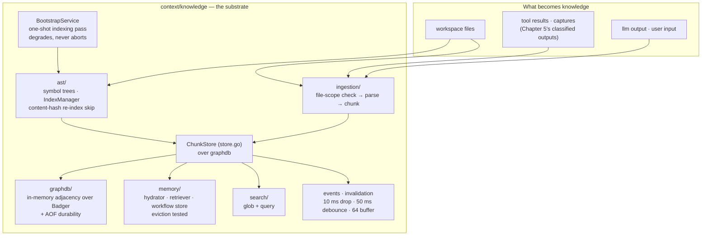
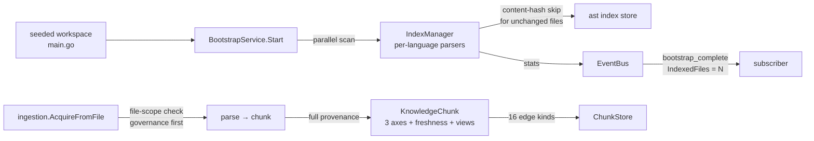

# Chapter 7 — The Knowledge Substrate

Everything a governed turn learns has to live somewhere, and Chapters 5
and 6 left a trail of it: observations, tool results, file reads, all
classified and audited. This chapter opens the world that trail lands
in — the knowledge substrate under `context/knowledge/` — because
Chapter 8's bi-directional compiler is nothing more (and nothing less)
than this world's reader and writer. Before you can understand
compilation, you need to know what is being compiled: the chunk, its
sixteen kinds of edges, the Badger-backed store that keeps adjacency in
RAM, the AST index that lets an agent navigate code without loading it,
and the working memory that holds a turn's mutable state.

This is also the chapter where the project's honesty about scale stops
being a footnote and becomes the design. The substrate is built for one
local workspace, not a data center — and the code says so in comments
this book quotes rather than apologizes for.

> **A note on citations.** Tracked files are cited `path:line`; the
> authoring corpus under `devdocs/` is cited by document and line and is
> not part of the public clone (`.gitignore:41`). Captured at commit
> `1bc57c62`; see the pin note in the front matter.

## Where you are

From Chapter 3 the envelope and the artifact store; from Chapter 5 the
decision metadata that provenance records; from Chapter 6 the classified
results that become chunks. This chapter is self-contained on those
mentions. No model backend is needed; the lab indexes a seeded
workspace.

By the end you will be able to:

1. Name every field group of a `KnowledgeChunk` and the four
   vocabularies it carries.
2. Explain why the graph engine keeps adjacency in memory over Badger —
   and which hot paths are full scans because of it.
3. Describe how code becomes chunks: the governed ingestion pipeline
   and the bootstrap indexing pass.
4. Find the scale ceilings in the project's own docs and in the code.

## Technical requirements

| Requirement | Version / notes |
|---|---|
| OS / toolchain | As Chapters 1–6 (Linux primary; toolchain pin `go1.27.2`, `go.mod:5`) |
| Model backend | **Not needed** |
| Sandbox | **Not needed** |

Captured on the Chapter 1 machine, commit `1bc57c62`.

## 7.1 The chunk: one atomic artifact, four vocabularies

`KnowledgeChunk` (`context/knowledge/chunk.go:168`) is the substrate's
atom, and the architecture doc summarizes its shape precisely:

> Knowledge chunks carry a three-axis model (memory class, storage mode,
> source origin), provenance (principal, trust, derivation chain),
> freshness, and typed views (decision, constraint, plan step, anchor,
> tension, intent). Chunks link through sixteen edge kinds, including
> `grounds`, `contradicts`, `refines`, `supersedes`, and
> `depends-on-code-state`.
> — `docs/ARCHITECTURE.md:194-198`

Read against the struct, that paragraph unpacks into four vocabularies
and three field groups:

- **The three axes** (`context/knowledge/chunk.go:12-31`): `MemoryClass` — `working`
  (mutable) vs `streamed` (read-only); `StorageMode` — `inline`,
  `external`, or `summarized`; `SourceOrigin` — `user`, `file`, `llm`,
  `tool`, or `derivation`. These are the axes the envelope's compiler
  budgets against in Chapter 8.
- **Provenance** (`ChunkProvenance`, `context/knowledge/chunk.go:146-154`): sources,
  session and workflow IDs, a code-state reference, and `CompiledBy` —
  a `CompilerPath` of `deterministic` or `llm_assisted`
  (`context/knowledge/chunk.go:95-100`). A chunk remembers not just where it came from
  but *what kind of process produced it*.
- **Freshness** (`FreshnessState`, `context/knowledge/chunk.go:85-93`): `valid`, `stale`,
  `invalid`, or `unverified` — semantic validity as a first-class
  field, which is what makes Chapter 8's invalidation drain possible.
- **Typed views** (`ViewKind`, `context/knowledge/chunk.go:104-117`): seven projections —
  `pattern`, `decision`, `constraint`, `plan_step`, `anchor`,
  `tension`, `intent` — a chunk can be *read as*, without changing what
  it *is*.

The identity group (`context/knowledge/chunk.go:170-178`) carries the ID, version,
workspace, `ContentHash`, and `TokenEstimate`; the tombstone group
(`context/knowledge/chunk.go:192-195`) marks chunks as `Tombstoned` and points at
`SupersededBy` — deletion in this substrate is metadata, never data
loss (full record history is retained, `docs/ARCHITECTURE.md:190`).

**The edges.** Sixteen kinds (`context/knowledge/chunk.go:121-136`), and the names are
the ontology: `grounds`, `contradicts`, `refines`, `generalizes`,
`exemplifies`, `derives_from`, `composed_of`, `supersedes`,
`requires_context`, `amplifies`, `invalidates`, `depends_on_code_state`,
`confirmed`, `rejected`, `refined_by`, `deferred`. Two of them —
`invalidates` and `depends_on_code_state` — are the substrate's
self-maintenance vocabulary: they are how staleness propagates when
code changes, which is Chapter 8's write path.

## 7.2 The store: RAM adjacency over a durable log

`graphdb` is described in its own package doc in eleven words that
explain every scaling decision in this chapter: "a durable embedded
graph engine optimized for traversal queries over in-memory adjacency
maps" (`context/knowledge/graphdb/doc.go:1-2`). Durability comes from
Badger (the `badger_backend.go` implementation, with an append-only
`aof.go` write path); traversal speed comes from adjacency maps held in
RAM. `ChunkStore` (`context/knowledge/store.go:28`) is the
knowledge-domain façade over that engine.

The trade is stated, not hidden. The architecture doc's scaling notes
(`docs/ARCHITECTURE.md:299-308`) name it as the first assumption:

> The graph engine keeps adjacency in memory over Badger; corpora are
> assumed to be workspace-sized, not web-sized.
> — `docs/ARCHITECTURE.md:300-301`

and then name the cost in the same breath:

> Several hot paths are full scans today (by-workspace chunk lookup,
> lineage search, compilation-record load); they are fine for local use
> and are known ceilings.
> — `docs/ARCHITECTURE.md:303-304`

The code agrees with the doc — a store method that scans carries the
warning in source: "NOTE: full scan — only use in migration or tooling"
(`context/knowledge/store.go:488`). And the bounded-growth posture is
structural: the event bus drops rather than blocks (a 10 ms publish
wait, then a counted drop — `context/knowledge/events.go:13-15`), and
the invalidation pipeline coalesces bursts behind a 50 ms debounce with
a 64-entry subscriber buffer (`context/knowledge/invalidation.go:14-16`).
INVARIANTS §4.3 tabulates these ceilings with their values
(`devdocs/HANDOFF-docs/INVARIANTS.md:308-330`) — the substrate is
bounded everywhere by design, not by afterthought.

## 7.3 Code becomes chunks: the AST index and ingestion

Two machines turn a workspace into knowledge, and they answer different
questions.

**The AST index** (`context/knowledge/ast/`) answers *where is
everything?*: "AST parsing and code indexing for Go and Markdown source
files, enabling agents to navigate workspace symbols without loading
entire files into context" (`context/knowledge/ast/doc.go:1-3`). Per-
language parsers (`parser_go.go`, `parser_markdown.go`) extract symbol
trees behind a common interface with language auto-detection; the
`IndexManager` (`ast/index_manager.go`) persists the index — including
a content-hash check so unchanged files are not re-indexed
(`context/knowledge/ast/ast_final_test.go:53`).

**Ingestion** (`context/knowledge/ingestion/`) answers *what did this
mean?*: `AcquireFromFile` builds a pipeline per file — and its first
act is a governance act (`context/knowledge/ingestion/pipeline.go:21-26`):

```go
// context/knowledge/ingestion/pipeline.go:22-26
if scope != nil {
	if err := scope.Check(ucperms.FileSystemRead, path); err != nil {
		return nil, fmt.Errorf("file scope denied: %w", err)
	}
}
```

Even reading a file *into knowledge* passes a file-scope check. The
pipeline then detects MIME type, parses (the ingestion parsers chunk
Go declarations — `ingestion/parsers.go`), and stores chunks with full
provenance. Ingestion is not a back door around Chapter 5; it is one
of its clients.

**Bootstrapping** ties the two together. `BootstrapService`
(`context/knowledge/bootstrap_service.go:15-27`) "runs a one-shot
workspace indexing/bootstrap pass," registered directly by the
workspace session — and its doc comment records two decisions worth
quoting. First, provenance of a change: "the ayenitd adapter that used
to host it is gone (S7)" — the substrate, too, has had tenants move
out. Second, the failure posture: "an operational indexing failure
degrades knowledge (log + boot.degraded telemetry), it never aborts
boot" — the same degrade-loudly pattern as Chapter 6's sandbox, tested
by name (`context/knowledge/bootstrap_service_test.go:57`:
`TestWorkspaceBootstrapIndexFailureDegradesNotAborts`). The success
path emits a `bootstrap_complete` event carrying the index stats —
including the count of indexed files — on the event bus
(`context/knowledge/bootstrap_service_test.go:75-106`).

**Working memory** completes the substrate's inside view:
`context/knowledge/memory/` holds the hydrator, retriever, and
workflow store — the mutable, per-turn side of the ledger whose chunks
are `MemoryClassWorking` — with eviction tested as a first-class
behavior (`memory/evict_test.go`). Search (`context/knowledge/search/`)
is deliberately small: glob and query over the indexed substrate
(`search/doc.go`).

## 7.4 The substrate, in two pictures

Structure — the packages, their stores, and what flows between them:



Flow — how a file becomes an indexed, queryable chunk (the lab's path):



## 7.5 The ceilings, quoted where they live

The project states no numeric SLOs — INVARIANTS is explicit: "There is
no latency target, no throughput target, and no availability target
anywhere I found" (`devdocs/HANDOFF-docs/INVARIANTS.md:284-285`). What
it states instead is a posture, and the posture is auditable:

| Assumption or ceiling | Value / statement | Where |
|---|---|---|
| Corpus size | workspace-sized, not web-sized | `docs/ARCHITECTURE.md:300-301` |
| Tenancy | single user, single workspace, per-process concurrency | `docs/ARCHITECTURE.md:302-305` |
| Known full scans | by-workspace chunk lookup, lineage search, compilation-record load | `docs/ARCHITECTURE.md:303-304`; `context/knowledge/store.go:488` |

A correction, stated here per this book's convention: of the doc's
three named scans, *by-ID compilation-record loads are no longer one* —
`GetCompilationRecord` is a direct graph-node get
(`execution/compiler/repository_impl.go:53-64`), and a guard test pins
it (`execution/compiler/replay_test.go:105`,
`TestRecordLookupsNeverScan`). The doc's list is the design intent;
the record-load item is stale as of the pin. Chapter 8 works the
compiler side in detail.
| Event-bus publish wait | 10 ms, then a counted drop | `context/knowledge/events.go:13-15` |
| Invalidation debounce / subscriber buffer | 50 ms / 64 | `context/knowledge/invalidation.go:14-16` |
| Compilation pins | 8 max active pins, 64-token pin references | `execution/compiler/` |

The honest reading: these are not limitations being excused, they are
the design's stated operating range — the same move as the whitepaper's
"partly aspirational" ranker disclosure (Chapter 3), applied to scale.
Chapter 8's compiler inherits all of it.

## 7.6 Hands-on: index a workspace, watch the substrate work

The lab (`docs/relurpic-internals/labs/ch07-substrate/`) uses the
substrate's own tests as the harness — no model, no sandbox, no
workspace setup beyond what the tests seed.

**1. The substrate, package by package.**

```bash
go test ./context/knowledge/... -count=1
```

Captured: seven packages `ok` — `knowledge` 4.5s, `ast` 4.3s,
`graphdb` 3.8s, `ingestion` 0.7s, `memory` 10 ms, `retrieval` 0.5s,
`search` 6 ms.

**2. Index a seeded workspace, end to end.**

```bash
go test ./context/knowledge -run 'TestWorkspaceBootstrap' -count=1 -v
```

Captured: both bootstrap tests pass —
`TestWorkspaceBootstrapIndexFailureDegradesNotAborts` (the failure
posture, by name) and `TestWorkspaceBootstrapSuccessIndexesAndEmitsComplete`
(the success path: a seeded `main.go` is indexed, retrievable by path
from the store, and a `bootstrap_complete` event arrives on the bus
with `IndexedFiles = 1`).

**3. The sites.** Read the four structures this chapter cites — the
chunk (`context/knowledge/chunk.go:168`), the sixteen edge kinds (`context/knowledge/chunk.go:121-136`),
the graphdb doc line (`context/knowledge/graphdb/doc.go:1-2`), and the full-scan warning
(`context/knowledge/store.go:488`) — and check the doc paragraph at
`docs/ARCHITECTURE.md:194-198` against them, clause by clause.

### Verification block

| Chapter claim | Where captured | Lab file |
|---|---|---|
| Seven substrate packages green | §7.6 step 1 | `transcript.txt` §1 |
| Bootstrap indexes a seeded workspace and emits stats | §7.6 step 2 | `transcript.txt` §2 |
| Indexing failure degrades, never aborts boot | §7.6 step 2 (test by name) | `transcript.txt` §2 |
| Sixteen edge kinds; four vocabularies | §7.1 | manual: `context/knowledge/chunk.go:85-136,168` |
| In-memory adjacency over Badger; full scans named | §7.2, §7.5 | manual: `context/knowledge/graphdb/doc.go:1-2`, `context/knowledge/store.go:488`, `docs/ARCHITECTURE.md:299-308` |
| Bounded everywhere (10 ms / 50 ms / 64) | §7.2, §7.5 | manual: `context/knowledge/events.go:13-15`, `context/knowledge/invalidation.go:14-16` |

## Summary

- A `KnowledgeChunk` carries identity, a three-axis model (working vs
  streamed memory; inline/external/summarized storage; five source
  origins), provenance including the producing `CompilerPath`,
  a four-state freshness field, seven typed views, and tombstoning —
  deletion is metadata; history is retained.
- Sixteen edge kinds form the ontology; `invalidates` and
  `depends_on_code_state` are how staleness propagates — the write
  path's raw material.
- The graph engine is in-memory adjacency over Badger with an AOF
  write path — workspace-sized by stated design, with the full-scan
  hot paths named in both the architecture doc and the code.
- Code becomes knowledge through two governed machines: the AST index
  (navigation without loading files) and ingestion (file-scope check
  first — governance is a client here too), bootstrapped once per
  workspace by a service that degrades rather than aborts.
- The substrate is bounded everywhere: counted drops, debounced
  coalescing, fixed buffers — ceilings the project publishes in its own
  docs rather than leaving to be discovered.

## Check yourself

1. A chunk is `MemoryClassStreamed` and `StorageModeSummarized`. What
   may the compiler do with it, and what may it never do?
2. A remote tool's output becomes a chunk. Which vocabulary records
   *what kind of process produced it*, and which Chapter 5 concept does
   its `TrustClass` field carry over?
3. Why is deletion a tombstone rather than a removal, and which
   Chapter 5 machinery does that preserve?
4. The by-workspace chunk lookup is a full scan. Why is that acceptable
   here, and what would it break first at web scale?
5. `AcquireFromFile` checks a file scope before reading. What does
   that tell you about the relationship between the substrate and the
   governance engine — which imports which, and why is that the only
   legal direction?

*Answers.* 1. It may be *read* into compiled context (streamed is the
read-only leg); it may never be mutated — working is the mutable class
(`context/knowledge/chunk.go:13-18`). Summarized means the body was condensed under the
insertion rules (Chapter 6); the summary, not the raw, is what compiles.
2. `CompiledBy` / `CompilerPath` — `deterministic` vs `llm_assisted`
(`context/knowledge/chunk.go:95-100`) — records the process; the `TrustClass` field is the
same seven-value provenance label from `capability/agentspec`
(Chapter 5 §5.2). 3. History is retained (`docs/ARCHITECTURE.md:190`),
and the audit chain plus the derivation graph must remain intact — a
removed chunk would silently break `derives_from` lineage and the
freshness propagation that `invalidates` drives. 4. The corpus is
workspace-sized by stated design (`docs/ARCHITECTURE.md:300-301`) and
the engine trades scan cost for RAM-resident traversal; at web scale
the adjacency maps would exhaust memory first, then the scans — which
is exactly why the design scopes itself before either happens. 5. The
substrate imports governance vocabularies (identity, permissions,
classification — see `ingestion/pipeline.go`'s imports); governance
never imports the substrate. The DAG fixes the direction, and the file
-scope check proves the substrate is a governed *client*, not a
parallel authority.

## Try it yourself

1. **Break a chunk's freshness by hand.** In a scratch test, build a
   `KnowledgeChunk` with `FreshnessState` = `stale` and walk the
   `invalidates` edge from a newer chunk to it
   (`context/knowledge/graph.go`). Which store method propagates the
   state, and what would Chapter 8's invalidation drain do with it?
2. **Measure the skip.** Run
   `go test ./context/knowledge/ast -run TestIndexManagerPersistWithContentHash -count=1 -v`
   and read the test: what does the content-hash check compare, and
   what would happen to bootstrap time on a 10 k-file workspace where
   9,900 files are unchanged?

## Where next

The world is built; now the compiler. Chapter 8 turns the substrate
into context: the seven-stage read path with its deterministic digest,
grounding at the epoch barrier as the write path, the invalidation that
joins them, and the stream trigger that delivers compiled context to
the model mid-turn. The ranker registry's "partly aspirational" honesty
— first met in Chapter 3 — becomes first-PR territory there.

The lab for this chapter lives in
`docs/relurpic-internals/labs/ch07-substrate/` — the command card, the
captured transcript from the pin, and `verify.sh ch07` to check your
machine against the deterministic outputs.
