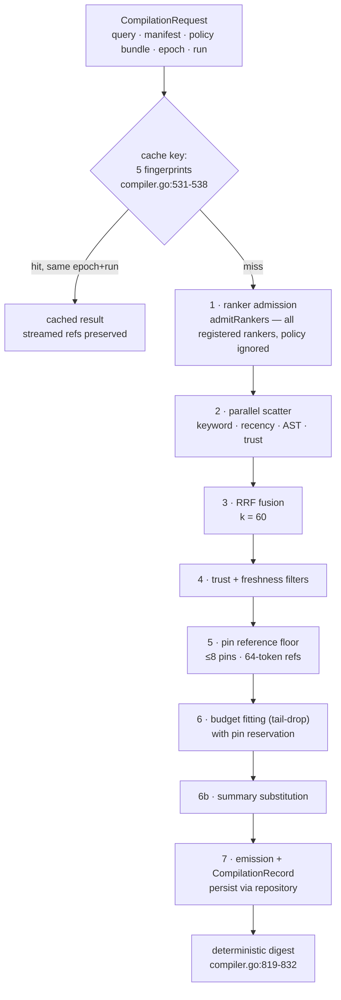
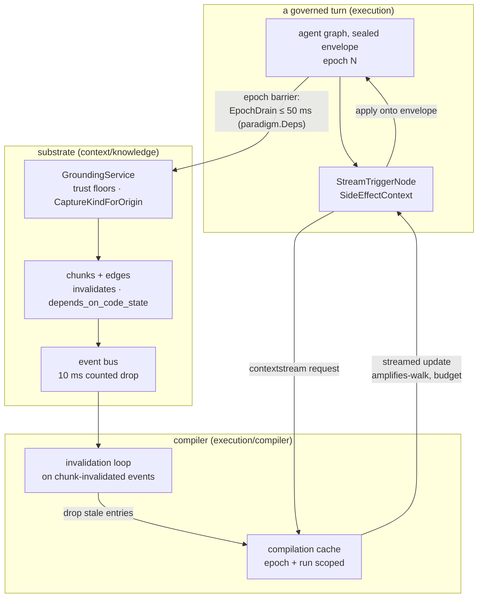

# Chapter 8 — Compilation and Grounding: the BKC

Chapter 7 built the world; this chapter is its compiler — in *both*
directions. The **read path** turns a query and a chunk graph into a
deterministically compiled, digest-fingerprinted context artifact.
The **write path** turns what a governed turn learned back into chunks,
at a barrier designed so the two directions can never race. Invalidation
joins them — staleness flows from the write side backward into the
read side's cache — and a stream trigger delivers compiled context to
the model *mid-turn*, not just at its start. Together: the
bi-directional knowledge compiler, the BKC.

This is the chapter where the project's honesty becomes contribution
terrain. Two disclosures you have already met — the unregistered
rankers (Chapter 3) and the dangling design-doc reference (Chapter 1) —
live here, and this chapter verifies both line by line at the pin. It
also verifies a third, subtler one: the compilation digest itself has a
documented weakness the whitepaper found and the code still carries —
reproducibility fingerprint, not security boundary — and closing it is
the most instructive first PR this tree offers.

> **A note on citations.** Tracked files are cited `path:line`; the
> authoring corpus under `devdocs/` is cited by document and line and is
> not part of the public clone (`.gitignore:41`). Captured at commit
> `1bc57c62`; see the pin note in the front matter.

## Where you are

You need Chapter 7's chunk model (axes, freshness, the sixteen edges)
and Chapter 3's envelope (`AssemblyMeta`, `EpochID`/`RunID`). The
compiler's types were introduced there. No model backend is needed —
the compiler is deterministic machinery over the substrate.

By the end you will be able to:

1. Walk the seven-stage read path, citing each stage's site.
2. Explain what the digest guarantees, what it does not, and why.
3. Describe grounding at the epoch barrier — what crosses, what waits,
   and what the trust floors do.
4. Trace invalidation from a chunk event to a cache eviction, and the
   stream trigger from a graph node to the envelope.

## Technical requirements

| Requirement | Version / notes |
|---|---|
| OS / toolchain | As Chapters 1–7 (Linux primary; toolchain pin `go1.27.2`, `go.mod:5`) |
| Model backend | **Not needed** |
| Sandbox | **Not needed** |

Captured on the Chapter 1 machine, commit `1bc57c62`.

## 8.1 What the BKC is

One scope note before the machinery. The book plan (decision D1)
defines the BKC as three things tied to two types: the **read path**
(seven-stage compilation), the **write path** (grounding at the epoch
barrier), and **staleness invalidation** — tied to the context envelope
(Chapter 3) and the context-streaming graph node. The original design
document that named all of this in one place no longer exists in the
tree; its ghost is the dangling reference at
`context/knowledge/grounding.go:680` (Chapter 1's find, and Chapter
12's first-PR candidate). So this chapter — like the whitepaper —
defines the BKC from the whitepaper (§5, §6.4), the domain model, and
the code, and flags the gap honestly rather than pretending the doc is
here.

## 8.2 The read path: seven stages

The canonical list is the whitepaper's
(`devdocs/relurpify-technical-whitepaper.md:209`): *ranker admission →
parallel retrieval → reciprocal rank fusion → trust filter → freshness
filter → token-budget fitting with pin reservations → emission plus a
persisted compilation record carrying a deterministic digest.* The
code's entry point says the same in its doc comment — "Compile
performs context assembly with 7 pipeline stages"
(`execution/compiler/compiler.go:137`) — and numbers four of them
inline: Stage 2 scatter (`execution/compiler/compiler.go:202`), Stage 5 pin floor
(`:210`), Stage 6 budget fitting with pin reservation (`:237`), and a
Stage 6b summary substitution under pressure (`:271`). The un-numbered
stages are the helper calls between them: `admitRankers` (`:555`),
`applyFilters` (`:235`), and the record build-and-persist at the end
(`:325`, `:351`).

**Cache first — and correctly scoped.** Compilation is cached, and the
cache key is the correctness story
(`execution/compiler/compiler.go:531-538`): five fingerprints — query, manifest, policy
bundle, and, decisively, **epoch and run**. A cached compilation is
only reused within the same run and epoch; the envelope's `AssemblyMeta`
comment said why in Chapter 3 ("the compiler cache must never serve an
entry across runs, whose epoch counters are independent"). INVARIANTS
names the trade: epoch-scoped, not TTL-scoped — lower hit rates in
exchange for correctness (`devdocs/HANDOFF-docs/INVARIANTS.md:300-302`),
pinned by tests that read like their own names:
`TestCacheKeyIncludesEpoch` and
`TestCacheRunScopePreventsCrossRunHits`
(`execution/compiler/cache_epoch_test.go:69,190`).

**Stage 1 — ranker admission, and the honesty you were promised.** The
production composition registers exactly four rankers
(`app/envcomposition/knowledge.go:86-92`): keyword (BM25 parameters
K1 1.2, B 0.75), recency (24-hour half-life), AST proximity (when an
index exists), and trust. The registry admits whatever is registered —
and this is the line Chapter 3 quoted, still true at the pin
(`context/knowledge/retrieval/types.go:67`):

```go
_ = policy // PolicyBundle does not carry ranker configuration; all registered rankers are admitted.
```

`BM25Ranker` and `FreshnessRanker` exist as full implementations
(`retrieval/rankers.go:16,60`) and are registered *nowhere* — which is
why the whitepaper calls the "deterministic" and "policy-driven" claims
"partly aspirational for the retrieval layer" (`:329`). This book's
open item 1 required re-verifying that line by line at writing; it
holds. Registering the unregistered rankers behind configuration is the
pathway map's second rung (Chapter 12).

**Stages 2–4 — scatter, fuse, filter.** Stage 2 fires the admitted
rankers in parallel (`execution/compiler/compiler.go:202`). Stage 3 fuses their rankings
by reciprocal rank fusion — `RRF_score(d) = Σ wᵢ/(k + rankᵢ(d))` with
`k = 60` as the default (`context/knowledge/retrieval/rrf.go:14-35`).
Stage 4 applies the trust and freshness filters
(`execution/compiler/compiler.go:235`) — the substrate's `FreshnessState` (Chapter 7)
becomes a compile-time exclusion here.

**Stages 5–6 — pins and budget.** Stage 5 lays a pin-reference floor
(`:210`): `PinReference` values (path, content hash, short digest —
`execution/compiler/types.go:102-108`) keep a usable handle to pinned
files regardless of budget. The ceilings you met in INVARIANTS §4.3
govern here: at most 8 active pins, 64-token pin references. Stage 6
fits the ranked chunks into the token budget by tail-drop *with pin
reservation* — pins are kept while ordinary chunks are dropped
(`:237`) — and Stage 6b substitutes chunk summaries under pressure
(`:271`), the `StorageModeSummarized` axis earning its keep.

**Stage 7 — emission and the record.** The result and its record are
built with the admitted ranker names (`:325`) and persisted through the
repository (`:351`). The record is Chapter 7's `CompilationRecord` —
request, result, dependencies, substitutions, and the digest.



## 8.3 The digest and replay: reproducibility, not security

The digest function is short enough to read whole
(`execution/compiler/compiler.go:819-832`):

```go
func compilationDigest(record *CompilationRecord) string {
	h := sha256.New()
	if record == nil {
		return hex.EncodeToString(h.Sum(nil))
	}
	h.Write([]byte(record.Request.Query.Text))
	_, _ = fmt.Fprintf(h, "%d", record.EventLogSeq)
	for _, chunkID := range record.Dependencies {
		h.Write([]byte(chunkID))
	}
	return hex.EncodeToString(h.Sum(nil))
}
```

Look at it the way Chapter 2 taught you to look at fences: the three
inputs are written with **no separators and no length prefixes**. The
whitepaper's §6.4 demonstrates the consequence with three concrete
collisions — `("a", seq=11, deps=["b"])`, `("a1", seq=1, deps=["b"])`,
and `("a", seq=1, deps=["1b"])` all hash identically, because the
concatenated bytes are literally `"a11b"` in every case. I verified the
collision structure by inspection at the pin; the function above is
unchanged. Whether it is *exploitable* depends on who controls the
query text — which is model- and user-influenced — so the discipline is
the one the whitepaper states: treat the digest as a **reproducibility
fingerprint, not a security boundary**, and length-prefix it if it ever
needs to be the former *and* the latter. The code comment says
"deterministic digest" with no caveat; this book's addition is the
caveat. Closing it — three lines of prefixing plus the tests — is the
pathway map's most instructive first PR.

Replay is the mechanism that *uses* the fingerprint.
`Compiler.Replay` (`execution/compiler/compiler.go:366`) re-runs a compilation by request
ID in one of two modes (`execution/compiler/types.go:25-32`):
`StrictReplay` bypasses the cache, recomputes, and compares digests —
failing with `ErrReplayMismatch` (`execution/compiler/compiler.go:41`) — while
`CurrentReplay` accepts the current substrate's answer and reports the
diff. Three guard tests pin the contract, captured at the pin:

```
$ go test ./execution/compiler -run 'TestStrictReplay|TestRecordLookupsNeverScan' -count=1 -v
--- PASS: TestStrictReplayGoldenRecordPasses (0.01s)
--- PASS: TestStrictReplayDetectsNondeterminism (0.00s)
--- PASS: TestRecordLookupsNeverScan (0.01s)
```

`TestStrictReplayDetectsNondeterminism` is the one to sit with: the
system tests that its own replay alarm fires. And the third test
resolves a small doc drift this book is obliged to flag:
`docs/ARCHITECTURE.md:303-304` lists "compilation-record load" among
the known full scans, but by-ID record loads are direct graph-node gets
(`execution/compiler/repository_impl.go:53-64`), and
`TestRecordLookupsNeverScan` (`execution/compiler/replay_test.go:105`) asserts zero list
calls during replay. The correction is stated in place in Chapter 7;
here it is the compiler-side proof.

## 8.4 The write path: grounding at the epoch barrier

Everything Chapter 6's pipeline classified can become knowledge — but
only across a barrier. A turn's graph runs against a sealed envelope
epoch; the substrate persists across turns. Grounding is the bridge,
and it is one-directional by construction: captures produced during
execution are *admitted* into the substrate, never merged back into the
running envelope.

`GroundingService` (`context/knowledge/grounding.go:131`) admits
`GroundingItem`s (`:74`) — and the first thing admission decides is
*what kind of chunk the capture becomes*, by origin:

```go
// context/knowledge/grounding.go:676-687 (from Chapter 1's verification)
func CaptureKindForOrigin(origin contextdata.OriginClass) ChunkKind {
	if origin == contextdata.OriginTool {
		return ChunkKindTool
	}
	return ChunkKindCapture
}
```

The comment above it is one of the best paragraphs in the tree — the
ingester's taxonomy heir, tool outputs ground as `ChunkKindTool`, and
verbatim LLM-response ingestion "stay[s] deferred by design: without a
summarizer and a recipe-level policy, storing model output under a
summarized-storage contract would be dishonest metadata." Honest
refusal as a design act. The same file carries the tree's most famous
line-break (the dangling `context/knowledge/grounding.go:680` reference), and the
grounding admission enforces trust floors — a provider's capture cannot
ground at a trust above its provenance
(`TestGroundingServiceTrustFloors`, `context/knowledge/grounding_test.go:75`).

**The barrier's drain.** The epoch barrier has a bounded grace: the
graph node that finishes an epoch drains pending substrate work before
the next epoch starts, and the drain is a *dependency*, not a hidden
call — `EpochDrain func(time.Duration)` on the paradigm contract
(`cognitionzoo/paradigm/deps.go:42-44`), defaulted at 50 ms
(`execution/agentgraph/epoch.go:21-22`) and wired by the agent
(`named/euclo/agent.go:309`). Chapter 5's pattern again: the seam is
declared on the contract, the composition root fills it.

## 8.5 Invalidation and the stream trigger

**Invalidation joins the directions.** When the substrate marks a chunk
stale — via the `invalidates` and `depends_on_code_state` edges of
Chapter 7, behind the 50 ms debounce — the compiler is listening:
`handleChunkInvalidated` (`execution/compiler/compiler.go:485`) feeds an invalidation loop
(`:499`) that drops the affected cache entries, and the retriever has
its own invalidation path (`retrieval/retriever_invalidation_test.go`).
Staleness therefore flows write-side to read-side without either
direction polling the other; the event bus (Chapter 7's 10 ms
counted-drop) is the only coupling.

**The stream trigger delivers mid-turn.** Compilation is not only a
turn-start event. `StreamTriggerNode`
(`execution/agentgraph/stream_node.go:16-29`) — the graph node
Chapter 1's diagram placed in `execution/agentgraph` — "requests a
compiler-triggered streamed context update," realized through the
`contextstream` package, whose doc defines the division of labor
(`context/contextstream/doc.go:1-5`):

> It does not assemble context itself. Instead, it provides request,
> result, trigger, and job primitives that let agent execution ask the
> compiler for a streamed update and then apply the compiler output
> back onto an envelope.

The streamed content walks `amplifies` edges from a seed
(`context/knowledge/stream.go:24-29,84`), with chat and planning seeds
(`:155,174`), under a streamed-slice token budget. The node's side
effect is declared as `SideEffectContext`
(`execution/agentgraph/contracts.go:23`) — the graph runtime's own
vocabulary for "this node changes what the model sees," which is
exactly the delivery half of the BKC's contract with the envelope.



## 8.6 Hands-on: compile, replay, ground, invalidate

The lab (`docs/relurpic-internals/labs/ch08-bkc/`) uses the compiler's
own tests as the harness — real stores, real digests, no model.

**1. Replay and the digest contract.**

```bash
go test ./execution/compiler -run 'TestStrictReplay|TestRecordLookupsNeverScan' -count=1 -v
```

Captured: golden-record strict replay passes (same digest on the
re-run — the "re-run for identical output" clause, pinned by test);
nondeterminism is detected; record lookups make zero list calls.

**2. The epoch-scoped cache.**

```bash
go test ./execution/compiler -run 'TestCacheKeyIncludesEpoch|TestCacheRunScopePreventsCrossRunHits' -count=1 -v
```

Captured: both pass — the cache key carries the epoch, and a different
run never hits another run's entries.

**3. Grounding, including the floors.**

```bash
go test ./context/knowledge -run 'TestGroundingService' -count=1 -v
```

Captured: happy path, trust floors, and edge creation all pass
(`context/knowledge/grounding_test.go:44,75,105`).

**4. The delivery half.**

```bash
go test ./context/contextstream ./execution/agentgraph -count=1
```

Captured: both packages `ok` (0.003s / 0.863s).

**5. The sites.** The digest function (`execution/compiler/compiler.go:819-832`), the
cache key (`:531-538`), the ranker registration
(`app/envcomposition/knowledge.go:86-92`), the policy-ignore comment
(`context/knowledge/retrieval/types.go:67`), `CaptureKindForOrigin`
(`context/knowledge/grounding.go:687-691`), and `StreamTriggerNode`
(`execution/agentgraph/stream_node.go:16-29`) — each read against its claim above.

### Verification block

| Chapter claim | Where captured | Lab file |
|---|---|---|
| Strict replay: same digest re-run; nondeterminism detected | §8.6 step 1 | `transcript.txt` §1 |
| Record lookups never scan (doc-drift correction) | §8.6 step 1 | `transcript.txt` §1 |
| Cache is epoch- and run-scoped | §8.6 step 2 | `transcript.txt` §2 |
| Grounding admits with trust floors | §8.6 step 3 | `transcript.txt` §3 |
| Stream trigger + envelope apply green | §8.6 step 4 | `transcript.txt` §4 |
| Four rankers registered; BM25/Freshness not; policy ignored | §8.2 | manual: `app/envcomposition/knowledge.go:86-92`, `execution/compiler/types.go:67` |
| Digest concatenation has no separators | §8.3 | manual: `execution/compiler/compiler.go:819-832` |

## Summary

- The BKC is three mechanisms over one substrate: a seven-stage read
  path (admission → scatter → RRF → filters → pins → budget → record),
  a write path (grounding across the epoch barrier), and invalidation
  joining them — delivered mid-turn by a stream trigger that applies
  compiler output back onto the envelope.
- The cache is correctness-scoped: five fingerprints, of which epoch
  and run are the ones that make cross-run hits impossible — lower hit
  rates traded for determinism, pinned by two tests with honest names.
- The digest is a reproducibility fingerprint with a documented
  weakness: three inputs, no separators, demonstrated collisions. The
  whitepaper's caveat is this book's caveat; the fix is a first PR.
- Grounding is honest by design: tool captures ground as tool facts,
  verbatim LLM output is *refused* rather than stored under a contract
  it cannot honor, and trust floors stop a capture from grounding above
  its provenance.
- The ranker registry's "partly aspirational" disclosure verified line
  by line at the pin: four registered, two implemented and unregistered,
  policy ignored — the exact gap a first PR closes.

## Check yourself

1. The cache key has five fingerprints. Which two make cross-run
   cache hits impossible, and why is that trade worth making?
2. Construct a digest collision different from the chapter's three.
   What property of `compilationDigest` makes every such construction
   possible?
3. A capture originates from a *user* during a turn. What `ChunkKind`
   does grounding assign, and what would grounding do with a verbatim
   LLM response — and why is that refusal the *honest* choice?
4. `EpochDrain` is a function field on `paradigm.Deps`. Who defaults
   it, who wires it, and what would go wrong if a paradigm called it
   with an unbounded duration?
5. `StreamTriggerNode`'s side effect is `SideEffectContext`. What does
   the node change, what does it *not* change, and which package does
   the applying?

*Answers.* 1. `EpochFingerprint` and `RunFingerprint`
(`execution/compiler/compiler.go:531-538`) — epoch counters are independent across runs,
so an entry from another run is meaningless; the trade is lower hit
rates for correctness (INVARIANTS §4.2), pinned by
`TestCacheRunScopePreventsCrossRunHits`. 2. Any split of the
concatenated bytes across the three fields: the digest is
`SHA256(text ‖ seq ‖ ids…)` with no separators, so `"x" + "2y"` equals
`"x2" + "y"` — length-prefixing (or delimiter escaping) is the fix.
3. `ChunkKindCapture` (`context/knowledge/grounding.go:687-691`); verbatim LLM output is
*not ingested at all* — the comment defers it "by design" because
storing model output under a summarized-storage contract without a
summarizer and policy "would be dishonest metadata"
(`grounding.go` capture-kind block). 4. The epoch coordinator defaults
it at 50 ms (`execution/agentgraph/epoch.go:21-22`); the agent wires it via
`SetDrain` (`named/euclo/agent.go:309`); an unbounded drain would let
one epoch's substrate work stall the next epoch's graph — the bound is
the barrier's whole point. 5. It changes what the model *sees* — a
streamed context update applied onto the envelope via `contextstream`
(doc.go:1-5) — not what the model may *do*; no capability runs through
it, which is why its side-effect class is `context`
(`execution/agentgraph/contracts.go:23`).

## Try it yourself

1. **Fix the digest.** In a scratch clone, length-prefix the three
   inputs in `compilationDigest`, run
   `go test ./execution/compiler -count=1`, and confirm the replay
   suite still passes (the tests are digest-internal, so prefixing is
   safe). Diff your change against the pathway map's description of
   this PR in Chapter 12.
2. **Watch invalidation fire.** Run
   `go test ./execution/compiler -run 'TestHandleChunkInvalidat|Inval' -count=1 -v`
   and find the test that feeds a chunk-invalidated event and asserts
   the cache drop. Then trace the event's origin: which substrate edge
   produced it?

## Where next

The compiler compiles, the substrate remembers, and the sidecar waits
with its spool. Chapter 9 turns to the runtime's shape: sessions and
agent lifecycle, recipes lowering into graphs (surveyed — book 2 owns
the depth), the durable jobs queue, and the runner boundary of ADR-007
— including what the runtime does today with a sidecar that has never
shipped.

The lab for this chapter lives in
`docs/relurpic-internals/labs/ch08-bkc/` — the command card, the
captured transcript from the pin, and `verify.sh ch08` to check your
machine against the deterministic outputs.
