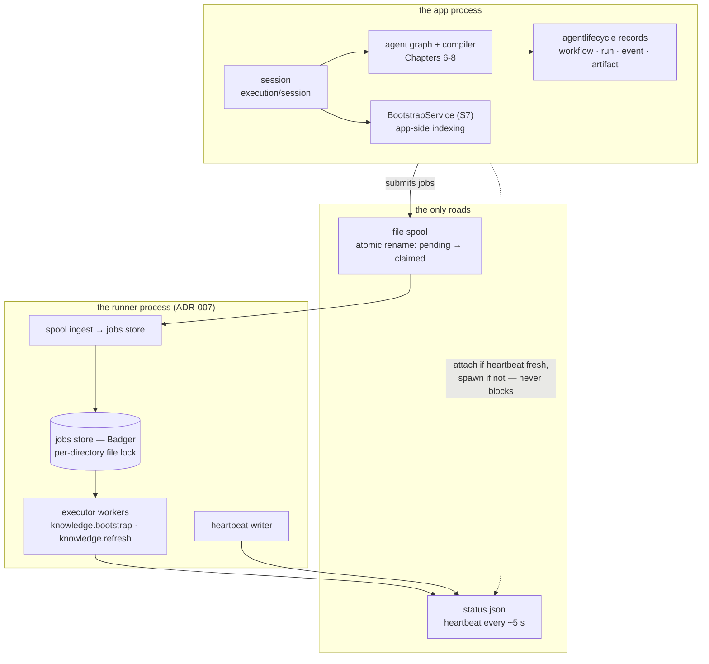
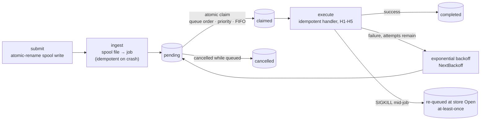

# Chapter 9 — Runtime, Sessions, and the Sidecar

Everything so far happened inside one process: the governed turn, the
compiler, the substrate. This chapter pulls the camera back to the
runtime's *shape* — who opens a workspace session, what a thoughtrecipe
becomes on its way to a graph, and why the durable work of knowledge
maintenance belongs to a second process that communicates with the
first through files and nothing else.

The chapter carries its paradox openly. Its subject, the
`relurpify-runner` sidecar, is the binary Chapter 1 established has
**never shipped** (decision D10). And yet the chapter's lab builds it
from source and watches it queue a job and drain it — because "never
shipped" is a statement about the release path, not about the seam. The
boundary of ADR-007 is real, enforced, and working; this chapter shows
you both halves of that sentence.

> **A note on citations.** Tracked files are cited `path:line`; the
> authoring corpus under `devdocs/` is cited by document and line and is
> not part of the public clone (`.gitignore:41`). Captured at commit
> `1bc57c62`; see the pin note in the front matter.

## Where you are

You need the DAG's two-process shape (Chapter 1), ADR-007 (Chapter 2),
and the substrate (Chapter 7) — the runner exists to execute knowledge
maintenance against it. No model backend, no sandbox; the lab builds
one binary from source.

By the end you will be able to:

1. Name the session and agent-lifecycle contracts and their ownership
   boundaries.
2. Say what a thoughtrecipe becomes between `.erpe` and graph.
3. Walk the durable-jobs contract — at-least-once, atomic claim,
   backoff, idempotent handlers — and the spool's atomic-rename dance.
4. Build and run the sidecar, and read its log as a job lifecycle.

## Technical requirements

| Requirement | Version / notes |
|---|---|
| OS / toolchain | As Chapters 1–8 (Linux primary; toolchain pin `go1.27.2`, `go.mod:5`) |
| Model backend | **Not needed** |
| Sandbox | **Not needed** |
| Extra | ~10 seconds of patience: the lab runs the runner for five of them |

Captured on the Chapter 1 machine, commit `1bc57c62`.

## 9.1 The runtime's shape: sessions and lifecycle

Two packages define the app-side runtime's contracts.

**Sessions.** `execution/session` "provides the app-facing provider
session contract for opening and managing workspace sessions" —
`WorkspaceService`, `WorkspaceSession`, focused controller interfaces,
and the assembly types that construct a session "from app-composed
products" (`execution/session/doc.go:1-4`). The composition root
(Chapter 1's `envcomposition`) builds the products; the session
assembles them into the thing a turn runs inside. Its close-stack and
log-rotation helpers (`session/closestack.go`, `session/logrotate.go`)
are the unglamorous machinery that makes a long-lived TUI process
survive its own runtime.

**Agent lifecycle.** `execution/agentlifecycle` is domain-first by
declaration, and its doc states the ownership boundaries that Chapter 8
relied on without saying so
(`execution/agentlifecycle/doc.go:3-10`):

> - Workflow, run, and delegation records belong to agentlifecycle
> - Runtime event logging belongs to agentlifecycle
> - Lineage bindings used by bridges belong to agentlifecycle
> - Compiler state (compilation records, cache, replay metadata) belongs
>   to execution/compiler
> - Knowledge/retrieval internals belong to their respective packages

The record types are the workflow persistence model (§9.5):
`WorkflowRecord`, `WorkflowRunRecord`, `WorkflowEventRecord`,
`WorkflowArtifactRecord` (`execution/agentlifecycle/types.go:9,17,56,67`), with
projection roles for read models (`:106`). Persistence is delegated
through an adapter interface — the substrate's workflow store implements
it (§9.5).

**Boot's attach-or-spawn decision.** When the app opens a session it
checks the runner's heartbeat: "a live heartbeat in
`<state>/jobs/status.json` (written every ~5 s) plus a PID check means
attach, otherwise the app spawns `relurpify-runner`"; a stale heartbeat
(≥ 15 s) means runner-down; stop is SIGTERM with a 25 s grace, then
SIGKILL (`docs/ARCHITECTURE.md:139-141`). Chapter 6's doctor capture
showed the outcome on every real machine so far: `runner: missing
[warning]` — and `Result: ready`, because a missing runner "degrades
boot; it never blocks it" (`docs/ARCHITECTURE.md:141-142`). The degrade
has a real cost, and it is worth naming: with no runner, the app-side
knowledge bootstrap still runs (Chapter 7's `BootstrapService` — "the
ayenitd adapter that used to host it is gone (S7)",
`context/knowledge/bootstrap_service.go:20-21`), but the *scheduled*
refresh cadence — a runner-side service (`ayenitd/runner.go:113`) —
never fires. The S7 move looks, from here, like the tree reducing its
dependence on a sidecar that has not shipped.

## 9.2 Recipes into graphs (the survey)

Book 2 teaches the thoughtrecipe DSL; this book needs only the
translation step. A `.erpe` document is parsed into a typed `Document`,
and lowering turns it into an `ExecutionPlan`:
`LowerDocument` and `LowerDocumentWithRegistry`
(`named/euclo/thoughtrecipes/lowering.go:19-25` — the registry variant
resolves coordination metadata against the tool vocabulary during
lowering). The plan is what the graph runtime executes; Chapter 11's
DSL goldens pin the lowering byte-for-byte. That is the whole survey:
*document → typed body → execution plan → graph*, with each arrow
validated by lint (Chapter 2's `euclo-*` gates) before a turn ever runs.

## 9.3 The durable jobs queue

The queue's contract is stated in one package doc and it is worth
quoting nearly whole (`jobs/doc.go:4-10`):

> The contract for the durable queue (executed by the ayenitd runner,
> stored by context/jobsstore on Badger): jobs are created by the
> spool-ingesting runner, claimed atomically by executor workers (queue
> order, priority descending, FIFO within a queue), retried with
> exponential backoff (NextBackoff), and cancelled effectively only
> while queued — a running job cannot be cancelled cross-process (no
> channel to the runner); shutdown grace bounds attempts instead.
>
> Delivery is at-least-once (crash recovery at store Open re-queues
> interrupted jobs); handlers MUST be idempotent per Spec.CorrelateID
> (handler.go, H1-H5).

Every clause has a test or a mechanism behind it. The store is Badger
under `context/jobsstore/`, and its mutual exclusion is not a
distributed lock, a database transaction, or a socket — it is "the
per-directory file lock," and the doc says exactly what that buys:
"exactly one [process]…" per directory (`context/jobsstore/jobsstore.go:3-4`),
enforced at `Open` (`:51`). The four e2e tests put the contract on
record (`ayenitd/e2e_runner_test.go:109-310`): `SpoolToCompleted`,
`RecoverAfterHardStop` (the at-least-once clause — a hard-killed
runner's interrupted job is re-queued and completed by the next one),
`LockSingleExecutor` (the second runner cannot take the lock), and
`TelemetryJSONL`. All four pass at the pin (§9.6).

**The kinds.** Two are registered today: `knowledge.bootstrap` and
`knowledge.refresh` (`ayenitd/runner.go:91-94`). The runner also hosts
the *scheduled* refresh submitter — a registered service whose cadence
comes from `--refresh-interval` (`ayenitd/refresh_submitter.go:33-38`,
`ayenitd/runner.go:113`), disabled by default (`0s`,
`docs/CONFIGURATION.md` runner table).

## 9.4 The spool and the sidecar boundary

The app and the runner exchange work through an **atomic-rename file
spool** — the submission edge is files, not sockets, "an atomic-rename
file [spool]: the runner claims files via rename to claimed/,
materializes them as jobs" (`ayenitd/spool.go:1-3`). The design is
crash-first, and the code says so precisely: interrupted-renames leave
`.tmp` debris that a boot sweep bounds and moves (`ayenitd/spool.go:73-74`),
crashes between rename and create "are re-ingested idempotently"
(`:123`), and a `.tmp` left by an interrupted rename is retained in
`failed/` rather than silently dropped (`:140`).

The boundary itself is two prohibitions, one per process. The runner
links no capability, governance, or model code — Chapter 1's DAG row
(`tooling/arch/domaindag.go:57-59`) — because "nothing needing
governance runs in the runner" (ADR-007, `docs/ARCHITECTURE.md:289-296`).
And the app never opens the job store: "the store's per-directory file
lock is the mutual-exclusion primitive"
(`devdocs/HANDOFF-docs/OVERVIEW.md:124`). The spool is the only road
in, the status file is the only road out, and neither road carries
authority. What the boundary buys: background work survives app
restarts (the store outlives the process that submitted), a crashed
runner cannot take governance decisions with it, and the app's hot path
never waits on a Badger lock it does not hold.

And then D10, stated plainly one more time: the runner **has never
shipped**. Every release archive in this project's history lacks the
binary; every real boot has degraded. What the lab below shows is that
the *seam* is complete — build it, point it at a workspace, and it
does its job. The gap is distribution, not design.

The topology, and the job's path through it:





## 9.5 Workflow persistence

What does `/workflows` read? The lifecycle records of §9.1 — workflow,
run, event, and artifact records — persisted through the
`WorkflowStateStore` interface that the substrate's memory store
implements (`context/knowledge/memory/workflow_store.go:14-28`:
`CreateWorkflow`, upserts for runs and artifacts), with projections
shaped by `WorkflowProjectionRole`
(`execution/agentlifecycle/types.go:106`). The persistence lives under
the substrate's roof because workflow state is workspace state; the
*records* live in `agentlifecycle` because their lifecycle semantics
are runtime semantics — the ownership split of §9.1, applied.

## 9.6 Hands-on: build the sidecar, queue a job, watch it drain

The lab (`docs/relurpic-internals/labs/ch09-runtime/`) does what the
chapter title promises — with the binary built from source, since no
release carries it.

**1. Build the runner.**

```bash
go build -o /tmp/relurpify-ch09/relurpify-runner ./ayenitd/cmd/relurpify-runner
```

Clean build. The command's own doc (`ayenitd/cmd/relurpify-runner/main.go:1-6`)
announces the contract: flags `--workspace --state-dir --queues
--workers --refresh-interval`, exit codes 0 clean drain / 1 lock held /
2 usage, and — Chapter 4's boundary holding — "reads no process env
directly (AGENTS.md)."

**2. Run it for five seconds, with scheduled refresh on.**

```bash
timeout 5 /tmp/relurpify-ch09/relurpify-runner \
  --workspace /tmp/ch09-ws --state-dir /tmp/ch09-state \
  --workers 1 --refresh-interval 500ms
```

Captured: the runner creates `ast/`, `jobs/{spool,store}`, `logs/`
under the state dir; writes `status.json` whose `started_at` and
`heartbeat_at` are five seconds apart (the ~5 s heartbeat, live); and
exits on the SIGTERM. The log, `logs/runner.jsonl`, is the job
lifecycle in five lines:

```
{"type":"runner.started", … "workspace":"/tmp/ch09-ws"}
{"type":"job.submitted","message":"spool file ingested", …
  "kind":"knowledge.refresh","producer":"relurpify-runner", …}
{"type":"job.claimed","message":"job claimed", …
  "kind":"knowledge.refresh","worker":"worker-0"}
{"type":"job.claimed","message":"knowledge.refresh complete", …
  "marked_stale":0}
{"type":"job.completed", … "duration_ms":0,"kind":"knowledge.refresh"}
{"type":"runner.stopped", …}
```

Read it against §9.3's contract: the runner *self-submits* a scheduled
refresh (producer `relurpify-runner` — the submitter of
`ayenitd/refresh_submitter.go:33-38`), an executor worker claims it atomically,
the handler runs (idempotently — `marked_stale: 0` on an empty
substrate), and the job completes. Queue a job, watch the runner drain
it: done, with the queue's own machinery doing both halves.

**3. The contract, under stress.**

```bash
go test ./ayenitd -run TestRunnerE2E -count=1 -v
```

Captured: `SpoolToCompleted` (0.50s), `RecoverAfterHardStop` (0.12s —
at-least-once, by name), `LockSingleExecutor` (0.10s — the second
runner cannot take the lock), `TelemetryJSONL` (0.31s). All pass.

### Verification block

| Chapter claim | Where captured | Lab file |
|---|---|---|
| Runner builds from source and runs clean | §9.6 step 1 | `transcript.txt` §1 |
| Heartbeat ~5 s in `status.json`; SIGTERM stop | §9.6 step 2 | `transcript.txt` §2 |
| Scheduled refresh self-submits, claims, completes | §9.6 step 2 | `transcript.txt` §2 |
| At-least-once, single-executor lock, telemetry leg | §9.6 step 3 | `transcript.txt` §3 |
| Runner links no capability/governance/model | §9.4 | manual: `tooling/arch/domaindag.go:57-59`, `ayenitd/cmd/relurpify-runner/main.go:1-6` (command doc) |
| Session/lifecycle ownership boundaries | §9.1, §9.5 | manual: `execution/session/doc.go:1-4`, `execution/agentlifecycle/doc.go:3-10` |

## Summary

- The runtime is two processes with one road between them: the app's
  session assembles composed products into a workspace session; the
  runner drains a spool into a Badger-backed jobs store it holds under
  a file lock. Neither opens the other's store; neither carries the
  other's authority.
- The lifecycle records (workflow, run, event, artifact) are
  agentlifecycle's; their persistence is the substrate's
  `WorkflowStateStore` — ownership split as architecture.
- The jobs contract is at-least-once with atomic claim, backoff, and
  mandatory idempotency per correlation ID; the spool's atomic-rename
  dance treats crashes as expected events with named debris paths.
- ADR-007's boundary is a DAG row the runner cannot cross and a lock
  the app must not take; what it buys is crash isolation and a
  governance-free background.
- The sidecar has never shipped (D10) — and the lab builds it and
  watches it work. The gap is the release path, not the seam; the S7
  move of bootstrap into the session reads as the tree hedging that
  gap.

## Check yourself

1. Why can't the app simply drain the spool itself and skip the second
   process? Give the mechanism, not the philosophy.
2. A runner is SIGKILLed mid-job. What happens to the job, which e2e
   test pins the behavior, and what does the contract demand of the
   *handler* as a result?
3. The runner wants to check a capability's trust class before running
   a job. Why can it not — and where would the check have to live?
4. With no runner on a real machine (D10), which knowledge maintenance
   still happens, and which does not? Name the S7 decision that shaped
   this.
5. `relurpify-runner --refresh-interval 500ms` self-submits work. Who
   is the producer on the spool file, and why can the runner claim its
   own submission without deadlock?

*Answers.* 1. The job store's per-directory file lock is the
mutual-exclusion primitive (`context/jobsstore/jobsstore.go:3-4`): the app never opens
the store (`devdocs/HANDOFF-docs/OVERVIEW.md::124`), so the spool is the app's only write and
the runner is the only claimer — the second process is what makes the
lock simple. 2. Store open re-queues interrupted jobs (at-least-once,
`jobs/doc.go:9`); `TestRunnerE2E_RecoverAfterHardStop` pins it; the
contract demands handlers idempotent per `Spec.CorrelateID`
(handler.go H1-H5) because the job will run again. 3. It cannot import
governance at all — `ayenitd`'s allowed imports exclude capability,
governance, and model (`tooling/arch/domaindag.go:57-59`, ADR-007). The check lives
in the admission pipeline of the process that *invokes* capabilities —
the app (Chapter 6's step 4). 4. App-side bootstrap indexing still runs
(`BootstrapService` registered directly by the workspace session — S7
moved it out of the ayenitd adapter, `context/knowledge/bootstrap_service.go:20-21`);
the scheduled `knowledge.refresh` cadence never fires — it is a
runner-side service (`ayenitd/runner.go:113`). 5. Producer
`relurpify-runner` (the scheduled submitter's spool write,
`ayenitd/refresh_submitter.go:33-38`); no deadlock because submission and
claiming are file operations on different directories — the spool's
pending/claimed rename — and the runner ingests its own spool files
like any other, with the idempotency contract covering the double
presence.

## Try it yourself

1. **Take the lock.** Start the runner in one terminal against a
   scratch state dir; start a second instance with the same
   `--state-dir`. Observe the exit code (the command doc promises 1 for
   "store lock held"), then find the enforcement in
   `context/jobsstore/jobsstore.go:51`.
2. **Crash it on purpose.** Submit a refresh job, SIGKILL the runner
   mid-drain, restart it, and find the re-queue line in
   `logs/runner.jsonl`. Which of the four e2e tests did you just
   perform by hand?

## Where next

The runtime runs, but what did it *record*? Chapter 10 closes Part II
with telemetry as the nervous system: OpenTelemetry everywhere, the
local OTLP-JSON segments with 7-day retention, attribute projection as
the privacy boundary, and the chapter's thesis — a run reconstructed
from telemetry alone is the standard of understanding this book aims
for. You have already seen one leg of it: Chapter 5's AC-3 check.

The lab for this chapter lives in
`docs/relurpic-internals/labs/ch09-runtime/` — the command card, the
captured transcript from the pin, and `verify.sh ch09` to check your
machine against the deterministic outputs.
