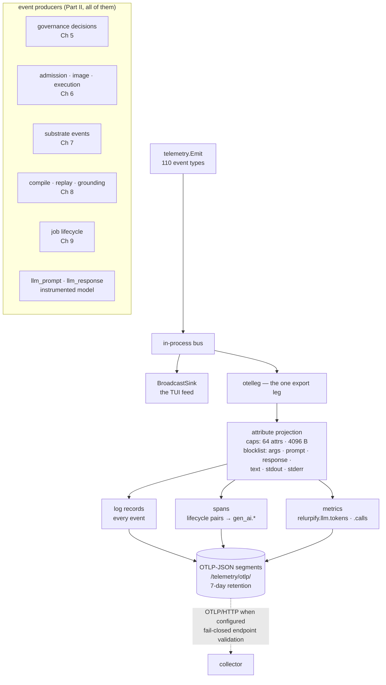
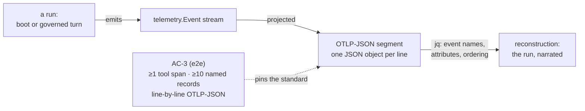

# Chapter 10 — Telemetry as the Nervous System

Every chapter of Part II left a trace. Chapter 5 decided and audited;
Chapter 6 admitted and executed; Chapter 7 stored; Chapter 8 compiled
and grounded; Chapter 9 drained a spool. This chapter is where all of
those traces converge — because in this runtime they converge by
design, into **one output leg**: an OpenTelemetry export that turns the
runtime's internal event vocabulary into the three OTel signals, writes
them as local OTLP-JSON segments, forwards them to a collector when one
is configured, and projects every record through a privacy boundary
before it leaves the process.

The chapter's thesis is the standard this book has been quietly
applying since Chapter 5: **a run reconstructed from telemetry alone is
the standard of understanding this book aims for.** Not "read the code
and trust it" — reconstruct. The lab does exactly that: boots a runtime
in a scratch workspace, then reads the run back out of its OTLP-JSON
segments, event by event, attribute by attribute.

> **A note on citations.** Tracked files are cited `path:line`; the
> authoring corpus under `devdocs/` is cited by document and line and is
> not part of the public clone (`.gitignore:41`). Captured at commit
> `1bc57c62`; see the pin note in the front matter.

## Where you are

You have seen the telemetry leg three times already without touring it:
Chapter 5's HITL decisions feed a `DecisionSink`; Chapter 6's unpinned
image warning *is* a telemetry event; Chapter 9's runner wrote a JSONL
telemetry stream. This chapter is the tour. No model backend, no
sandbox; `jq` earns its place in the front matter's requirements list
here.

By the end you will be able to:

1. Name the one export leg, its two sinks, and why it deliberately does
   not import userconfig.
2. Map the internal event vocabulary onto the three OTel signals.
3. State the attribute projection's caps and blocklist — and the one
   deliberate non-block.
4. Reconstruct a boot (and verify a turn) from telemetry segments
   alone.

## Technical requirements

| Requirement | Version / notes |
|---|---|
| OS / toolchain | As Chapters 1–9 (Linux primary; toolchain pin `go1.27.2`, `go.mod:5`) |
| Model backend | **Not needed** |
| Sandbox | **Not needed** |
| Extra | `jq` for segment inspection |

Captured on the Chapter 1 machine, commit `1bc57c62`.

## 10.1 One leg: OpenTelemetry, two sinks

The export leg announces its own scope
(`telemetry/otelleg/doc.go:1-9`):

> Package otelleg is the single OpenTelemetry export leg for relurpify.
>
> It consumes the internal telemetry.Event vocabulary (via
> telemetry.Telemetry) and exports OTel traces, log records, and metrics
> through exactly two sinks: OTLP/HTTP when an endpoint is configured,
> and an always-available local OTLP-JSON segment store. It is the only
> output besides the in-process BroadcastSink.
>
> The package deliberately does not import userconfig: the telemetry
> domain must not depend on configuration decoding.

Three design decisions live in those nine lines. **One leg**: every
event the runtime emits has exactly one observability exit — no package
ships its own log format, no subsystem dials a collector directly.
**Two sinks**: an OTLP/HTTP forwarder *when configured*, and a local
segment store that is *always* on — telemetry never depends on the
network being up. **No userconfig import**: the boundary discipline of
Chapter 4, mirrored — the telemetry domain receives resolved `Settings`
from a wiring site rather than decoding configuration itself
(`telemetry/otelleg/doc.go:8-9`). The OpenTelemetry dependency is real, not decorative:
`go.opentelemetry.io/otel v1.45.0` with the three OTLP/HTTP exporters
(logs, metrics, traces) and `otel/log` (`go.mod:19-24`).

The observability doc states the projection, signal by signal
(`devdocs/observability.md:14-25`):

| OTel signal | Source | Shape |
|---|---|---|
| Log records | every `telemetry.Event` | event name, severity, body, projected attributes |
| Spans | lifecycle event pairs (`graph`, `node`, `agent`, `delegation`, `llm`, `tool`, `capability`) | `span_assembler.go` pairs start/finish and stamps `gen_ai.*` attributes |
| Metrics | usage/perf counters | `relurpify.llm.tokens`, `relurpify.llm.calls`, perfstats |

The span table's `gen_ai.*` is worth pausing on: the assembler stamps
OpenTelemetry's *GenAI semantic conventions* — `gen_ai.request.model`,
`gen_ai.system` (`telemetry/otelleg/span_assembler.go:453-454`) — so an
LLM lifecycle span in this local runtime is shaped like an LLM span
anywhere in the OTel ecosystem. The runtime speaks the ecosystem's
vocabulary, not a private dialect.

## 10.2 The event vocabulary, read systematically

The internal vocabulary is 110 event types
(`telemetry/telemetry_types.go`), and you have already met several
without counting: `llm_prompt` / `llm_response` (emitted by
`platform/llm/instrumented_model.go` — observability.md:29-31),
`tool.edited`, `graph.branch_merged`. The live capture below adds
others: `sandbox.image_unpinned` — Chapter 6's pin warning, which you
can now see *is* an event — plus `state_change`,
`grounding.ports_unwired`, `context_policy_reloaded`, and
`runtime.shutdown_drain`.

Reading the vocabulary systematically means reading it as the run's
narrative voice: lifecycle events pair into spans; decision events
carry what was decided (Chapter 5's `DecisionSink`); state events carry
what the runtime believes about itself. Chapter 6's insertion decision,
Chapter 8's compile events, Chapter 9's job lifecycle — all of it
narrates through this one vocabulary, which is what makes
reconstruction (§10.5) possible at all.

## 10.3 Segments: OTLP-JSON with a 7-day memory

Locally, the chain writes **OTLP-JSON segments** — one JSON object per
line, valid OTLP/HTTP JSON bodies — under
`<state>/telemetry/otlp/relurpify-<date>.jsonl`
(`devdocs/observability.md:21-22`; the writer's prefix is `relurpify`,
`telemetry/otelleg/segment_writer.go:17`). The segment writer is
self-managing: it "prunes segments older than the retention window"
(`telemetry/otelleg/segment_writer.go:21-22,220`), and the default retention is
`168 * time.Hour` — seven days to the hour
(`telemetry/otelleg/settings.go:20`), with a max segment size also
configurable (`telemetry/otelleg/chain.go:146`).

Forwarding is the other sink: `Settings.Endpoint` accepts a full
OTLP/HTTP URL or a bare `host:port` (`telemetry/otelleg/settings.go:133-135`), and its
validation is fail-closed in the Chapter 2 mold — "a bad endpoint, a
missing CA file, an out-of-range sampling [rate]" are load-bearing
failures under gate D9 (`telemetry/otelleg/settings.go:101`). A collector is optional;
the local store is not. Your run's telemetry exists even when nothing
is listening.

## 10.4 Attribute projection: the privacy boundary

Before any record reaches either sink, it passes through projection
with caps and a blocklist (`devdocs/observability.md:34-40`):

> `telemetry/otelleg/attributes.go` projects event metadata onto OTel
> attributes with caps (64 attributes, 4096 bytes each) and a
> **blocklist**. These keys are never projected:
>
> ```
> args · prompt · response · text · stdout · stderr
> ```
>
> The rule is intentional: raw payloads — prompt bodies, model output,
> tool arguments, command output — must not reach the telemetry
> backend. `text_preview` is deliberately *not* blocked because
> `platform/llm` clips it to 1024 chars by construction.

This is the third layer of the same idea you have now seen three
times. The audit chain (Chapter 5) records *decisions* without
payloads. The insertion decision (Chapter 6) decides what the *model*
sees. Attribute projection decides what the *record* keeps. A prompt
body can be visible to the model, stored under contract by the
substrate, and still never leave the process through telemetry — the
boundaries are independent, and each is enforced where it lives.

What telemetry *does* carry about an LLM turn is exactly the decision
metadata: "the model, tool-calling mode, finish reason, token usage,
the tool names offered, the structured `tool_calls`, and the clipped
`text_preview`" (`devdocs/observability.md:43-45`) — the events being
`llm_prompt` / `llm_response` from the instrumented model. Even under
debug, raw bodies appear only as metadata the projection then blocks:
"telemetry is not the place for raw bodies" (observability.md:46-47).

## 10.5 The thesis, demonstrated

The tree holds itself to the reconstruction standard. The e2e turn's
AC-3 check requires that "the turn's telemetry must reach the durable
OTLP-JSON leg — at least one tool span, at least ten named log records,
and a segment file that parses line-by-line as OTLP-JSON"
(`app/relurpish/e2e/boot_turn_test.go:252-257`). And the operator's
window is documented for humans: "Inspecting state" in RELURPISH
(`docs/RELURPISH.md:171`) — end-user-facing inspection, distinct from
this internal leg (observability.md:8-10).

Here is the thesis executed on a boot. In a scratch workspace, one
script-safe command boots the whole runtime:

```bash
/tmp/relurpify-ch06/relurpish status --workspace /tmp/ch06-ws --format json
ls /tmp/ch06-ws/.relurpify_state/telemetry/otlp/
# relurpify-2026-10-23.jsonl
```

Eight OTLP-JSON lines — and `jq` reads the run out of them:

```bash
jq -r '.resourceLogs[0].scopeLogs[0].logRecords[]?.eventName' \
  /tmp/ch06-ws/.relurpify_state/telemetry/otlp/relurpify-2026-10-23.jsonl | sort | uniq -c
```

Captured (counts vary; the *names* are the reconstruction):

```
     1 sandbox.image_unpinned
   211 state_change
     1 grounding.ports_unwired
     1 context_policy_reloaded
     1 runtime.shutdown_drain
```

A boot narrated entirely by its telemetry: the pin warning you know
from Chapter 6, the readiness state machine ticking through
`state_change` records as the doctor's checks resolve, the grounding
seam reporting itself, the policy bundle reloading, the shutdown drain.
The attribute keys across the segment are decision metadata —
`agent_id`, `capability_id`, `provider`, `fingerprint`,
`security_event` — and not one payload key (§10.4's blocklist, working).

That is the chapter's standard in one command: **the boot, reconstructed
from telemetry alone** — and the AC-3 check applies the same standard
to a full governed turn.





## 10.6 Hands-on: reconstruct a run from telemetry alone

The lab (`docs/relurpic-internals/labs/ch10-telemetry/`) captures the
boot reconstruction end to end, plus the turn leg.

**1. Boot and read back.** As §10.5: scratch workspace, one
`status` command, then `jq` over the segment — event names, attribute
keys, the segment's line count.

**2. The turn leg.**

```bash
go test ./app/relurpish/e2e -run TestBootTurnToolCall -count=1
```

Captured: `ok … 0.125s` — the AC-3 check inside it verified the
turn's telemetry reached the durable leg (≥1 tool span, ≥10 named log
records, line-by-line OTLP-JSON).

**3. The projection, verified at its site.** Read the blocklist and
caps in `telemetry/otelleg/attributes.go`, then confirm against the
captured segment: no `args`, `prompt`, `response`, `text`, `stdout`,
or `stderr` key appears — and `text_preview` would, on an LLM turn,
because the instrumented model clips it before emit.

**4. Forwarding (boxed).** Pointing the leg at a local OTLP/HTTP
collector is configuration, not code: set the telemetry endpoint in the
workspace config (Chapter 4's boundary — the wiring converts it to
`Settings`), restart, and the second sink activates. The lab boxes this
per the plan: no collector is assumed, and the fail-closed validation
path (`telemetry/otelleg/settings.go:101-135`) is the testable half.

### Verification block

| Chapter claim | Where captured | Lab file |
|---|---|---|
| Boot reconstructed from one segment (event names, attribute keys) | §10.6 step 1 | `transcript.txt` §1 |
| Turn telemetry reaches the durable leg (AC-3) | §10.6 step 2 | `transcript.txt` §2 |
| Blocklist keys absent from a real segment | §10.6 step 3 | `transcript.txt` §3 |
| 7-day retention default | §10.3 | manual: `telemetry/otelleg/settings.go:20` |
| Fail-closed endpoint validation | §10.6 step 4 (boxed) | manual: `telemetry/otelleg/settings.go:101-135` |
| gen_ai.* conventions on LLM spans | §10.1 | manual: `telemetry/otelleg/span_assembler.go:453-454` |

## Summary

- One output leg: `otelleg` consumes the 110-type internal event
  vocabulary and exports three OTel signals through exactly two sinks —
  OTLP/HTTP when configured, an always-on local OTLP-JSON segment store
  — with the TUI broadcast as the only other output. The leg
  deliberately does not import userconfig.
- Spans pair lifecycle events and stamp OTel's GenAI conventions
  (`gen_ai.request.model`, `gen_ai.system`); metrics carry usage
  counters; every event becomes a log record.
- Segments live at `<state>/telemetry/otlp/relurpify-<date>.jsonl`,
  pruned on a 7-day default retention; forwarding is optional and its
  endpoint validation fails closed.
- Attribute projection is the privacy boundary: 64 attributes, 4096
  bytes each, six blocked keys — args, prompt, response, text, stdout,
  stderr — with `text_preview` deliberately safe by upstream clipping.
  Decisions travel; payloads never do.
- The reconstruction standard is enforced by the tree itself (AC-3)
  and demonstrated here: a boot, read back out of its segments, event
  by event.

## Check yourself

1. Why must `otelleg` not import `userconfig`, and who converts
   configuration into `Settings`? Which earlier chapter's discipline
   is this?
2. A prompt body is visible to the model during a turn. Name the three
   independent boundaries that each answer a different "who may see
   it," and what each one keeps.
3. Your collector is down and the network is flaky. What does the run
   still produce, and where?
4. `text_preview` carries model output, yet it is not blocklisted. What
   makes it safe, and where does the clipping happen?
5. The AC-3 check demands "at least one tool span." Which lifecycle
   event *pairs* produce a tool span, and which OTel conventions stamp
   its LLM cousin?

*Answers.* 1. "The telemetry domain must not depend on configuration
decoding" (`telemetry/otelleg/doc.go:8-9`) — wiring sites convert the resolved
userconfig telemetry section into `Settings`; this is Chapter 4's
boundary discipline mirrored (the consumer receives resolved objects,
it never decodes). 2. The insertion decision (what the *model* sees —
Chapter 6), the substrate's storage contract (what the *ledger* keeps —
Chapter 7), and attribute projection (what the *record* keeps — here).
Each is enforced where it lives; none implies the others. 3. The local
OTLP-JSON segment store — it is "always-available" (`telemetry/otelleg/doc.go:5-6`)
and the hot path is a file write; forwarding resumes when the endpoint
returns. 4. The instrumented model clips `text_preview` to 1024 chars
*by construction* before emitting (`platform/llm/instrumented_model.go`;
observability.md:40-42) — the projection trusts the upstream invariant.
5. A tool's lifecycle start/finish event pair, assembled by
`span_assembler.go`; the LLM cousin is stamped with `gen_ai.request.model`
and `gen_ai.system` (`telemetry/otelleg/span_assembler.go:453-454`).

## Try it yourself

1. **Trace one emitter.** Pick `tool.edited` from the vocabulary
   (`telemetry/telemetry_types.go`), find its emit site, and name the
   user action that triggers it. You are one `grep` away from the
   nervous system's reflex arc.
2. **Feel the fail-closed validation.** Set a malformed telemetry
   endpoint (e.g. `http://[::1`) in a scratch workspace config and
   observe the boot's reaction; then read `telemetry/otelleg/settings.go:101-135` and
   match each validation branch to what you saw.

## Where next

Part II is complete: substrate, compiler, runtime, sidecar, nervous
system. Part III turns to you, the contributor: Chapter 11 opens the
test estate — the three layers, agenttest and its OSB assertion kinds
(disambiguated from suite run tiers per the plan), tapes, goldens, and
the coverage floor — and Chapter 12 walks the merge path and the
pathway map that ends in your first PR.

The lab for this chapter lives in
`docs/relurpic-internals/labs/ch10-telemetry/` — the command card, the
captured transcript from the pin, and `verify.sh ch10` to check your
machine against the deterministic outputs.
