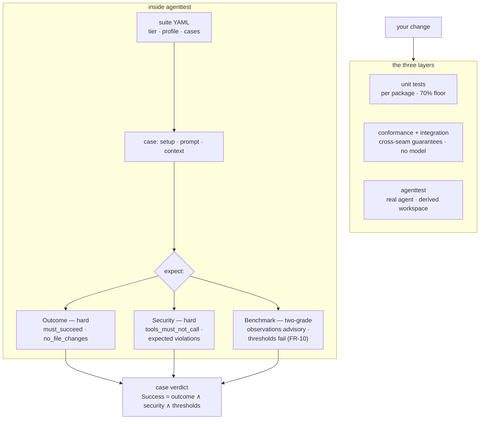
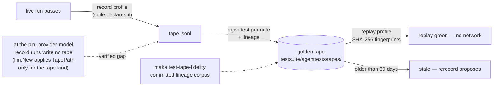

# Chapter 11 — The Test Estate

Everything Chapters 5–10 taught you about the runtime — decisions,
sandbox, substrate, compiler, sidecar, telemetry — is held in place by
a test estate with three layers and a vocabulary of its own. This
chapter tours the estate as a working system, then goes deep on its
centerpiece: **agenttest**, the automated benchmark-testing suite for
Euclo — how a suite is written, how the runner executes it, and how the
Outcome-Security-Benchmark (OSB) assertion model grades what a run did.

The chapter carries two honest finds from its own lab. First, the
word *advisory* — the docs grade the Benchmark kind "soft," and the
code grades it in two ways at once. Second, the tape lifecycle's
record half: at the pin, a passing record run writes no tape, and this
chapter shows you exactly where the wiring stops. Both are verified
against the tree, both are stated as first-PR material, and neither is
smoothed over.

> **A note on citations.** Tracked files are cited `path:line`; the
> authoring corpus under `devdocs/` is cited by document and line and is
> not part of the public clone (`.gitignore:41`). Captured at commit
> `1bc57c62`; see the pin note in the front matter.

## Where you are

You need Chapters 5–10: the OSB model grades the governed behavior you
have been studying, and its telemetry hints read the event vocabulary
of Chapter 10. **This chapter's lab needs a live model** — it is the
book's first: `gemma4:e4b` served by Ollama (the Book 1 setup). The
gates half of the lab needs nothing.

By the end you will be able to:

1. Choose the right test layer for a change, and name what each layer
   pins.
2. Read a suite YAML — setup, prompt, and the three OSB `expect` blocks
   — and predict its verdicts.
3. Explain the profile matrix, and why `--profile` is a filter, not an
   override.
4. Walk the tape lifecycle — and state precisely where its record half
   currently stops.

## Technical requirements

| Requirement | Version / notes |
|---|---|
| OS / toolchain | As Chapters 1–10 (Linux primary; toolchain pin `go1.27.2`, `go.mod:5`) |
| Model backend | **Needed for the live lab**: Ollama serving `gemma4:e4b` (Book 1, Chapter 1) |
| Sandbox | Not required for the lab's read-only case |
| Extra | None — `dev-agent` builds from the tree |

Captured on the Chapter 1 machine, commit `1bc57c62`.

## 11.1 Three layers, one estate

The testing doc's own routing table
(`docs/TESTING.md:121-126`) is the chapter in miniature:

- **Pure logic change** → unit tests in the package (the `go test`
  runs this book has been capturing since Chapter 1).
- **A cross-seam guarantee** (policy, visibility, boundary) → framework
  integration test or conformance suite.
- **End-user-visible agent behavior** → an agenttest case, then
  "record a tape from a passing live run and promote it"
  (`docs/TESTING.md:124-125`).
- **Recipe DSL change** → the byte-identical DSL goldens, deliberately
  re-baselined.

The infrastructure map (`docs/TESTING.md:129-136`) locates each piece:
the harness in `testsuite/agenttest/`, suites and tapes in
`testsuite/agenttests/`, conformance in `testsuite/conformance/`,
per-agent adapters in `testsuite/subjects/`, and the coverage gate in
`tooling/coverage/`. The lab's verification block will touch all four.

## 11.2 agenttest: how it works

Suites are YAML files in `testsuite/agenttests/` named
`euclo.<name>.testsuite.yaml`. "Each case runs the real agent in a
derived temp workspace with setup fixtures and a model matrix, then
asserts" (`docs/TESTING.md:22-25`) — the `dev-agent` binary (Chapter
1's binary map) builds the runtime per test case. Five subcommands
drive the lifecycle (`dev-agent agenttest --help`): `run`, `promote`,
`report`, `rerecord`, and `baseline`.

A case's anatomy, from the shipped baseline suite
(`testsuite/agenttests/euclo.baseline.chat.testsuite.yaml:38-77`):

```yaml
- name: chat_ask_baseline
  task_type: analysis
  tags: [baseline, ask, level:1]
  setup:
    files:
    - path: testsuite/fixtures/euclo_baseline_chat/user.go
  prompt: Explain what the User type … represents.
  context:
    context_file_contents: […]
    extensions:
      euclo: {mode: chat}
  expect:
    outcome:
      must_succeed: true
      no_file_changes: true
    security:
      tools_must_not_call: [file_write]
    benchmark:
      tools_expected: [file_read]
      tools_not_expected: [go_test]
```

`setup` seeds the derived workspace; `prompt` and `context` drive the
turn; `expect` carries the three OSB blocks — one per assertion kind.

**The profile matrix — and the filter.** Six profiles select where
model traffic comes from: `live`, `record`, `replay`,
`developer-live`, `ci-live`, `ci-replay` (`docs/TESTING.md:35-45`;
replay needs no network). The flag's help says `--profile` *overrides*
the execution profile — but the code *filters*: `MatchesProfile`
requires the requested profile to equal the suite's declared effective
profile, and only an *empty* request matches everything
(`testsuite/agenttest/suite.go:701-709`). This book's suite declared
`live` and `--profile record` was rejected outright ("no testsuites
matched the requested filters" — captured, §11.6). To record, the
suite must *declare* record. The distinction matters when you automate
estate runs; the help text will not teach you that.

## 11.3 The OSB assertion kinds

The model's table (`docs/TESTING.md:29-33`) is three lines long:

| Kind | Hardness | Asserts |
|---|---|---|
| Outcome | hard | What the run achieved |
| Security | hard | The sandbox contract, including expected violations |
| Benchmark | soft | Telemetry hints (calls, tokens, phases) |

**Outcome** asserts achievement: `must_succeed`, `no_file_changes`,
mode expectations. **Security** asserts the sandbox contract — and
note the subtlety in the table's third cell: *including expected
violations*. A case may demand that a protected path deny a tool, and
the security evaluator maps capability identifiers to OSB security
observations (`testsuite/agenttest/runner.go:314`). Security failures
fail the case (`testsuite/agenttest/runner.go:673-678`).

**Benchmark** reads the telemetry hints of Chapter 10 — and here the
book owes you a correction to the table's single word *soft*. The
evaluator's comment is precise
(`testsuite/agenttest/benchmark_evaluator.go:24-26`):

> Thresholds (`max_tool_calls_hint`, `max_total_tool_time_hint_ms`,
> `tool_call_latency_ms`, `token_budget`) and negative assertions
> (`tools_not_expected`) fail the case when violated (FR-10).

and the runner enforces it: a benchmark threshold breach sets
`report.Success = false` with failure kind `benchmark`
(`testsuite/agenttest/runner.go:698-705`), counted as an assertion
failure in the suite verdict (`testsuite/agenttest/runner.go:490-500`). Meanwhile
`llm_calls_expected` is a pure observation — recorded, compared,
*never* failing (`testsuite/agenttest/benchmark_evaluator.go:144-153`). So the
implementation is **two-grade**: expected-value hints are advisory
measurements; threshold hints are hard. The docs' single word "soft"
flattens that, and this book reports the divergence rather than
resolving it — aligning the docs with the code (or splitting the
benchmark tier's two behaviors) is first-PR material, in the same
family as Chapter 2's bucket-threshold gap.

**Tiers are the other axis — keep them separate (the plan's D2a
rule).** The suite YAML's `tier:` field — `smoke | stable |
live-flaky | quarantined` — controls *when suites run* (PR smoke, merge
gate, quarantined live runs — `docs/TESTING.md:108-115`). The OSB
kinds control *what a case asserts*. One word, two meanings; wherever
both are in play, this book says **assertion kinds** for OSB and
**run tiers** for the YAML field.

## 11.4 Tapes — and where the record half stops

Tapes are "fingerprinted record/replay fixtures for LLM traffic"
(`docs/TESTING.md:48-49`): replay matches requests by SHA-256
fingerprint, "a mismatch is an actionable re-record error, never a
silent pass"; promotion turns a passing live run into a golden fixture
with lineage; a tape older than 30 days is stale, and `agenttest
rerecord` proposes the refresh; the committed lineage lives under
`testsuite/agenttests/tapes/` and `make test-tape-fidelity` enforces
replay coverage (`docs/TESTING.md:50-56`).

The machinery exists end to end — the `TapeModel` has a record mode
(`platform/llm/tape_model.go:29`), the run descriptor carries a tape
path (`testsuite/agenttest/run_descriptor.go:164`), and `promote`
consumes it. But the wiring has a gap at the pin, and the lab hits it
live: a passing `record`-profile run of a provider-model case writes
**no tape at all**. The reason is visible in the factory:
`llm.New` dispatches on kind, and only the `tape` kind reads
`TapePath` — and only for replay
(`platform/llm/factory.go:57-62`; `platform/llm/providers_tape.go:29`
builds the model with `TapeReplay`). The record wrapper is never
applied to provider backends, so `promote` fails with the honest
error the lab captures: `case "stringkit_osb_read" tape invalid: open
…/tape.jsonl: no such file or directory`. The estate's *replay* half
is verified against the committed corpus
(`make test-tape-fidelity` — `ok`, captured); the *record* half for
provider models is the estate's open seam, and wiring the recorder
into the provider kinds is this chapter's first-PR candidate.

## 11.5 Conformance, goldens, and the coverage floor

**Conformance** (`testsuite/conformance/`) pins what must not drift
between tool-calling modes: traversal/grep/edit parity, visibility and
no-leak guarantees for tool results, grant semantics and output-ceiling
spill (`docs/TESTING.md:58-63`). It needs no live model, and CI runs
it — captured at the pin: `ok … 1.020s` under `make test-conformance`.

**Goldens** come in two systems: DSL goldens — plan/graph/trace
triples for thoughtrecipes, byte-identical by policy — and TUI panel
snapshots (`docs/TESTING.md:65-72`). The golden discipline is stated
as a rule of judgment, and it is quoted here because it will meet you
in your first PR: "A golden diff is a design question first and a
mechanical update second" (`docs/TESTING.md:74`). The mutation test
proves the goldens bite — `TestGoldenTraceFailsOnMutation` passes at
the pin (`make test-euclo-golden`, captured).

**Coverage** has a floor of 70% per package, built and enforced by the
coverage gate (`docs/TESTING.md:76-80`; `make test-coverage`,
`tooling/coverage/`) — with an integration-surface exemption documented
in CONTRIBUTING.





## 11.6 Hands-on: author a suite, run it, and meet the gap

The lab (`docs/relurpic-internals/labs/ch11-test-estate/`) authors a
suite exercising all three OSB assertion kinds against stringkit — the
Book 1 fixture — and then follows the tape lifecycle as far as the pin
allows. The suite ships as a lab fixture and, for discovery, as
`testsuite/agenttests/euclo.stringkit.osb.testsuite.yaml`.

**1. Author.** The suite declares tier `smoke`, profile `record`, one
read-only case over `stringkit.py`, and all three `expect` blocks:
outcome (`must_succeed`, `no_file_changes`), security
(`tools_must_not_call: [file_write]`), benchmark (`max_tool_calls_hint:
6`, `tools_expected: [file_read]`, `tools_not_expected: [file_write,
go_test]`). Discovery lesson learned the hard way: suites are
discovered from `testsuite/agenttests/` — the same file outside that
directory never matches (`tooling/dev-agent-cli/agenttest_cmd.go:105-127`).

**2. Run it live.** With `gemma4:e4b` served:

```bash
dev-agent agenttest run \
  --suite testsuite/agenttests/euclo.stringkit.osb.testsuite.yaml \
  --profile record --out /tmp/ch11-run
```

Captured: `euclo.stringkit.osb.testsuite.yaml [record]: 1/1 passed
(0 infra, 0 assertion)` — and the runtime's governance visible in the
log: the tool-admission warning from Chapter 5 and a
`sandbox.denied{… reason="protected path: …/relurpify_cfg"}` from
Chapter 6. A real governed turn, graded by three assertion kinds.

**3. Promote — and meet the gap.**

```bash
dev-agent agenttest promote --run /tmp/ch11-run --all \
  --suite testsuite/agenttests/euclo.stringkit.osb.testsuite.yaml
```

Captured: `case "stringkit_osb_read" tape invalid: open
…/execution/artifacts/tape.jsonl: no such file or directory` — the
record run wrote no tape (§11.4). Verify the wiring gap at its site:
`platform/llm/factory.go:57-62` and `platform/llm/providers_tape.go:29`.

**4. The replay half, verified.**

```bash
make test-tape-fidelity   # ok — committed lineage corpus
make test-conformance     # ok — cross-seam guarantees, no model
make test-euclo-golden    # PASS — incl. TestGoldenTraceFailsOnMutation
```

All three captured at the pin. Replay, conformance, and golden
discipline all hold; recording is the open seam.

### Verification block

| Chapter claim | Where captured | Lab file |
|---|---|---|
| Authored suite passes live, all three OSB kinds | §11.6 step 2 | `transcript.txt` §2 |
| Governance visible in the run (admission, protected path) | §11.6 step 2 | `transcript.txt` §2 |
| Promote fails honestly: no tape at the pin | §11.6 step 3 | `transcript.txt` §3 |
| `llm.New` applies `TapePath` only for the tape kind | §11.4 | manual: `platform/llm/factory.go:57-62`, `platform/llm/providers_tape.go:29` |
| Benchmark two-grade behavior (observation vs threshold) | §11.3 | manual: `testsuite/agenttest/benchmark_evaluator.go:24-26`, `testsuite/agenttest/runner.go:698-705` |
| Tape fidelity, conformance, golden gates green | §11.6 step 4 | `transcript.txt` §4 |

## Summary

- Three layers route every change: unit (per package, 70% floor),
  conformance/integration (cross-seam, no model), agenttest
  (end-user behavior, real agent, derived workspace).
- agenttest suites are YAML; the runner builds the runtime per case
  and grades with OSB assertion kinds — Outcome and Security hard,
  Benchmark two-grade (advisory observations, hard thresholds per
  FR-10). The docs' "soft" flattens that; the divergence is flagged,
  not resolved.
- `tier:` (when suites run) and OSB kinds (what cases assert) are
  different axes — the book calls them run tiers and assertion kinds,
  never interchangeably.
- The profile matrix is a filter: a suite must *declare* the requested
  profile. `record` without a declared-and-wired recorder produces no
  tape — the estate's record half is the open seam, replay is verified
  against the committed corpus.
- Conformance, DSL goldens (with a mutation test that bites), and the
  coverage floor complete the estate; "a golden diff is a design
  question first."

## Check yourself

1. Which OSB kind can *never* fail a case, and which kind does the
   documentation call soft but the code makes partly hard?
2. You want a case to assert that a protected path denies `file_write`
   — and the denial is the *expected* result. Which OSB kind carries
   that, and why does its table cell say "including expected
   violations"?
3. Your suite declares `profile: live` and you invoke `--profile
   record`. What happens, which code decides it, and what does the
   flag's help text claim?
4. A replayed request's fingerprint mismatches the tape. What does the
   harness do, and why is a silent fallback the wrong design here?
5. The record gap: name the two pieces that exist (mode, tape model)
   and the missing link between them.

*Answers.* 1. The Benchmark kind's *observations* (`llm_calls_expected`)
never fail; the docs call Benchmark soft, but thresholds
(`max_tool_calls_hint`, `token_budget`, `tools_not_expected`) fail the
case (`testsuite/agenttest/runner.go:698-705`) — two-grade in code, single-word in docs.
2. Security — the sandbox contract includes *expected violations*, and
the security evaluator maps tools to OSB security observations
(`testsuite/agenttest/runner.go:314`); a demanded denial that happens proves the fence, not
a failure of it. 3. "No testsuites matched the requested filters" —
`MatchesProfile` requires the requested profile to equal the suite's
declared effective profile (`testsuite/agenttest/suite.go:701-709`), while the help text
says "Override execution profile." 4. The mismatch is an actionable
re-record error, never a silent pass (`docs/TESTING.md:50-51`) — a
silent fallback would replay a wrong model response as if pinned, which
is precisely the failure tapes exist to prevent. 5. `recording.mode:
record` resolves a tape path into the run descriptor
(`testsuite/agenttest/run_descriptor.go:164`), and `TapeModel` implements record mode
(`platform/llm/tape_model.go:29`) — but `llm.New` applies `TapePath` only for the
`tape` kind, and only for replay (`platform/llm/factory.go:57-62`,
`platform/llm/providers_tape.go:29`); no wrapper engages the recorder for provider
backends.

## Try it yourself

1. **Feel the two grades.** Set `max_tool_calls_hint: 1` in your
   stringkit suite and re-run. The case should now fail with
   `[benchmark] tool calls … exceed limit 1` — an advisory-looking
   hint failing a case, exactly as FR-10 says. Revert.
2. **Read the coverage report.** Run `make test-coverage` and find the
   integration-surface exemption in CONTRIBUTING. Which package sits
   closest to the floor, and what would a first PR there look like?

## Where next

You know how the estate judges; Chapter 12 closes the book with how to
pass judgment yourself: the merge path — DCO, commit style, the gates
as writing discipline — and the pathway map from "fix the dangling
`context/knowledge/grounding.go:680` reference" to "register a ranker behind
configuration," each verified to keep CI green. Your first PR is a
pattern, not a pinned diff; the estate you just met is what it must
satisfy.

The lab for this chapter lives in
`docs/relurpic-internals/labs/ch11-test-estate/` — the authored suite
fixture, the captured transcript from the pin, and `verify.sh ch11` to
check your machine against the deterministic outputs.
