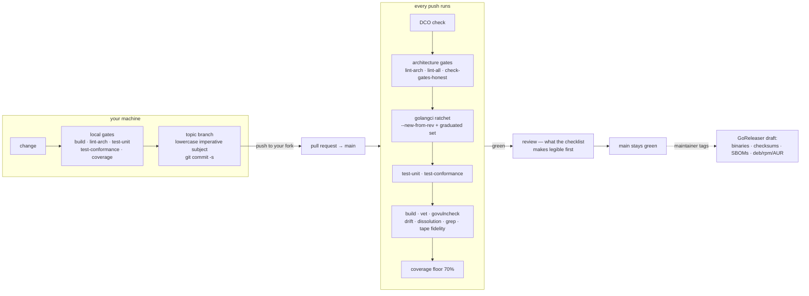
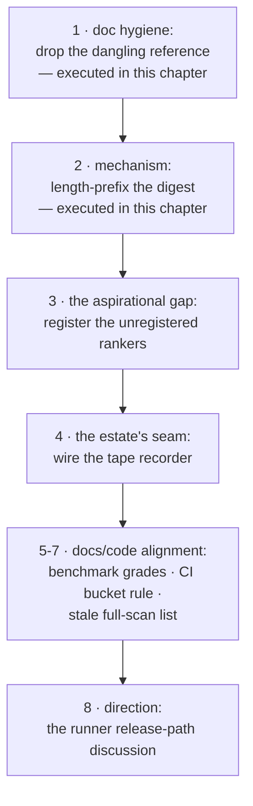

# Chapter 12 — Your First PR

Eleven chapters of map, law, offers, and machinery — and now the door.
This chapter walks the merge path end to end: the ground rules (DCO,
commit style, the charter), the gates as *writing* discipline rather
than review obstacles, the pull-request checklist annotated by the
chapters that taught each line, the release path that turns `main`
into artifacts, and finally the pathway map — the per-subsystem answer
to "where does a first PR plausibly land?" — with the worked example
the book has been walking toward since Chapter 1: the dangling
`context/knowledge/grounding.go:680` reference, fixed here as a complete, real
walkthrough. Branch, diff, sign-off, gates, PR body — captured in a
scratch clone at the pin.

Two conventions govern the chapter. First, the plan's decision D8: the
worked example teaches the *pattern*; its diff is chosen at writing
time and swappable. Second, the source of truth: this chapter
paraphrases `CONTRIBUTING.md` — the project's normative contribution
document — and never replaces it. When they disagree, CONTRIBUTING
wins, and you will have learned enough by now to notice.

> **A note on citations.** Tracked files are cited `path:line`; the
> authoring corpus under `devdocs/` is cited by document and line and is
> not part of the public clone (`.gitignore:41`). Captured at commit
> `1bc57c62`; see the pin note in the front matter.

## Where you are

You need the whole book — this chapter applies all of it. No model
backend is needed; the walkthrough is a comment fix plus a verified
second pathway. The lab's artifact is a scratch clone with a signed
commit on a topic branch, ready to become a real PR on your fork.

By the end you will be able to:

1. Shape a change the merge path can accept on the first honest
   attempt: branch, commit style, sign-off, gates.
2. Read the PR checklist as annotated by this book, and know where each
   requirement is enforced.
3. Describe the release path from tag to draft.
4. Choose a first PR from the pathway map, with the gates that will
   judge it named in advance.

## Technical requirements

| Requirement | Version / notes |
|---|---|
| OS / toolchain | As Chapters 1–11 (Linux primary; toolchain pin `go1.27.2`, `go.mod:5`) |
| Model backend | **Not needed** |
| Extra | A GitHub fork when you convert the walkthrough into a real PR |

Captured on the Chapter 1 machine, commit `1bc57c62`.

## 12.1 The merge path

The ground rules come first because they are *acceptance* rules, not
suggestions (`CONTRIBUTING.md:11-19`): every PR commit carries a
`Signed-off-by` trailer — commit with `git commit -s`; the charter
bans shims, compatibility layers, aliases, and stubs, and "a PR that
introduces any of the four does not merge"; and the environment
boundary of Chapter 4 holds for contributors too. The DCO rule is
enforced by CI's first job — a `Signed-off-by` check on every PR
commit, with merge commits exempted (`CONTRIBUTING.md:13-15`;
`.github/workflows/ci.yml:14-35`).

Branching is trunk-based: "`main` is the integration branch and must
stay green. Use short-lived topic branches for anything larger than a
one-commit fix" (`CONTRIBUTING.md:33-36`). Commit style matches the
existing history: "a short, lowercase, imperative subject line (keep
it under about 72 characters when you can), an optional body separated
by a blank line, and the `Signed-off-by` trailer" — and the project
does not use Conventional Commits prefixes
(`CONTRIBUTING.md:38-42`). That last line is a style rule, stated not
reasoned: match the history you are joining.

## 12.2 The gates as writing discipline

Every push runs the same ladder (`CONTRIBUTING.md:113-121`): the DCO
check; the architecture gates (`make lint-arch`, `lint-all`,
`check-gates-honest` — Chapter 2); the golangci-lint **ratchet**;
`make test-unit` and `test-conformance`; the build-and-vet job
(`go build ./...`, `go vet ./...`, `govulncheck`, config drift,
contract dissolution, the grep gates, `test-dev-agent`,
`test-tape-fidelity`); and the coverage floor.

The ratchet deserves its paragraph. golangci-lint (v2.15.0 or newer)
runs twice: once over *your* new code only (`--new-from-rev=origin/main`),
and once over the whole tree with the "graduated" linter set
(`.golangci-graduated.txt`) — "Do not add new violations; fixing old
ones is welcome" (`CONTRIBUTING.md:97-101`). Read as writing
discipline: the tree's history is not your cleanup burden, but its
floor is your ceiling.

Coverage is the same shape: every package holds a 70% floor, new code
must bring its package to or above it, and a package whose surface is
integration-test-only carries the justification in its `doc.go`
(`CONTRIBUTING.md:104-108`). Chapter 11's estate is the machinery;
this is its contributor-facing contract.

## 12.3 The PR checklist, annotated

The checklist (`CONTRIBUTING.md:123-133`) has nine items; here they
are with the chapter that taught each:

| Checklist item | Taught in |
|---|---|
| Commits are signed off (`git commit -s`) | §12.1 |
| `make lint-arch` and `make lint-all` pass | Chapter 2 |
| `make test-unit` and `make test-conformance` pass | Chapters 1 and 11 |
| `make test-coverage` passes; new packages meet the floor | §12.2 |
| Configuration changes were made in the templates and regenerated | Chapter 4 |
| New envelope keys are registered and documented in the key registry | Chapters 3 and 10 (`telemetry/otelleg/keys.go`) |
| Goldens were re-baselined only deliberately | Chapter 11 |
| Docs referencing changed paths/commands/env vars were updated, references verified against the tree | This book's citation convention, applied to your diff |
| The PR summary states what changed and why and names any known gaps | The honesty convention, everywhere |

Two items are easy to miss and load-bearing. The **envelope-key
registry** item is Chapter 10's attribute vocabulary: a new key that
the projection does not know is a key that silently never reaches
telemetry. And the last item — *name any known gaps* — is the book's
own honesty convention, promoted into the merge path.

What does a maintainer read first? The checklist's order is the honest
answer this book can give: the commit subject (style-checked), then
the summary's what-and-why, then the diff — and the gates run before a
human does. A PR whose summary names its gaps and whose gates are
green is legible in ninety seconds; that legibility is what the
checklist buys.

## 12.4 The release path

When `main` is green and the maintainer tags — `git tag v0.1.0 && git
push origin v0.1.0` — CI runs GoReleaser (`release --clean`), which
creates a **draft** GitHub release carrying everything Chapter 1's
binary map promised: binaries for Linux and macOS (amd64 + arm64),
`checksums.txt`, SBOMs, `.deb`, `.rpm`, and an AUR package — with the
three AST tooling binaries additionally building for Windows
(`CONTRIBUTING.md:141-150`; `.goreleaser.yaml:243-249` for the
verification artifacts). The maintainer reviews the draft, adds
release notes, and publishes. One contributor rule rides along:
update `CHANGELOG.md` in the same PR that changes user-visible
behavior (`CONTRIBUTING.md:152`).

Two threads from earlier chapters terminate here. The release
artifacts are why Chapter 3's checksums-and-SBOMs promise holds. And
the runner — D10, the sidecar that has never shipped — is a release
*path* decision that this book flags rather than makes: whether
`relurpify-runner` joins the GoReleaser build list is a
maintainer-discussion first (§12.5's last rung).

## 12.5 The pathway map

Decision D5 put a per-subsystem "where to start" map in scope, and
open item 3 demanded each pathway be verified before printing. The
verification levels are stated honestly per rung: two pathways were
*executed* at the pin (green gates, captured in §12.6); the rest name
their judging gates with the gap verified but the implementation left
— honestly — as the contributor's work.

| # | Pathway | Teaches | Judged by | Verified at the pin |
|---|---|---|---|---|
| 1 | Drop the dangling `context/knowledge/grounding.go:680` design-doc reference (Ch 1) | Doc hygiene; why "repoint to `devdocs/`" dangles for public readers | build + envcheck + `context/knowledge` tests | **Executed** — committed on the lab branch, gates green (§12.6) |
| 2 | Length-prefix `compilationDigest` (Ch 8's caveat) | The digest is reproducibility, not security — until you prefix it | `go test ./execution/compiler` incl. strict replay | **Executed** — NUL-delimited variant, full suite `ok` (§12.6) |
| 3 | Register `BM25Ranker`/`FreshnessRanker` behind configuration (Ch 3, 8) | The "partly aspirational" gap closes | `test-unit`, `lint-arch`; site: `app/envcomposition/knowledge.go:86-92` | Site compiles at the pin; implementation is the work |
| 4 | Wire the tape recorder into provider kinds (Ch 11) | The estate's record half | agenttest e2e + tape tests (`make test-tape-fidelity`) | Gap verified live (promote failure captured); wiring is the work |
| 5 | Align the benchmark tier's docs with its two grades (Ch 11) | Docs/code divergence, stated not hidden | docs-only PR; estate gates still run | Divergence verified (§11.3) |
| 6 | Widen CI's bucket coverage to the written 3+ rule (Ch 2) | The stricter rule CI doesn't run | CI itself, on the PR | Threshold divergence verified (`tooling/arch/runner.go:33` vs `tooling/arch/domaindag.go:268`) |
| 7 | Correct the stale full-scan list in `docs/ARCHITECTURE.md` (Ch 7, 8) | Doc drift, corrected in place | docs-only PR | Drift verified (record loads are node gets) |
| 8 | The runner release-path decision (Ch 1, D10) | A maintainer-discussion PR: package the sidecar or document its absence | The release process itself (§12.4) | Seam verified working (Chapter 9's lab) |

The ladder's shape is deliberate: doc-hygiene rungs first (smallest
diff, greenest gates), mechanism rungs in the middle (each closing a
verified gap), and the maintainer-discussion rung last — because a
solo-maintained project takes direction conversations through issues
and PR bodies, not through surprise refactors
(`CONTRIBUTING.md:12-13`: the project "accepts contributor pull
requests" into a trunk the maintainer keeps green).





## 12.6 The worked example

Decision D8 made the first-PR example a pattern; the pin's smallest
verified pathway is its instance. What follows is the complete
walkthrough, captured in a scratch clone at the pin
(`/tmp/ch12-clone`, branch `fix/grounding-dangling-doc-ref`).

**1. Branch at the pin.**

```bash
git clone <your-fork> && cd relurpify
git checkout -b fix/grounding-dangling-doc-ref 1bc57c62
```

**2. The diff — three lines, and a decision.** The comment at
`context/knowledge/grounding.go:677-686` cites a design document that
no longer exists (Chapter 1's find). The fix decision, per D8 made at
writing time: **delete the pointer, do not repoint it** — the
obvious alternative, pointing at the whitepaper, would dangle for
every public reader, because `devdocs/` is not part of the clone
(`.gitignore:41`). That reasoning belongs in the commit body, where
reviewers look for it.

```diff
--- a/context/knowledge/grounding.go
+++ b/context/knowledge/grounding.go
@@ -677,8 +677,7 @@ func kindFor(item GroundingItem) ChunkKind {
 // CaptureKindForOrigin resolves the canonical chunk kind for a runtime
 // capture from its dataflow origin floor. It is the grounding-side heir of
 // the output ingester's input taxonomy (the ingester was absorbed into this
-// commit boundary; see devdocs/plans/bkc-bidirectional-context-and-hermetic-
-// dryrun-spec.md, Phase 3): a capture whose dataflow floor is tool output
+// commit boundary): a capture whose dataflow floor is tool output
 // grounds as a tool fact (ChunkKindTool, the kind the capture encoding already
 // documents for tool results), while agent claims and user-given values ground
 // as ChunkKindCapture. Verbatim LLM-response and observation ingestion stay
```

**3. The gates, locally.**

```
$ go build ./context/...                     # clean
$ go test ./context/knowledge -run 'TestGround|CaptureKind' -count=1
ok  	codeburg.org/lexbit/relurpify/context/knowledge	0.155s
$ make envcheck
[PASS] envcheck: no env access outside userconfig (1087 files scanned)
```

**4. The commit — style and sign-off, exactly as §12.1 teaches.**

```
$ git add context/knowledge/grounding.go
$ git commit -s -m "drop dangling design-doc reference in grounding comment"
```

Captured log (excerpt):

```
commit e87307567790737d304dee0a2fae570f381b0537
Author: prestin liu <lexbit@users.noreply.github.com>

    drop dangling design-doc reference in grounding comment

    The referenced plan doc (bkc-bidirectional-context-and-hermetic-
    dryrun-spec.md) no longer exists in the tree; the sentence stands
    without the pointer. Repointing to devdocs/ would dangle for every
    public reader, since devdocs/ is not part of the clone.

    Gates: go build ./context/... clean; context/knowledge tests ok;
    make envcheck PASS (1087 files).

    Signed-off-by: prestin liu <lexbit@users.noreply.github.com>
```

Lowercase imperative subject, the body carrying the *decision*, the
gates named, the trailer present.

**5. The second rung, executed.** In the same clone, the digest fix of
§12.5's rung 2: NUL-delimit the three inputs in `compilationDigest`
(`execution/compiler/compiler.go:819-832`) and run the full compiler suite —
`ok … 0.209s`, strict replay included (the replay compares digests
computed by the same function, so the change is self-consistent).
The diff ships as the lab's second fixture.

**6. The PR body.** The lab ships it as a fixture
(`pr-body.md`), shaped by the checklist's last item:

> **What:** drop a dangling design-doc reference from the
> `CaptureKindForOrigin` comment (3 lines, comment-only).
> **Why:** the referenced plan doc no longer exists in the tree;
> repointing at `devdocs/` would dangle for every public reader, since
> `devdocs/` is not part of the clone.
> **Gates run:** `go build ./context/...`; `go test ./context/knowledge`;
> `make envcheck`. **Known gaps:** none in this diff; the sibling
> digest-prefixing pathway is drafted separately.

That last sentence is the convention working: a small PR that *names
its neighbor* is how the pathway map stays honest.

## 12.7 Where the book ends

The Bible's promise, restated as delivered: you can name every
top-level directory's contract, trace a tool call from model decision
to sandboxed effect and back through the insertion decision, explain
the bi-directional knowledge compiler in both directions with its
digest's caveat, and land a PR that passes CI on the first honest
attempt — two of whose rungs this book executed for you, gates green.

Three doors remain open, and they are the back matter's:
**Books 1–2** for operator depth and agent construction; the
**handoff-doc corpus** as the living parent this book pins
(`devdocs/HANDOFF-docs/`, authoring tree); and **`CONTRIBUTING.md`**
itself — the normative source this chapter paraphrased and never
replaced. Re-verify before you rely: the citation index (Appendix D)
is the worklist, and the re-pin rule (re-run every chapter's
verification card at the new tag) is how the next edition earns its
pin.

The lab for this chapter lives in
`docs/relurpic-internals/labs/ch12-first-pr/` — the branch walkthrough,
both diffs, the signed commit's log, and the PR-body fixture.
